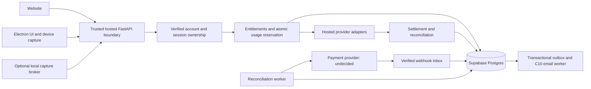

# Intervucopilot C11–C13 subscription implementation plan

**25 October 2026 current acceptance:** See the [single current-status table](C11_C13_ACCEPTANCE_RUNBOOK.md#current-status--25-october-2026) and [hosted relay/privacy review packet](C13_HOSTED_RELAY_PRIVACY_REVIEW.md). Synchronized timing and controlled JBL disconnect/reconnect are accepted and not repeated. Default-off relay/shared coordination and deletion preparation are locally implemented/tested; irreversible deletion, released desktop hosted transport, signed installation and target-specific staging remain open. Native account/relay: 69 passed (one browser case deselected); final boundary/usage suite: 178 passed; Node: 172 passed; unsigned packaged JWT/browser/Electron smoke: wrapper 1 passed, embedded Playwright 2 passed. Existing full lint remains 60 errors / 29 warnings, no new attributed error pairs. No overall C11/C13 closure or production acceptance.

Latest acceptance follow-up: [gate reconciliation, packaged/physical procedure and isolated staging preflight](C11_C13_ACCEPTANCE_RUNBOOK.md). Packaged native 48 passed; combined-process 235 passed. Short real-device PCM smoke is separate from outstanding physical reliability/installed/hosted acceptance. See current evidence; earlier failed records remain historical.

**C13.2 continuation - local implementation evidence (24 October 2026):** The missing Auto mic/system/Both gRPC lease integration, durable Screen classification/results/settlement, resume capacity/initial-history/replacement/active-set/reindex paths, native Notes/Ask AI/history/export gates and client account cleanup are implemented default-off. Actual Windows Electron main/preload/renderer now passes native-JWT Current plan/Upgrade/logout and synthetic STT acceptance; packaged installed-device acceptance is separate. Native integration: **48 passed**, including two actual-native Playwright browser/Electron subcases. Backend regressions: **662 + 105 passed**; existing catalog/admin Playwright: **57 passed**, plus the separately mocked resume chooser. The [current evidence](C13_2_IMPLEMENTATION_EVIDENCE.md) records final native/check/build counts, exact migrations, transport boundaries and remaining limits. No shared changes or production activation. **C11/C13 remain partial; C13.2 release acceptance is not inferred from isolated tests or a failing repository-wide lint.**

Historical planning update (23 October 2026; implementation now recorded in section 29): the user reports isolated manual acceptance, the demo is shut down, and the next consolidated milestone is **C13.1 durable account/usage foundation -> C13.2 authoritative enforcement and Electron integration**. See [the consolidated milestone](SUBSCRIPTION_ENTITLEMENTS_USAGE_MILESTONE.md) and section 28. No new implementation or activation is authorized. Earlier status tables are historical where superseded by sections 26-28.

Current implementation: **C13.1 closed foundation locally accepted**, production-unwired; section 29 and the [fixed C11 closure checklist](C11_CLOSURE_CHECKLIST.md) record acceptance and remaining gates.

Operator instructions: [Subscription-admin user guide](SUBSCRIPTION_ADMIN_USER_GUIDE.md) (current controls, access, recovery and environment prerequisites; source-checked 2026-10-23).

Date: 2026-10-22 (Asia/Calcutta). **C11.2A/B complete locally; bounded C11.2C storage/native verification and C11.2D closed adapter accepted locally on PostgreSQL 17.11 (sections 15/16). C11.1/C11.2 remain partial.** Hosted mode defaults off and production authority remains closed. No shared/remote apply, runtime activation, live calls, commercial seeds or real admin assignment. C11.3A/B foundations and C11.3C opt-in authenticated draft APIs are implemented/native-tested locally (sections 17-19); one unrelated PDF-dependent import regression is environment-blocked. C11.3 remains partial. Sections 13 through 19 and the [readiness audit](C11_SUBSCRIPTION_READINESS_AUDIT.md) record actual scope and limits; historical proposal records remain below.

Latest bounded update: **2026-10-23, approved Plus/Pro and C11.4 website pricing locally integrated and accepted; see section 27. Free integration remains in section 26; F4 history is in section 25.** Historical dated records remain below; C11.1/C11.2/C11.3 are still partial and production publication stays unavailable.

## 1. Scope and execution order

Preserve roadmap ownership in `SAIIA_CLOUD_PRODUCT_IMPLEMENTATION_ROADMAP.md`: C11 Pricing and Subscription Foundation, C12 Payment Provider Integration, C13 Usage Limits and Backend Feature Enforcement. The approved subphase IDs refine those meanings; section 7 maps the earlier proposal labels without renumbering the main roadmap.

Approved execution: **C11.0 -> C11.1 -> C11.2 -> C11.3 -> C11.4 -> C13.1 -> C13.2 -> C12.1 -> C12.2 -> C12.3 -> closure**. C11 remains pricing/subscription foundation, C12 payments, C13 usage/enforcement. This supersedes the original A/B/C/D/E/F proposal order; the historical mapping is recorded in section 7. Provider costs are company-funded. Plans may cover only implemented features that pass their own release checks. The subsequently approved Free/Plus/Pro names, allocations and INR prices are recorded in section 27 and PLUS_PRO_APPROVED_DECISIONS.md. Provider selection and undecided commercial/lifecycle policies remain pending; historical proposals below do not override that decision record.

Launch scope candidates grounded in code: manual/typed/Auto answer assistance; supported microphone/system/combined transcription routes; resume extraction/review/storage and chunk grounding; job-context personalization; OCR/vision screen analysis; owned sessions/transcript TXT/Markdown exports; AI Notes; session Ask AI. Offer only the modes that pass release acceptance and hosted-boundary migration. Saved-answer diagrams remain a separately gated candidate because their implementation is not activation-ready (`docs/ANSWER_QUALITY_PHASE7.md:3`).

Future backlog, excluded from launch entitlements: mock-interview orchestration and quotas, guided role/HR/system-design practice, resume scoring/ATS optimization, validated candidate feedback tiers, personal learning plans, scored reports and performance analytics. Support SLA/priority queue and an early-access program need operations decisions, not merely flags. Transcript-based coaching notes can be offered using that precise name; generated assistant text must not masquerade as actual candidate performance.

Nonfunctional requirements: authoritative multi-worker admission, tenant isolation, no company secrets on user devices, bounded provider spend under failure, nonblocking capture/rendering, cancellation/resource cleanup, explainable usage and reversals, auditable lifecycle updates, minimal operational data, and reversible deployment. Latency/error/concurrency/capacity targets are pending measured baselines and product approval; no invented SLOs or margins.

## 2. Facts, recommendations and pending decisions

**Verified local facts:** cloud JWT ownership exists; local compatibility paths coexist; Electron defaults to local backend; gRPC is loopback-only; model catalog is not entitlement; Notes/Ask AI/screen have independent provider routing; existing generation/Ask AI/email claims provide useful fences; no commercial ledger/payment integration was found. See audit capability and bypass tables for exact source citations.

**Technical recommendations:** retain FastAPI and Supabase/Postgres as the first hosted modular service; add a shared billing/entitlement/usage boundary rather than separate microservices; use PostgreSQL transactions for quota admission; keep device capture separate from paid provider execution; use verified payment events plus reconciliation and an outbox. These are reviewable proposals, not approved business terms.

**Current confirmed choices:** Free/Plus/Pro names, approved INR monthly/annual prices, shared dynamic model eligibility, plan-specific allowances, original-signup IST monthly periods/no rollover, and stated support scope are in section 27. **Pending business choices:** tax/rounding, trials/discounts, detailed failure/reconciliation charging, operational concurrency/capacity, lifecycle/grace/proration/refunds/subscriber migration, retention/expiry rights, support operations, explicit review validity/reviewer approvals, payment provider and markets. The pricing artwork is not a seed file.

## 3. Proposed architecture and decision records



### ADR S1 — Put company-funded operations behind hosted authority (proposed)

Context: local provider/backend execution is modifiable; clearing cloud IDs currently permits local generation (`backend/app/api/generate.py:261`). Recommendation: hosted service owns company secrets, auth, quota admission and providers. Device performs capture/UI only; company-funded execution belongs on the trusted server. Local development remains compatible; distributing company secrets or offering a BYOK product is not approved by this slice. Alternative local enforcement is unsuitable for paid authority; migrating the entire Windows backend unchanged also fails because server loopback cannot capture user audio. Consequence: capture protocol/latency and privacy engineering is required before selling audio time. Any future local/BYOK product requires separate approval; do not remove existing compatibility paths in an unreviewed change.

### ADR S2 — Use a Postgres ledger and transactional reservations (proposed)

Context: check-then-increment and per-process counters race across website/Electron/HTTP/gRPC. Recommendation: immutable events plus transactional balance/reservation RPCs in existing Postgres, unique operation scopes and fencing tokens. Alternative Redis-only authority introduces a second durability/financial reconciliation system; process memory cannot enforce account quotas. Trade-off: hot-account row contention; bound operations and measure it. An operational rate limiter may be added separately; it does not replace durable usage.

### ADR S3 — Separate catalog, price, entitlement and allowance periods (proposed)

Context: yearly payment does not determine monthly minute reset; catalog changes must not rewrite historical purchases. Recommendation: versioned catalog/entitlement snapshots, separate price options and allowance periods; each subscription references the accepted version and effective dates. Alternative a mutable plans JSON row is simpler but risks retroactively changing promises and quota units. Consequence: explicit grandfathering/change policy and slightly more schema.

### ADR S4 — Inbox/outbox with recoverable at-least-once processing (proposed)

Context: payment events duplicate, arrive late/out of order, and external calls cannot commit atomically with SQL. Recommendation: durable verified event inbox, transactionally applied state and outbox, retryable workers and reconciliation. Do not claim exactly-once provider execution. Alternative checkout redirect/client-state unlocking is not authoritative; synchronous webhook email couples payment to mail downtime. Trade-off: worker/queue monitoring and eventual UI confirmation states.

### ADR S5 — Bind logical operations across transports (proposed)

Context: existing session generation and Ask AI already have claims/replay and uncertain recovery; billing must not duplicate them. Recommendation: one server-authorized logical-operation identity with child provider attempts and usage reservations; frontend request IDs are correlation inputs, not unlimited fresh spending authority. Reuse existing checkpoints to save/replay without regenerating. Alternative per-route counting double bills retries/fallbacks or permits bypass. Trade-off: shared orchestration integration and explicit ambiguity handling.

The company-funded trusted-server boundary in S1 is confirmed. Detailed storage/workflow choices in the other ADRs remain proposals for their named later phases, not implemented contracts. No provider-specific capability is asserted; sandbox signature/retry/portal/invoice/refund details must be verified against the selected provider's current official documentation before implementation.

## 4. Commercial measurement contract (proposal)

These are unit recommendations only; no allowances are set.

| Capability | Recommended customer-facing unit candidate | Separate internal cost measurement | Decision / boundary |
| --- | --- | --- | --- |
| Typed/manual answer | Successful logical answer turn, bounded input/output | Input/output tokens, model, all attempts/corrections/fallbacks, latency | Decide whether bundled in live time or separate; never silently charge both. Explicit user Retry after delivered success differs from retrying failed delivery. |
| Transcription / Auto live assistance | **Auto: elapsed authorized running time including silence**, one logical run regardless of Mic/Computer/Both. Standalone transcription units remain undecided. | Provider connection duration, accepted sample duration, silence/drop time, STT billed duration and answer costs | Approved Auto measurement is server-authorized running time, not sample duration, transcript activity, or stored-session age. Implement trusted server time and bounded renewable leases in C13.1; lifecycle exceptions remain undecided. |
| Screen analysis | One explicit successful analysis operation, with bounded source/image/input size | Image pixels/count, input/output tokens, context length, attempts | One screenshot batch containing several questions is one logical analysis under this proposal; new explicit reanalysis is a new operation. Frozen retry is same operation. Approve reference-context reuse/multi-image rules. |
| Resume extraction | Successful extraction of a versioned upload | Bytes/pages/chars, parsing attempts and model tokens | Count extraction separately from active stored resumes. Duplicate delivery/recovery does not consume again. User-requested re-extraction of same file needs explicit policy. |
| Resume storage | Concurrent retained files and total bytes; cap chunks separately | Storage bytes/chunks and object operations | Deletion can release storage capacity, not refund previously spent extraction units. Replacement creates new work; distinguish review/index-only rebuild from paid re-extraction. |
| Resume grounding | Feature entitlement; bounded context per answer | Retrieval CPU and prompt tokens | Avoid charging an extra “RAG request” as a surprise on each answer. Current retrieval is token-scored chunks. |
| JD/context | Entitlement/storage cap; successful AI extraction if separately metered | Text/file size, extraction tokens, versions | Manual context CRUD need not incur inference units. Repeated extraction needs idempotency/limits. |
| AI Notes | Successful generation of a session's transcript-version notes | Input transcript size/output tokens, regeneration attempts | Reading cached notes is not generation. Regeneration of unchanged data vs updated data needs policy. |
| Ask AI | Successful user-to-assistant turn | Bounded transcript/Notes/history tokens and provider attempts | Same request replay returns saved messages without new usage. No cross-session product implied. |
| History/transcripts/export | Read/export entitlement plus retained-byte/record cap | Query/egress costs and export size | Recommend rate limits on repeated downloads rather than a paid per-download count; read/export rights after expiry need approval. TXT/MD only currently. |
| Model selection | Entitlement allowlist/model class, not arbitrary client model ID | Selected and actual model, fallback and correction costs | Premium candidates only after cost/quality/access measurements; no selected model is declared premium here. Internal fallback must not unexpectedly debit a premium unit twice. |
| Diagrams (deferred candidate) | Successful diagram for authoritative saved-answer revision | Independent model cost/cache/retry | No charge for cached reads. Do not enable before its own source identity/schema/release checks. |

**Entitlement** answers whether a capability/model is allowed. **Quota** caps consumed units in a defined allowance period. **Storage cap** limits retained files/bytes/records at a point in time, independent of consumption. **Operational limits** bound request size/rate, simultaneous streams, device leases and provider concurrency even with remaining quota. “Unlimited” still requires explicit capacity and fair-use policy; do not publish the artwork claim by default.

**Trial:** a one-time grant needs a durable server-owned redemption identity and grant ledger distinct from recurring balances. Resetting the calendar, signing out, switching devices, deleting a resume or downgrading must not mint another trial. Eligibility across account deletion/recreation and privacy-preserving anti-abuse retention is a business/privacy decision. Do not silently create anti-abuse identifiers with indefinite retention.

### Approved Auto measurement and unresolved lifecycle policies

Auto allowance counts elapsed **authorized running time**, including silence. A combined microphone/system run counts once, never the sum of the two source durations. PCM duration, transcript counts and provider/STT billed duration are internal diagnostics/costs, not the customer clock. A stored interview session may remain open while Auto is stopped; its wall-clock age is not consumption.

C13.1 will use trusted server timestamps and renewable bounded run leases, account-wide reservations and one durable logical-run identity across reconnects/transports. Do not trust device clocks or client-reported balances. Payment frequency and allowance reset frequency are separate.

| Lifecycle | Current decision/status |
| --- | --- |
| Running silence | Counts, confirmed. No speech/delta requirement. |
| Both source mode | One elapsed run, confirmed. Source diagnostics remain separate. |
| Pause/Stop acknowledgement, disconnect, failed lease renewal and in-flight tail | Exact charging boundary/recovery/settlement rules pending; do not implement charging based on assumptions. |
| Provider/STT failure, cancellation, uncertain processing | Customer charge/release/credit policy pending; keep internal incurred costs distinct. |
| Concurrent devices and reconnect continuity | Shared-account limits and deduplicated operations required; permitted concurrency and charge/continuity rules pending. |
| Retry, fallback and replay | Must not double charge one logical operation. Explicit new work versus recovery policy must be approved. |

No meter or lease is implemented in the first admission slice. Earlier accepted-audio-duration recommendations are superseded by the confirmed elapsed-running-time requirement.

## 5. Proposed schema and API contract

Names/fields below are design proposals, not migrations present in the repository.

| Proposed object | Purpose and integrity requirements |
| --- | --- |
| `plans`, `plan_versions`, `plan_prices` | Stable internal code, version/effective dates, active/admission status, approved public copy, unit/feature definitions; separate interval/currency/minor amount/provider price mapping. Client sends an internal offer reference; server resolves allowed current price. No artwork seeding. |
| `subscriptions` | Verified user FK, accepted version/price, provider/customer/subscription references, normalized state plus original safe provider state, billing period start/end, cancellation/end/trial times and monotonic revision. Unique provider identities; at most one effective subscription per applicable account scope. Preserve historical records. |
| `entitlement_grants` / `trial_grants` | Server-owned source, allowed features/models, effective range, unit definitions, one-time redemption constraint and policy version. Restrictive security/deletion holds take precedence; billing cannot clear them. |
| `usage_periods`, `usage_balances` | Explicit allowance interval/timezone/anchor and policy version; `(user, metric, period, grant)` uniqueness; integer base units, used/reserved counters and nonnegative constraints. Annual billing may create monthly allowances. `usage_monthly` roadmap projection can be retained as a view if semantics permit. |
| `usage_operations`, `usage_reservations`, `usage_events` | Logical operation scope, feature, canonical payload hash/version, account/session/resource, period/grant, reserved amount, fence/lease, terminal state, measured units and reversal references. Unique server scope prevents duplicate settlement. Events immutable; amendments use compensating entries. |
| `provider_attempts` | Child attempts/outcome/actual provider/model, request correlation, measured resource usage and uncertainty; sanitized fields only, no prompts/audio/screenshots/transcripts/credentials. |
| `payment_events` | Unique `(provider, event_id)`, verified receipt, safe reference/hash, processing state/retry/lease, object/version/time metadata. Minimize payload retention and encrypt any necessary retained payload under an approved retention policy. |
| `billing_outbox`, `billing_reconciliation_runs` | Transactional follow-up work, safe account/state references, deterministic email/action keys, retry/dead-letter handling and reconciliation evidence. |
| `active_operation_leases` | Shared per-account/session concurrency and bounded stream allocations; owner/token/expiry; prevent long-lived streams bypassing suspension or quota exhaustion. |

Ownership/RLS: candidates may read only their own subscription/usage projections and approved public catalog fields; deny all direct candidate/anonymous billing, grant, reservation, ledger and payment-event writes. Service-only transactional RPCs derive/bind verified owner from trusted service inputs and repeat account/session/resource ownership checks. Restrict EXECUTE grants, explicitly set search_path for SECURITY DEFINER functions, test role behavior and do not rely on RLS to constrain service-role application mistakes. Customer-visible DTOs exclude provider secrets, raw webhook bodies, fraud/risk fields and internal billing controls.

Proposed reads: `GET /api/plans`, `/api/billing/subscription`, `/api/billing/entitlements`, `/api/usage`, `/api/usage/limits`. Responses include contract/policy version, metric/base/display units, allowance-period start/end/reset time, used/reserved/remaining, effective subscription state and server time. Unavailable is distinct from zero or free access. Use decimal/integer-safe serialized quantities. Website and desktop receive the same effective projection through their existing authenticated access patterns.

Proposed mutations later in C12: checkout, cancellation, resume/portal/invoice if supported by selected provider, and a signature-verified webhook. Validate server-controlled active offer/price IDs, authenticated account, request idempotency, and allowlisted return destinations; never accept arbitrary amount/currency/customer/user override. Checkout redirect shows pending confirmation until authoritative backend state changes. No card data stored by Intervucopilot.

Proposed operation errors: machine-readable not-entitled, allowance-exhausted, concurrency-exceeded, billing-confirmation-pending, auth-expired, operation-processing and accounting-unavailable, with safe retry/reset information. Keep HTTP and gRPC semantics equivalent. Do not silently route blocked hosted work into an ungated company-key local provider. Existing contracts need backward-compatibility/version handling.

### Atomic accounting protocol

1. Verify account JWT/session/resource ownership; normalize feature/unit/payload and resolve effective entitlement/version/restrictions server-side. Lock relevant subscription/allowance state in consistent order.
2. In one transaction: claim unique logical operation; reject same key with changed payload; replay completed reference or return processing for existing attempt; enforce shared concurrency; reserve sufficient units using conditional update/row lock so `used + reserved + requested <= allowance`. Missing/unavailable authority fails closed for new paid work.
3. Issue a short leased/fenced execution claim and commit before provider invocation. Record child attempt before dispatch; never hold a DB transaction open across network inference. For streams reserve bounded chunks of duration ahead of ingestion and renew atomically; exhaustion stops upstream acceptance and resources.
4. On validated success, atomically settle actual units, release unused reserve, write immutable usage event/result reference and terminal state. Coordinate existing answer/Ask AI completion RPCs so a saved successful result cannot be lost between quota settlement and response. If atomic completion cannot span stores, use durable pending settlement/outbox before acknowledging final success, with safe replay.
5. Before-provider rejection releases reserve exactly once. After-provider timeout/crash/cancel may be uncertain: retain a bounded pending reconciliation state rather than freeing it for uncontrolled retries. Fence stale completions; lease expiry is not proof the upstream request did not run.
6. Reconcile expired claims/checkpoints/provider outcomes and balance aggregates; finalize or compensate with auditable reason. Recompute materialized balances from events; alert on drift. No negative allowance and no automatic “unknown therefore free and rerun.”

Identity hierarchy: account + metric + allowance period + canonical logical operation, linked to session/turn/resource revision; transport request and provider attempt IDs are children. User-retry recovery, HTTP buffered/stream, gRPC, generated answer transcript writes and fallback must converge on that operation. Existing final-save generation claims and Ask AI request keys are integration points, not duplicate billing claims. Prevent duplicate charging for persisted-result replay, save-only checkpoint recovery, provider fallback, multi-question screen batch and combined audio.

## 6. Allowance and lifecycle policies pending approval

| Topic | Technical recommendation | Required business answer |
| --- | --- | --- |
| Monthly reset | Immutable UTC intervals with explicit product timezone/anchor, half-open `[start,end)`; derive new periods without destructive counter reset | Calendar-month vs subscription-anniversary; anchor/timezone, rollover and rounding. Never use local device clock. |
| Annual plan | Separate annual paid period from monthly allowance periods if that is approved; no year-long credit implied | Monthly drip vs upfront annual pool; first/last partial month and leap/end-of-month behavior. |
| Upgrade | Versioned effective change, transactional balance/grant update, no double refill | Immediate vs next cycle, proration/credit, whether used units carry forward and any delta grant. |
| Downgrade | Schedule effective version; preserve history and avoid deleting excess stored data automatically | Immediate vs renewal, over-cap handling, grace and storage retention. |
| Cancel | Represent cancel request separately from effective service end | End-of-period vs immediate, annual treatment, read/export access and credit/refund. |
| Expiry / failed renewal | Deny new costly operations once effective access expires; recheck stream leases | Grace/dunning duration, reduced access, handling in-flight reservations and restoration. |
| Refund / dispute | Compensating financial/access records, linked event/outbox, no deletion of accounting evidence | Full/partial refund, allowance restoration/revocation, fraud/dispute suspension and appeal. |
| Trial / free allowance | Distinct one-time vs recurring grants; server-only eligibility | Duration/unit, eligibility/start trigger, renewal into paid, account recreation and abuse policy. |
| Existing transcripts / Notes / Ask AI reads | Recommend retain owner read and TXT/MD export during approved retention even after paid expiry; separately gate new inference | Exact post-expiry read/export rights and retention period. Do not hold account deletion hostage to paid access. |
| Account deletion | Integrate C15 lifecycle, remove/pseudonymize user content per approved retention, revoke sessions/streams, prevent billing renewals; retain only required minimal financial records | Deletion/cancellation relationship, retention/legal obligations and lawful minimal billing-record retention need review; no legal assumption here. |
| Price/policy change | Immutable accepted versions and explicit effective dates | Grandfathering, notice, consent, taxes/currency/rounding and renewal terms. |

No backend account-deletion completion is claimed; C15 remains an explicit dependency. Transcript deletion is not account deletion and currently leaves Notes/chat (`frontend/src/auth/WebsiteSessionViewer.jsx:69`). Define deletion/retention across raw resume blobs/chunks, transcript/Notes/chat, generation claims/answer sources/diagrams, billing references, usage events and email events. Security/account restrictions must outrank billing grants, with no payment webhook capable of clearing an independent hold.

## 7. Approved subphases, current status and historical mapping

Authorized work through this record: C11.0, bounded C11.1A/B foundation, C11.1C review, C11.2A design, C11.2B pure contracts and C11.2C isolated storage and C11.2D closed adapter. C11.1C/C11.2A were documentation-only; C/D acceptance is recorded in sections 15/16. Later C11.3 onward rows remain planned. No shared/remote migration application is inferred from local tests.

| Phase / current status | Scope and dependencies | Acceptance and verification | Rollback / release boundary |
| --- | --- | --- | --- |
| **C11.0 - baseline validation: complete locally** | Actual capabilities, all mounted routes/provider families, admin/identity, deployment and capture dependencies. Source evidence in audit section 8. | Source and registered-route matrix; offline bypass/identity coverage. Deployed configuration remains unknown. | Documentation-only inventory; preserve historical evidence and update it when source changes. |
| **C11.1 - trusted backend/admin foundation: partial locally; C11.1C review complete** | Disabled-by-default hosted boundary, verified owned-session buffered admission, bound operation identity/decisions, closed authority; C11.3A supersedes static probe authorization with authoritative caller-scoped storage reads. Ingress, reservation/recovery and revocation contracts reviewed in section 10 C11.1C. | A/B tests are recorded evidence; C foundation acceptance and isolated owner/RLS/grant verification remain open. A working quota engine, payment adapter and deployed capture are not catalog-design prerequisites. Do not mark C11.1 complete on review documentation alone. | Keep mode disabled and authority closed. Production ingress/capture/shared-state gates remain separately blocked. |
| **C11.2 - partial: bounded A/B/C/D accepted locally, production composition deferred** | Sections 13 through 16 record pure contracts, closed C storage and D private draft/archive adapter. C11.3B/C now supplies draft-only validated identity/API composition, default-disabled; snapshot/publisher/runtime resolver composition remains closed. C11.1 remains partial. | D: 12 actual adapter/native tests and 224 focused regressions; C: 12 native SQL groups passed again. Current draft identity/service/API evidence is in section 19; target ownership/grants, publication assurance and wider lifecycle work remain. | Ordinary/service-role catalog mutation access remains revoked. C11.3A adds caller self-read; B/C adds only the isolated executor draft entry point, without production login provisioning. No operational publication, customer display, checkout or paid enforcement. |
| **C11.3 - partial: draft workspace and F1-F4 lifecycle flows locally verified; activation deferred** | Sections 17-25 record authoritative access, durable drafts, website workspace, exact review receipts, atomic lifecycle SQL/services and opt-in authenticated APIs. One reviewed direct SQL pool; lifecycle ingress defaults off and publication policy resolver code exists; approved production policy/configuration remains unaccepted. Public catalog is locally implemented in C11.4; checkout/enforcement and real deployment acceptance remain open. F4 website confirmations, terminal views and operation recovery are locally verified; production policy approval remains unavailable by default. Broader C15.5 stays deferred. | Native HTTP/JWT/pool/SQL, immutable history, retry/revocation/race and safe DTO tests in section 24; production policy/credential/RLS/TLS acceptance remains open. | Disable lifecycle composition/ingress; preserve immutable versions, consumption, durable results and audits. |
| **C11.4 - partial: public catalog/website accepted locally; account customer state pending** | Section 27 records safe public API, catalog revisions and website pricing. Authoritative account binding/current-plan state remains missing; Electron Buy Credits current plan/Upgrade is later C13.2 integration. | Synthetic publication/public API/browser flow and user-reported manual acceptance are local evidence only. No checkout or customer entitlement assignment is implied. | Disable public composition to hide offers; preserve immutable history and future account references. |
| **C13.1 - closed backend foundation accepted locally; live measurement integration pending** | Section 29: immutable account binding, durable operations/periods, atomic reservations/settlement/releases/reconciliation, capacity and fencing; production-unwired. Actual Auto elapsed leases/relay, result-store completion and execution integration remain in the consolidated C13.2 handoff; pending policy paths stay unavailable. | 17 new native service/SQL tests plus domain/admission and native adapter/draft/lifecycle regressions passed. Fixed C11 checklist records what this does and does not close. | Keep ClosedAuthority/default-off admission; preserve immutable events and reconcile outstanding claims, never reset balances to roll back. |
| **C13.2 - enforcement/visibility: planned** | Entitlement/model/shared-account limits on every enabled costly path; used/reserved/remaining/reset shared website/Electron APIs. Depends on C13.1 and reviewed hosted capture/transport. | Bypass matrix, last-unit/concurrent-device races, renewable leases, session revocation, accurate UI; unreviewed routes stay unavailable. | Disable affected routes, retain enforcement and records; UI unavailable must never mean unlimited access. |
| **C12.1 - provider/sandbox checkout: planned** | Provider and commercial decisions first; verify selected provider official docs; server offer mapping/amounts/discounts; authenticated idempotent sandbox checkout. Depends on C13.2. | Forged prices/discounts/redirects rejected; timeout replay and owner isolation; redirect never grants access. No provider chosen here. | Disable checkout; preserve pending operations and provider references. |
| **C12.2 - payment lifecycle: planned** | Provider-prescribed raw-body signatures; durable deduplicated events and ordering/reconciliation; purchase/renewal/failure/cancel/refund/dispute as supported; confirmed-state email through actual C10 readiness. Depends on C12.1 and approved lifecycle/email policies. | Event replay, delayed/out-of-order events, worker crashes, uncertain writes/provider reconciliation, mail deduplication; dry-run is not delivery acceptance. | Disable new sales while preserving verified intake/reconciliation and cancellation safety; retain inbox/outbox. |
| **C12.3 - admin billing operations: planned** | Subscription/payment/invoice/safe event views; permission-controlled provider-backed actions, explicit consequential confirmation and audit. Depends on C12.2. Complimentary grants separate from payment facts. | No arbitrary unpaid-to-paid edit; authorization, confirmation, idempotency, audit, provider-backed state tests. | Disable actions, retain read/audit and reconciliation. |
| **C11-C13 closure - planned** | Draft/publish -> public offer -> purchase -> access -> metering -> renewal/cancel. All preceding phases plus C10/C15/C16 release prerequisites. | Isolation/bypass/recovery/native audio/provider costs, hosted migration/deployment, rollback drills; human/native/live evidence explicitly separate. | Disable sales/generation safely; preserve provenance, contracts, ledger and reconciliation. Production activation requires separate approval. |

Historical label mapping (the original proposal is preserved below **only as superseded history**):

| Earlier proposal label | Approved owner now |
| --- | --- |
| A1 inventory / hosted authority | C11.0 + C11.1 |
| A2 shared desktop handoff / hosted capture | C11.1 deployment prerequisites + C13.2 stream rollout; C16.1 retains shared-handoff ownership |
| Old C11.1 versioned contracts | C11.2 |
| Old C11.2 entitlement resolver | C11.2 contracts + C13.2 authoritative enforcement |
| Newly explicit subscription editor and published catalog | C11.3 + C11.4 (subscription administration only brought forward from C15.5) |
| Old C13.1 ledger / old C13.2 instrumentation | C13.1 |
| Old C13.3 all-route enforcement / old C13.4 usage UI | C13.2 |
| Old C12.1 checkout / C12.2 webhook | C12.1 / C12.2 |
| Old C12.3 payment email | C12.2, gated by actual C10 capability |
| Newly explicit admin billing actions | C12.3 |
| F reconciliation/security/launch | Closure plus the relevant C12.2/C13.1 recovery tests |

<details>
<summary>Superseded initial A-F proposal; IDs here are historical, not current phase authority</summary>

### Historical initial breakdown

Each row is a separate reviewable slice. Proposed file paths are suggestions, not existing implementation. No migration is to be applied during this planning task.

### A — Prerequisite and dependency closure (C11/C13 prerequisites; C16.1 remains C16.1)

**A1: Hosted authority and route inventory.** Scope: classify every provider call as hosted company-funded, device capture, or explicitly approved local/BYOK. Exclude payment and feature redesign. Proposed affected files: `backend/app/main.py`, existing `api/generate.py`, `api/transcribe.py`, `api/auto_stt.py`, `api/resume.py`, `api/job_context.py`, `api/screen_ocr.py`, `api/screen_context.py`, `grpc_server.py`, `grpc_cloud_context.py`; proposed `backend/app/commercial/admission.py` and deployment configuration. Schema/API: proposed hosted deployment mode/admission interface; no commercial migrations yet. Dependencies: boundary/BYOK decision and verified user identity. Acceptance: every registered costly route and internal bypass has an allow/deny owner; no-cloud-ID generation is rejected on hosted company-key mode; unsupported paths disabled; fake provider call count remains zero on denial, unknown accounting or forged owner. Rollout: disabled hosted mode in isolated/staging environment; do not alter the local development default. Rollback: disable hosted admission/service rather than reopen anonymous provider access.

**A2: Identity, capture and release dependency closure.** Scope: implement shared atomic desktop handoff under C16.1; design/verify device capture to hosted inference for microphone/system/combined, TLS/auth, stream cancellation and identity refresh; review paused recovery migration and production admission readiness. Exclude public rebinding of current insecure gRPC and silently applying existing migrations. Proposed affected: `api/auth.py`, `frontend/electron/desktop_auth_session.cjs`, `grpc_realtime_client.cjs`, capture/mixer/transport controllers and deployment runbooks; proposed handoff/stream-lease migration, transport contract. Dependencies: A1, C16.1 ownership, capture-format/version decision and privacy retention; dev-only model project guard needs separate production review. Tests: multi-worker handoff single consumption/TTL/restart; token expiry/logout stops spending; user audio originates on device; combined is one STT stream; disconnect/late events/unknown processing cannot replay; RLS/role checks on isolated DB followed by authorized staging checks. Rollout: compatible version negotiation and synthetic transport first, then separately authorized native/provider acceptance. Rollback: disable new transport/admission, cancel leases, retain claims; old client cannot silently gain hosted access. Do not roll back schema by deleting records.

### B — C11 plan catalog, subscription state and shared entitlements

**Historical proposal C11.1: Versioned contracts and state model.** Scope: approved feature/metric vocabulary, normalized subscription lifecycle, versioned catalog/price separation and safe projections; no checkout, real prices or payment calls. Proposed affected: `backend/app/commercial/catalog.py`, `subscriptions.py`, `contracts.py`, `frontend/src` shared contract consumers and new `supabase/migrations/<timestamp>_subscription_foundation.sql`. Proposed schema: plans/versions/prices/subscriptions; proposed GET plan/subscription/entitlement routes. Dependencies: launch-scope and lifecycle decisions; still implement schema/interfaces without unapproved commercial seeds. Tests: state transition table, immutable accepted version, invalid interval/unit/model rejected, safe default account initialization under concurrent requests, owner reads/cross-owner denial, direct writes denied. Acceptance: website/Electron same authoritative contract; unknown state fails closed for spending; no client metadata unlocks access. Migration/rollout: additive reviewed migration on disposable DB then authorized staging; catalog remains inactive until approved seed review. Rollback: disable reads/admission feature flag, preserve records, forward-fix schema.

**Historical proposal C11.2: Effective entitlement resolver.** Scope: one backend resolver for features/model allowlists/effective dates and restriction precedence, with website/Electron read integration; no broad commercial enforcement claim yet. Proposed files: `commercial/entitlements.py`, `api/billing.py`, cloud bootstrap integration, Electron narrow IPC/preload, website state. Proposed schema/API: server-owned grants/trial grants; resolver response/version/cache expiry. Dependencies: C11.1, A identity, trial/free-grant decisions. Tests: active/free/trial/canceled-but-valid/expired/past-due/paused/incomplete; security/deletion hold wins; account switch invalidates caches; stale client/clock/forged plan/model cannot override; cache staleness bounded and execution rechecks. Acceptance: entitlement-only feature check works without payment service; no trial duplication across devices. Rollout: internal approved test catalog and read-only projections; rollback by disabling new admission, not by treating missing entitlement as paid. Additive grants retained for audit.

### C — C13 usage foundations required before selling limited plans

**Historical proposal C13.1: Ledger/reservations and period engine.** Scope: durable operations/balances/reservations/settlements/compensation, no payment or user charge. Proposed files: `commercial/usage.py`, `periods.py`, `usage_store.py`, new service-only SQL RPCs/migration and `tests/test_usage_*.py` plus isolated Postgres tests. Proposed schema: section 5 usage objects and leased concurrency. Dependencies: C11 contract and approved units/reset/trial/concurrency rules; unknown values stay pending, do not hardcode artwork numbers. Tests: competing final-unit requests in independent DB connections, one settlement, payload conflicts, expired fence, retry/replay, negative/overflow validation, UTC/end-of-month/leap/annual-monthly windows, period-crossing stream reservations, refund adjustment and recomputation. Acceptance: `used + reserved` cannot overspend; old-period reservations settle against original period, long streams renew in correct period, no destructive reset, no “check then insert” race. Rollout: append-only shadow measurement with fake grants/no paid access, discrepancy alerts. Rollback: stop new reservations/hosted spend, settle or reconcile existing leases, retain immutable ledger; never reset balances to mask drift.

**Historical proposal C13.2: Instrument one complete operation then all independent provider paths.** Scope: first buffered session answer under existing claim/checkpoint ownership, then streaming answer, STT, screen, resume/JD extraction, Notes, Ask AI and optional diagram. Exclude new mock/assessment products. Proposed affected: existing generation/Ask AI completion RPC integration, provider adapters, `api/*` expensive-operation routes, `grpc_answer_pipeline.py`, `grpc_server.py`, screen service, Notes and resume services. Proposed API: canonical operation identity and safe usage snapshot/result reference, HTTP/gRPC error mapping. Dependencies: C13.1, A hosted capture/bypass closure; stalled paths stay denied on hosted mode. Tests: HTTP/gRPC/REST fallback same logical operation; failed-before-provider release; canceled-before/after-dispatch; successful result persisted then response lost; checkpoint save-only recovery; provider fallback/corrections one customer debit; screen batch one operation; mixed audio one clock; simultaneous devices share balance. Acceptance: complete trace from admission to final ledger for each enabled provider entry; internal attempt cost recorded separately from customer usage. Rollout: operation by operation under allowlist, shadow comparison then enforced test grants; rollback: disable affected feature and settle in-flight claims, preserve compatibility data and result references.

### D — C12 payment integration in sandbox only

**Historical proposal C12.1: Provider decision and sandbox checkout adapter.** Scope: selected provider interface, server-controlled offer mapping, sandbox customer/checkout and pending-confirmation UI; no live charge. Proposed affected: `backend/app/billing/providers/<selected>.py`, `api/billing.py`, website billing page, backend-only secrets/deployment configuration. Proposed schema/API: unique customer refs, checkout-attempt idempotency, checkout and supported portal/invoice/cancel actions. Dependencies: business provider/market/currency/price/interval/tax decisions, C11 contract, C13 measurement readiness before selling. Verify selected provider's current official sandbox/signature/status/retry docs before coding; do not assume all abstraction methods are supported. Tests: forged amount/price/customer/redirect denied, same-key duplicate returns same session, timeout/unknown result recovery, cross-account isolation, mode/secret separation; provider adapter fake tests first, explicit sandbox acceptance later. Acceptance: redirect never grants access and no secrets/card details reach browser/Electron/storage/logs. Rollout: sandbox credentials and test-only catalog in staging, disabled live mode. Rollback: disable checkout; keep pending/event records for reconciliation, no destructive financial schema rollback.

**Historical proposal C12.2: Verified webhook inbox and authoritative state.** Scope: raw-body signature/timestamp handling as documented by chosen provider, durable unique events, worker leases, normalized state updates, outbox and reconciliation. Proposed files: `billing/webhooks.py`, `event_worker.py`, `reconcile.py`, new payment-event/outbox migration and tests. Proposed API/schema: webhook receives provider events, inbox states/unique indexes, account/provider-object mappings and subscription revision/fences. Dependencies: C12.1 and provider event semantics; no matching account must not create arbitrary paid ownership. Tests: invalid signature/body/timestamp, duplicate event IDs, same object delivered concurrently, retry after DB failure, event before checkout response, old event after newer cancellation, replay/worker crash, unknown event type, provider timeout. Acceptance: acknowledge only after durable verified receipt; state application/outbox atomic; older/ambiguous events do not regress access, reconcile authoritative provider state rather than relying solely on arrival order/event time. Rollout: sandbox event replay corpus, worker alerts/dead-letter runbook. Rollback: disable live checkout/paid admission; continue durable intake/reconciliation where safe, do not drop confirmed cancellations or inbox records.

**Historical proposal C12.3: Payment email dependency closure.** Scope: confirmed-state payment email types/templates, durable deduped outbox handoff and safe failure/retry; no promotional sending. Existing `backend/app/email/service.py:288` refuses live transactional mode, `backend/app/email/provider.py:7` allowlist excludes payment types, and current email event migration has a bounded type contract. Proposed affected: email provider/service/templates/event store, reviewed new CHECK/RPC allowlist migration, billing outbox worker, C10 operational runbook. Dependencies: actual C10 live transactional provider/sender/credential/trigger readiness and user-approved email policy; marketing live path is not a substitute. Tests: no email on redirect, one deterministic event after confirmed transition, mail timeout does not roll back subscription, duplicate payment event produces no duplicate mail, reconcile uncertain send before retry, no transcript/card/secret/body payload logs. Acceptance: sandbox mail is dry-run until separately authorized delivery verification; real payment notifications cannot be claimed ready on dry-run evidence. Rollout/rollback: additive allowlist update before worker, sender activation separate; disable worker without losing outbox or reverting subscription state. No customer email is sent in this planning task.

### E — Complete backend enforcement and website/desktop usage visibility (C13)

**Historical proposal C13.3: All-route enforcement and long-lived streams.** Scope: every enabled hosted expensive operation uses shared entitlement/reservation authority, bounded renewable stream leases and current holds. Proposed affected: all A1 inventory routes/adapters plus HTTP/WebSocket/gRPC ingress, capture routing, model-selection admission/execution and recovery. Proposed schema/API: no extra ledger; use C13.1 lease/RPC and canonical errors; disable legacy hosted endpoints not migrated. Dependencies: C13.2 route-by-route evidence, C11 versions, A hosted capture, accepted lifecycle rules. Tests: anonymous/no cloud IDs, arbitrary provider/model/resource identifiers, old clients, raw API calls, WebSocket reconnect, manual/cloud gRPC, retries/refinement/debug, bypass via local flags, pending/expired/failed renewal and midstream revocation; two devices racing last unit. Acceptance: no company-funded call can occur without successful reservation, no overage beyond bounded allocated chunk, never client-only unlock. Rollout: staging deny-by-default route matrix then canary approved accounts; rollback: feature/route kill switches, terminate leases and settle, never reenable ungated company-key paths.

**Historical proposal C13.4: Shared usage visibility and lifecycle UX.** Scope: authenticated current plan/usage/reset/remaining/reserved displays and accurate pending/limit/failure states in website and desktop; no fabricated balances. Proposed files: `api/usage.py`, website billing/usage components and routes, `StartupSessionChoiceScreen.jsx`, `StartupSessionSetupScreen.jsx`, Electron main/preload/auth request helpers. Proposed API: section 5 read DTOs with policy version/server time; refresh on operation settlement/account change and bounded polling/events. Dependencies: C11/C13 authority and approved catalog copy/data-access policies. Tests: parity, logout/account switch clears data, offline/unavailable differs from zero, pending webhook, period rollover while UI open, annual billing/monthly quota wording, optimistic UI cannot unlock, accessible limit/error states and approved expired-account read/export. Acceptance: balances reconcile to ledger; no “Checking” control implies authority it lacks; old clients receive clear unsupported/upgrade states. Rollout: backend projection first then clients, minimum-version/admission rules reviewed. Rollback: hide new display or show unavailable while backend enforcement remains authoritative; never manufacture a local balance.

### F — Reconciliation, recovery, security and launch readiness

**C12/C13 closure: failure drills and financial/usage reconciliation.** Scope: scheduled subscription/provider reconciliation, stale usage/stream claims, balance rebuild, email outbox, recoverability and alerts; exclude automatic unreviewed refunds or mass data changes. Proposed files: `billing/reconcile.py`, `commercial/reconcile.py`, worker schedules/runbooks, privacy-safe dashboards. Proposed schema/API: reconciliation run/checkpoint records and compensating events, no candidate mutation API. Dependencies: prior stages and provider-approved API semantics/rate limits. Tests: crash at each boundary, timeout after successful provider processing, billing DB unavailable, out-of-order renewal/refund/cancel, worker duplicates, stale fence, missed webhook, mail failure, period drift, replay/backup restore and inactive-worker backlog. Acceptance: every uncertainty has bounded spending and visible reconciliation state; recovery does not regenerate completed output or silently grant access; ledger/aggregate/provider discrepancy alerts have owner and remediation. Rollout: sandbox drills with synthetic users first; rollout/rollback playbooks preserve immutable records and continue safe cancellation/reconciliation intake.

**Release gate: security, privacy and operational acceptance.** Scope: multi-account RLS/EXECUTE/grant review, hosted identity/transport/secrets, C16.1 handoff, full bypass matrix, C15 retention/account deletion contract, C10 real transactional readiness, native capture/model/screen acceptance, packaging and economic measurements. Proposed files: tests, deployment config, release checklist and operating runbooks; no further commercial schema assumed. Dependencies: explicit business answers, separately authorized staging/provider/sandbox/native verification and independent production migration review. Tests: forged claims, cross-user IDs, direct Supabase writes, stale entitlements, forwarded-header/loopback assumptions, public webhook abuse/body limits, log redaction, service credential exclusion from packaged client, rate/concurrency/size abuse, deletion cancels streams/renewals while preserving minimal approved records. Acceptance: measured capacity/cost budget and rollback drill, approved offer/policy text, consistent website/desktop and no launch-blocking unknowns. Production enablement requires separate authorization; this plan does not deploy. Rollback: disable new sales and costly features, preserve owner data access per policy, reconcile active payments and claims, communicate through approved operations process.


</details>

## 8. Cost and capacity evidence required

No provider prices, margins or sustainable minute limits are established. Build a privacy-conscious measurement worksheet before choosing quotas:

- Per-feature input/output tokens (including correction/fallback/retry), actual model/provider, screen pixels/images and context accumulation; summarize distributions and worst-case bounds rather than average alone.
- Accepted/captured/connected/provider-reported audio duration, silence ratio, idle connection costs, Auto question frequency, combined-mixer CPU/network and device-to-host latency. Compare HTTP/gRPC paths on equivalent synthetic work.
- Resume bytes/pages/chars, parse time/failures, rebuild frequency, chunk storage and retrieval CPU; retained session/transcript/Notes/chat/diagram bytes and object egress.
- Hosting workers/CPU/RAM/network, DB query/RPC load/locks/storage/backup, WebSocket concurrency/leases, authentication/JWKS/shared handoff, worker backlog, email delivery, payment processing/refund/dispute operational costs after provider selection.
- Reconciliation/manual-support time, fraud/abuse rates, simultaneous-device use and refund exposure. Do not infer priority support capacity from available email code.

For each approved feature limit, model worst-case bounded cost as validated resource units × current contracted rates plus hosting/storage/payment/support allocation, across selected and fallback scenarios. Populate rates only after official/current provider documentation or actual account contract review; none fabricated here. Record gross/net/tax treatment only after business/accounting decisions. Start paid launch only when measured usage, hard upper bounds and operational capacity support the proposed allowances.

Operational logs should contain opaque account/operation references, metric, integer units, policy/catalog version, outcome/reason codes and timings. Avoid auth headers/tokens, secrets, raw webhook bodies, email addresses, card/customer payment details, transcripts, resumes, screenshots, audio, prompts and full provider errors. Define retention/access controls for correlation IDs and reconciliation evidence; aggregate for capacity dashboards.

## 9. Pending business decision register (not questions blocking this slice)

1. **Launch acceptance subset:** only implemented features are eligible. Record which existing audio/screen/models pass hosted/native/cost acceptance. Mock/practice products remain excluded. Local development compatibility is preserved; a separate BYOK product is not approved.
2. **What consumes allowance:** Auto elapsed authorized running time including silence is confirmed; decide standalone transcription and other feature units, whether typed/screen/Notes/Ask AI are bundled or separate, and resume stored-count vs extraction allowance. Define cancellation/no-speech/failure/retry treatment and allowed simultaneous devices.
3. **Allowance/trial cadence:** one-time trial eligibility/start, any recurring free grant, monthly anchor/timezone, annual monthly allocation vs annual pool, rollover, rounding and storage over-cap handling. No artwork values assumed.
4. **Commercial offer:** final names, prices, currency, intervals, markets/taxes and payment provider. These can follow measured cost evidence; select provider before C12 adapter work.
5. **Lifecycle and data rights:** upgrade/downgrade timing/proration, failed-renewal grace, cancellation/refunds/disputes, post-expiry transcript/Notes/chat read/export access, retention/deletion and billing-record retention.
6. **Operations:** support channel/priority commitment, early-access eligibility, transactional billing email requirements and ownership of recovery/reconciliation alerts.

## 10. Current C11.1 foundation and exact next slice

The authorized C11.0 + first C11.1 slice is implemented locally: see audit section 8 for source/route evidence, test results and limitations. No actual access authority is enabled.

Configuration: `HOSTED_COMMERCIAL_MODE=false` by default; invalid non-boolean values fail configuration loading. `SUBSCRIPTION_ADMIN_SUBJECTS` is an empty backend-only UUID allowlist by default, granting nobody permission. Do not set either in real environments during this task.

`commercial/admission.py` defines an immutable operation-scoped `AdmissionContext` and explicit admission-decision interface. It verifies JWT identity and an owned active stored session before a buffered answer can dispatch. The production `ClosedAuthority` always rejects; no runtime flag installs a successful resolver. Only tests substitute successful authority. Internal coordinator attempts reuse the server-owned request-state grant, not a client-supplied proof. The existing generator still enforces context/model/session validation and one final-save owner.

`CommercialBoundaryMiddleware` admits only exact `POST /generate/`, `GET /api/auth/me`, and `GET /api/commercial/admin/me` to routing. All other HTTP routes (including currently cheap reads), unknown future routes, alternate methods/redirect spellings and WebSockets fail closed before endpoint/body parsing in hosted mode. Current loopback gRPC reports no capability and rejects `StreamInterview` before capture/STT/provider startup. This deliberately restrictive slice is **not a usable hosted product**: public pricing, identity handoff/bootstrap, read/export, unsubscribe, screen, audio, Notes, Ask AI, diagrams, and all other routes require later reviewed ingress decisions. Those existing local routes remain unchanged with the mode off. Do not deploy this boundary over existing public auth/email/unsubscribe traffic without splitting/routing those surfaces first.

### Controlled subscription-admin bootstrap (procedure only; not executed)

1. An authorized operator independently verifies the intended Supabase subject UUID through the approved account-management process; email or editable metadata is not sufficient. No real subjects were queried or assigned here.
2. Through a reviewed server-deployment configuration change, set only approved UUIDs in backend `SUBSCRIPTION_ADMIN_SUBJECTS`; record approver, actor, reason, before/after revision and rollback in the deployment record. Never ship this setting to Electron/frontend. No database role or paid entitlement is created by it.
3. Verify `/api/commercial/admin/me` with that subject and a distinct ordinary account. Only `subscriptions.manage` is available; the endpoint exposes no memberships or candidate data. No admin mutation/editor, role grant, billing action or support-data access exists.
4. Revoke by removing the subject and restarting affected backend instances; verify denial. This initial static bootstrap requires coordinated restarts, is not full RBAC/audited membership management or step-up auth, and is not C15.5 completion. C11.3 must design durable admin-edit authorization/audit before any catalog write exists.

**Prior handoff (completed by C11.1B below):** finalize the server-derived admission operation-identity/decision DTO contract in `commercial/admission.py` (including how existing logical-turn/retry/recovery identities reach a future reservation adapter), and add request-isolation, stale/revoked identity, authority-failure and controlled admin-bootstrap/revocation tests in `test_commercial_admission.py`. Specify the reviewed read/auth ingress rollout matrix without enabling additional costly routes. This must not implement charging, broaden the static admin permission, or install a successful production resolver. Keep actual authority closed. Do not implement catalog/editor/payment/ledger or hosted audio until their phases/dependencies are approved. C11.2 follows after C11.1 review; no commercial plan may be sold on this slice.

### C11.1B operation and decision contracts (2026-10-22)

Implemented locally; C11.1 remains partial. No production access authority exists.

- `AdmissionContext` carries verified account, owned active session, `answers.generate`, validated logical `request_id`, canonical request hash, retry attempt, recovery action and superseded request. `operation_id` namespaces account/operation/session/key; a retry/recovery keeps that logical identity. A changed request hash under the same key is a conflict, not a new operation.
- The existing request-body `request_id` is the idempotency key: ASCII `[A-Za-z0-9._:-]{1,120}`; invalid/empty supplied values and invalid supersession keys receive 422 `commercial_request_id_invalid`. Missing keys receive a server UUID for ordinary new requests; recovery requires an explicit key. Clients must retain the returned key to retry; no identity is inferred from question wording or a client balance. No new header alias is introduced.
- `generation_request_hash` extracts the existing generation claim calculation unchanged. Authoritative session resume/role/company/JD fields are used before admission and claim. Existing coordinator/RPC `payload_conflict` is 409, and account/session ownership is checked before claim. No commercial in-memory deduplication cache, durable reservation or new database was created. The existing turn table is keyed by session/request and verifies session ownership before access; it is not an account-wide usage ledger.
- Reused server grants must match the exact body object, verified account/session, key, hash, retry, recovery and supersession. Authentication/active ownership are rechecked before reuse. Recovered payloads are rebound only after the coordinator loads the owned durable request; client replacement text cannot become recovered authority. The stored generation hash serialization is unchanged.
- Explicit `AdmissionDecision` outcomes: allowed (continue), denied (403 `commercial_access_denied`), unavailable (503 `commercial_authority_unavailable`). Invalid resolver values (including boolean true), exceptions and arbitrary upstream reason strings cannot grant access or escape as private error text. Cancellation is not caught. Only tests inject allowed decisions. The installed `ClosedAuthority` returns unavailable.
- Hosted admission also requires the existing coordinated generation path; otherwise 503 `commercial_coordination_unavailable`, including a stale grant after the coordinator is disabled. Local unmanaged routing remains unchanged with hosted mode off. This does not enable any new route or transport.

**Future entitlement/reservation integration:** use the same account/operation/resource/key and canonical hash for durable conflict checks. Resolve entitlements/model eligibility and atomically acquire or reuse the reservation before returning allowed for new upstream work; inability to establish either is unavailable, a known policy refusal is denied. Reconcile a durable turn before deciding whether a retry needs more upstream work: completed replay/checkpoint recovery must not reserve or generate again. Explicit retry attempt is distinct from logical operation; account-wide reservations must fence concurrent claims and settle/release once using authoritative completion/cancellation. No settlement/release guarantee is implemented by this DTO. Do not install a successful resolver until those lifecycle hooks and durable reconciliation are verified.

**Future transport identity:** HTTP and gRPC must carry the same retained logical request ID and canonical request semantics, with account/session derived server-side. Transport connection/run IDs, display revisions and raw idempotency keys alone are insufficient. Current fingerprints include request source/context; do not simply resubmit a different transport body with the same ID. A later reviewed adapter must reload the stored canonical request or normalize both transports consistently without invalidating historical hashes. All current hosted HTTP streaming, WS and gRPC routes remain blocked. No retry transport is activated here.

**Admin verification:** same-client account switching, forged roles/email/metadata, removal, malformed authority and narrow probe output are tested. No per-user permission cache exists; each request reads process settings. Settings are a startup environment snapshot: changing an environment variable alone does not revoke an existing process's authority. Controlled removal requires removing the UUID, restarting/draining every relevant instance, then verifying assigned/ordinary subjects. Existing JWT issuer/JWKS caches are authentication infrastructure, not a verified immediate token-revocation system. This slice does not claim immediate JWT or cross-process admin revocation. Initial bootstrap remains the reviewed operator-only procedure above; no actual assignment or self-service promotion is available.

**Ingress rollout matrix (unchanged):** `/generate/` POST reaches owned-session/default-closed admission; auth/admin GET probes reach verified identity; all other registered/unknown HTTP methods and paths, WS and current gRPC stay unavailable. Encoded spellings resolving to the reviewed path still pass its admission; alternate/trailing/double slashes, case changes and unknown paths cannot redirect around the boundary. Public auth/handoff/email/unsubscribe/read/export still need explicit separate routing review before deployment. No current hosted activation is safe.

**Historical B handoff, now addressed by C11.1C:** ingress/deployment, reservation/recovery and admin-revocation contracts are reviewed below. No additional ingress is admitted. Existing owner/RLS/grant declarations were inspected, not executed against a database; deployment topology is absent rather than verified. The exit checklist distinguishes foundation acceptance from later runtime/launch work. Catalog design does not require payment or a working quota engine; catalog implementation remains separately authorized.

Testing and actual results: readiness audit section 9. Rollback: leave hosted mode disabled or withdraw hosted ingress; keep production resolver closed. Never roll back by reopening anonymous company-funded routes.

### C11.1C — Ingress/deployment and reservation-lifecycle prerequisite review (2026-10-22)

**Review completed; C11.1 remains partial.** This section is the current prerequisite contract, not a deployed architecture or implementation of reservations. No demonstrated admission/boundary runtime defect requiring a fix was found in this source review; runtime files, settings, grants and migrations remain unchanged. A/B test counts below are historical, not rerun acceptance. Audit section 10 contains current source references and verification limits.

#### Device-to-host path and ingress disposition

Intended production path, **proposed**: device capture/UI -> authenticated TLS hosted ingress -> verified account and active resource ownership -> effective entitlement plus durable work classification/reservation -> hosted provider adapter -> durable checkpoint/final result -> settlement/reconciliation -> response. No successful production resolver or end-to-end hosted path exists today.

| Component / ingress | Current source behavior | Production requirement and owning later work |
| --- | --- | --- |
| Device | Electron windows, permission prompts, renderer mic PCM, native screen capture, main-process token/IPC boundary. Computer capture and combined mixing currently run in the local Python/gRPC backend, not on a hosted machine. | Keep OS capture on device; a local capture-only broker may retain native WASAPI/mixing if reused. No company provider/payment/service-role keys there. C13.2 transport work must separate capture from inference before audio admission. |
| `POST /generate/` | Only funded HTTP entry allowed to route in hosted mode; checks JWT, canonical active owned session/context, request semantics and coordinated generation. ClosedAuthority returns unavailable; there is no successful production dispatch. | C13.1 durable reservation/classification integrated with generation ownership; C13.2 execution gating. Authenticated is not entitled and request-state grant is not a durable reservation. |
| `GET /api/auth/me` | JWT verification, safe identity projection; no provider execution. | Preserve auth-only behavior; JWT validation does not prove immediate account/session revocation. Future account restrictions require trusted lookup/version checks. |
| `GET /api/commercial/admin/me` | JWT plus backend-config subject membership, returns only `subscriptions.manage`; no catalog writes. | Shared current permission authority before C11.3 editor writes; no permission from client roles, email or metadata. |
| Every other HTTP route/method, including `/generate/stream`, docs, CORS preflight and health routes | Denied before routing/body parsing by the hosted allowlist. Decoded equivalents of reviewed paths still undergo admission. An allowed path is not necessarily granted. | Explicit future route review. Do not assume an OPTIONS/health/bootstrap exception exists; an infrastructure health check must use a separately reviewed non-provider endpoint or infrastructure mechanism. |
| HTTP WebSocket routes | All rejected with close code 1008 in hosted mode, before STT/capture startup. | No hosted `/ws/auto-stt` or system-STT transport until authenticated handshake, owned run, renewable admission, backpressure, disconnect cleanup and denial tests exist. |
| gRPC | Server and Electron client enforce loopback; insecure local transport. Hosted health returns no capabilities and StreamInterview aborts UNAVAILABLE before work. Local cloud-context auth is optional outside hosted mode. | Do not change a host flag to publish this listener. Review TLS/authenticated transport or an authenticated HTTPS/WS relay separately; both require the same durable operation/run authority. No transport selected or enabled here. |
| Existing desktop generation | Authenticated main helper uses `/generate/stream`; cloud startup uses additional routes; default backend URL is localhost. | Setting a hosted URL cannot make this a usable commercial client. Later reviewed client/ingress compatibility work must negotiate supported paths and fail visibly; no downgrade to anonymous local company-funded inference. |
| Persistence | Generation RPC uses service role, locks/checks owned session, stores fenced turn/checkpoint and completes transcript plus turn state. | Keep provider/store credentials hosted. Verify actual migration/role state separately; current source SQL is not proof of applied deployment. |

Public website auth pages, Supabase Auth interaction, backend profile bootstrap, desktop handoff, unsubscribe, and owner read/export paths cannot simply share the current hosted allowlist: most are blocked. **Recommended deployment split (not implemented):** separately route an explicitly bounded identity/public/read surface and a default-denied funded-operation surface. The identity/read service must expose only reviewed routes/services and no reachable funded provider helpers; either remove company inference credentials there or prove an equivalent default-deny boundary. Never solve the split by routing public requests to the full app with hosted mode off while retaining company keys. Gateway route/header rewrites cannot constitute a bypass or grant. Handoff creation remains authenticated; exchange uses its one-time state/code proof; owner read/export remains authenticated; unsubscribe has its scoped opaque-token contract. Their future admission is not authorized by this review.

**Capture to hosted processing:** microphone already yields bounded PCM on device. System capture currently starts beside the Python backend and combined mode feeds its mixer. Preserve/reuse those device functions via a capture-only local broker, then send bounded frames with run/segment sequence to a future authenticated hosted stream; alternatively move device capture into Electron only after native verification. Neither is shipped here. Hosted workers must receive client audio, never start their own WASAPI loopback to capture a user's call. Hosted processing owns STT/model credentials, validates sizes/rates/sequences and ownership, and persists the result. Auto's customer clock is approved **server-authorized running time including silence**, one clock for Both; sample/STT durations are diagnostics/costs. Pause/disconnect/failure charging boundaries remain pending, so this review defines safe execution/reconciliation behavior without choosing customer charges.

#### Deployment inventory, secrets and configuration

Repository inventory found `.github/workflows/ci.yml` (tests/build/security checks), local audit/hook/branch PowerShell scripts and Electron packaging configuration. It did **not** find a production container/process manifest, reverse-proxy/TLS configuration, hosted service topology, shared worker scheduler, secret-manager wiring or infrastructure-as-code. This is a repository finding, not an assertion about infrastructure outside the repository. CI is not a deployment; packaged Electron is not a hosted service. No live config or running listener was inspected.

- Required hosted secrets: provider/STT, Supabase service-role/verification configuration, later payment/webhook and mail credentials. Desktop may hold its own user session in main-process safeStorage and public Auth configuration; never company credentials. Local dotenv support is development behavior, not production secret provisioning or validation. No actual key placement was verified.
- Proposed TLS boundary: HTTPS/WSS at a trusted managed ingress/reverse proxy; encrypt private hops where needed by topology and restrict origin access to that ingress. Public gRPC would need its own reviewed TLS/HTTP2/auth configuration. No certificates/termination are implemented here.
- Trusted proxies must be enumerated in the ASGI server/deployment configuration. Strip/overwrite externally supplied forwarded headers; never trust arbitrary `X-Forwarded-*` to prove a loopback caller or identity. `screen_context.py` uses the ASGI peer after server proxy adjustment; a loopback reverse proxy in front of a legacy mode-off app could make remote requests appear local. Hosted default deny currently blocks that path; preserve denial until proxy/auth rules are verified. No Uvicorn proxy-trust configuration was found in deployable files.
- Current startup validates the boolean spelling of HOSTED_COMMERCIAL_MODE; it defaults false. Admin subjects default empty, parse as UUIDs at request time, and malformed membership fails unavailable. Supabase settings check required values when used; auth validates token signature/expiry/issuer/audience using configured keys. Model readiness remains guarded to the named dev project. These are not a comprehensive production configuration validator.
- Before any activation, validate fixed HTTPS origins/destinations, no credential forwarding to arbitrary URLs, separate prod/dev projects, required secret presence, JWKS/issuer/audience, CORS/Host policy and trusted proxies, schema/RPC versions, supported clients/transports, shared services and startup failure behavior. CORS presently allows localhost and the outer boundary denies preflight; Electron's URL helpers still permit development HTTP. Do not claim HTTPS-only deployment, public browser compatibility or production model readiness. Any validator/transport changes belong to separately authorized implementation.

#### Shared-state inventory before multiple workers

| Existing local state | Consequence / required disposition |
| --- | --- |
| Desktop handoff dictionaries, creation timestamps and limits | C16.1 must supply shared atomic hash-keyed TTL create/exchange/consume and deployment-wide rate/active limits. Sticky sessions or one worker do not satisfy restart/durable one-time semantics. Current handoff records contain user tokens in process memory; future shared storage must protect stored sensitive payload, not merely hash the lookup code. |
| Static subscription-admin subjects and settings/auth-config snapshots | Every old worker retains its startup permission list until restart; replace production write authority as below. Caches of verification keys/config are not online membership/session revocation. |
| Notes generation locks; screen capacity semaphore; diagram task map/capacity; native system-capture ownership | Process-only exclusion/capacity is not account-wide admission. C13.1 supplies durable operation/concurrency/lease fences; C13.2 integrates each enabled provider path. Notes needs shared duplicate-work ownership before multi-worker admission. Diagram durable claims can remain authoritative while tasks/capacity stay local; reconcile lost task ownership rather than sharing Python task objects. Native capture ownership remains device-local, never a hosted entitlement. |
| Generation queues, controls, ContextVars, output and variation caches; local profile/index files | Keep request-local queues/control local and reconstruct from durable state on recovery; do not move every cache into a database. Variation can remain best-effort. Legacy profile/index is not hosted tenant storage. Shared result/claim authority already has SQL definitions; verify applied grants/versions before use. |

#### Future reservation lifecycle contract (C13.1 design input, not runtime)

Retain `AdmissionContext.operation_id = hash(account, operation, session, logical request key)` and canonical semantics hash. Retry attempt, connection ID and provider-attempt ID are children, not new customer operations. Current `AdmissionDecision` contains no reservation ID/fence or work classification and is insufficient to activate spending. Current HTTP entry calls authority **before** the coordinator recovers/claims durable work. Recovery rebinding then substitutes trusted stored semantics without a second authority call. This is safe only because production authority is closed; do not attach a naive reserve-on-every-admit adapter.

Required future sequence:

1. Authenticate and verify current account/resource; validate caller key. Recover authoritative stored request/hash when requested, then durably classify the owned turn as new work, processing, checkpoint, completed, terminal or uncertain. Classification must share transactional locking/fences with reservation ownership so concurrent workers cannot race between classification and dispatch. Do not change historical hash serialization silently.
2. New or approved failed-attempt work: resolve current entitlement/model and atomically reserve/reuse allowance under that logical operation; issue durable reservation/attempt fence before dispatch. Processing duplicate returns processing; completed/checkpoint read/save recovery rechecks appropriate ownership/access but does not require a fresh spending grant or fail merely because remaining allowance is zero. Their existing pending settlement is reconciled, not reserved again.
3. Commit dispatch intent before any upstream call. External execution cannot be one transaction with Postgres. A crash between dispatch intent and actual call is ambiguous; record attempts and reconcile conservatively. No exactly-once upstream guarantee.
4. Checkpoint validated result, then atomically complete persisted result and usage settlement when in the same database, or write a durable pending-settlement action in the result transaction. Return billable final success only under the reviewed durable completion contract. Retries replay result/reference and complete pending settlement safely. No open database transaction across provider calls.
5. Release only provably unused reservation; a release, settlement or adjustment must be idempotent and fenced. Keep provider uncertainty separate from customer-policy decisions; unresolved attempts cannot automatically free capacity for fresh upstream work. Immutable adjustment records preserve reconciliation history.

| Failure / recovery case | Required future reservation/result behavior |
| --- | --- |
| Failure before provider dispatch | If durable evidence proves no upstream dispatch and no active sibling attempt, release once. If no reservation was created, do nothing. Failure of the release write leaves a recoverable record, not a presumed released balance. |
| Cancellation before dispatch | Fence/cancel ownership and prove the dispatch worker cannot later run before releasing. A canceled client task alone is not that proof. |
| Cancellation after dispatch | Stop ingestion/provider best-effort, fence stale result/settlement; record incurred/uncertain attempt. Release unused portion only; customer consumed-unit/credit treatment is pending policy. Current explicit Stop/disconnect can purge a checkpoint, so future accounting evidence must survive content purging without storing answer text in the ledger. |
| Provider timeout / unknown completion | Mark attempt/operation needs reconciliation with bounded reservation exposure. Provider timeout or cooperative cancellation is not proof of no upstream work/cost. Do not automatically start a new billable logical operation. |
| Result success then response lost | Recover/replay durable completed result and prior settlement; no new provider work, reserve or customer debit. If only checkpoint exists, use save-only completion. A client-supplied fresh key cannot be assumed the same operation. |
| Provider success, persistence fails | Known checkpoint -> save-only retry under existing fence, no regeneration. Unknown checkpoint/complete response -> inspect durable state; unknown remains uncertain. Result-less provider success cannot be reconstructed from an in-memory promise. Settlement reconciles actual result persistence and pending cost under approved customer policy. |
| Recovery request / explicit retry | Recover stored canonical payload before spending classification. Completed/checkpoint uses prior operation; failed turn may admit only approved next attempt/fence, reusing logical identity. `uncertain`, deleted or canceled work must not regenerate through recovery. No second reservation from internal recursive handler admission. |
| Duplicate / transport fallback | Same owner/session/key/hash yields one durable operation and at most one active dispatch fence. Changed semantics conflicts. Transport fallback must reload the stored canonical request or use a reviewed normalization/version contract; equal raw keys on HTTP/gRPC are insufficient. Current hosted alternate transports remain blocked. |
| Reservation expiry / worker crash | Expiry before proven dispatch may release after fencing. After dispatch intent, inspect checkpoint/turn/attempt; expire lease and rotate fence, but do not blindly delete/regrant balance or replay upstream. A later reconciler owns a new reconciliation fence. Stale workers cannot write result, release or settle. |
| Provider fallback / internal correction/retry | All upstream attempts retain their own cost/outcome under one logical customer operation. Eligible fallback may spend internal cost without adding another customer answer debit. A fresh reservation per fallback is wrong; enforce an overall resource budget. Customer retry/failure charge rules remain pending. |
| Stream crosses allowance boundary | Split server-authorized running intervals at authoritative half-open period boundaries, reserve next interval before allowing it, settle each against its originating period/version. Retain one logical run across the split/reconnect; no previous unused reservation silently becomes a new-period grant. Stop new work if renewal/reservation fails. Exact pause/disconnect/credit rules remain pending. |

Existing generation SQL provides a **120-second processing lease**, expired-processing -> uncertain fencing, hash conflicts and token-fenced checkpoint/complete/cancel/fail; it is not the future reservation lease. Do not copy its duration or assume it is renewed by `check`. `complete` stores transcript and completed turn together; no usage settlement is there. Current cancellation may discard checkpoints, while persistence failures preserve them; losing an RPC acknowledgment already leads to conservative uncertainty. Preserve those distinctions. Replay currently still traverses ClosedAuthority, and a future classifier must support no-spend recovery without installing a permissive default. Original/explicit retried provider costs may exceed the one customer success unit; use separate internal attempt records.

#### Subscription-admin revocation contract

Current permission checks read `settings.SUBSCRIPTION_ADMIN_SUBJECTS` on every request; there is no per-subject cache, durable membership or revocation broadcast. Settings are a startup environment snapshot. Changing deployment/environment configuration does not change any running worker. Revoke only through reviewed removal plus restart/drain of **all** workers/instances and denial verification; an old worker may still authorize while it drains. Previously authorized in-flight work is not recalled by list removal. No actual catalog mutations exist yet, so this is a bootstrap/probe limitation, not a proven live editor exposure. No administrator is assigned by this review.

Before C11.3 writes: replace static bootstrap as runtime write authority with one shared authoritative `subscriptions.manage` membership/revision service and auditable revocation, owned by C11.3's permission/audit schema work. Reuse that source for later C15.5 integration rather than add a parallel temporary role system. Catalog C11.2 server-only storage/grants alone do not supply human admin membership. JWT role/email/metadata never grants it.

For privileged mutations, prefer an authoritative shared membership check in the same transaction as CAS/publication/audit (serialize with permission removal or recheck membership revision under lock). Revocation linearizes before/after the mutation; a stale cached positive cannot commit after revocation wins that ordering. Default to no positive permission cache for writes. If read/probe caching is introduced, define and test a finite maximum staleness, version/invalidation across workers and restart, and fail closed when it cannot be refreshed; no TTL value is approved here. Invalidation delivery is an optimization, not the only correctness mechanism. Token expiration/JWKS refresh does not revoke a subscription permission. Verify concurrent remove-versus-publish, cross-worker stale cache, lookup outage, old-worker restart and complete audit before enabling the editor.

#### Exit/readiness checklist — current status, not phase renumbering

| Classification | Checklist and evidence | Gate |
| --- | --- | --- |
| Implemented and historically tested foundation | [x] Strict default-off mode; outer default deny; three reviewed ingress pairs; closed typed authority; active owner/context checks; bound key/hash/recovery identity; static empty admin probe. A/B records report 67 focused tests and broader offline checks; source/test assertions re-read in C. | Local implementation evidence, not a new runtime test pass, hosted deployment or online revocation. |
| Implemented durable generation foundation | [x] Existing owned SQL claims/checkpoints/fences/replay definitions and coordinator result completion; current migration/readiness limitations explicitly retained. | Not a ledger. Recovery-hardening migration remains paused/unverified applied. |
| C11.1C review | [x] Ingress/deployment/capture/shared-state inventory, lifecycle integration matrix, revocation contract and dependency separation documented. | Review scope complete; no runtime changes required by demonstrated defect. |
| Remaining C11.1 foundation acceptance | [ ] Independently accept A/B boundary/test evidence and C contracts; [ ] isolated ownership/RLS/EXECUTE/grant/version checks for the existing session/turn boundary are not established by C's source-only review; retain the recorded Python 3.11 fixture/CI limitation. | C11.1 remains **partial** until its actual foundation acceptance is closed; do not mark complete on documentation alone or on a test count from another runtime. No additional prerequisite implementation defect was demonstrated here. |
| C11.2 catalog dependencies | [x] Stable owner/feature/unit and version boundaries can inform design; [ ] proposed immutable plan/offer/price/entitlement/allowance schema + server-only ownership/grants, validated state transitions and isolated schema tests; [ ] separate implementation authorization. | **Catalog design can begin** with no payments, quota engine, public ingress or audio deployment. Catalog implementation must verify its own grants/dependencies; it cannot claim C11.1 completion or enable spending/editor writes. Unapproved prices/limits remain unseeded. |
| C11.3 admin-write prerequisite | [ ] Shared authoritative subscription permission/revision, revocation, mutation CAS/audit and write authorization; replace restart-only bootstrap for writes. | Before editor/publish writes, not a blocker to pure catalog design. Broader C15.5 remains deferred. |
| C13.1 accounting prerequisites | [ ] Durable work classification + reservation/attempt/settlement/release/reconciliation and concurrency fences; [ ] resolve pause/disconnect/failure units and periods; [ ] integrate checkpoint/completion without duplicate reservation. | Before any successful production authority or limited funded execution. Do not pull implementation into C11.1C/C11.2. |
| C13.2 transport/enforcement | [ ] Reviewed HTTP stream/WS/gRPC ingress, all provider-family gates, authenticated device audio relay and multi-device leases; [ ] website/Electron parity. | Enable each route only after its accounting/capture/identity tests. |
| Deployment/launch-only gates | [ ] Actual hosted infra/TLS/proxy/origin/secret/startup validation, compatible clients/model target, C16.1 shared handoff, multi-worker shared controls, applied schema/RLS verification, native/live/cost/C10/C15/C16 acceptance. Payments follow C13 per approved order. | Deferred while catalog is designed/tested offline; block hosted activation/public release, not catalog modeling. |

**Next implementation slice (not started):** close the outstanding C11.1 foundation acceptance evidence in isolation; C11.2 immutable catalog **design** can proceed independently from the reviewed contracts. Its later authorized implementation is only versioned plan/offer/price/feature/allowance storage and tests with no commercial seeds, editor, payment, quota engine or activation. No new C11.1D phase is invented. Keep HOSTED_COMMERCIAL_MODE disabled by default and ClosedAuthority installed; no production configuration was inspected or changed to assert a deployed setting. Stop after this review.

## 11. Final handoff

1. **Actually supported:** live assistant and authenticated resume/session workspace with personalization, OCR/vision, text exports, Notes and session chat; precise limits and local verification are in the audit.
2. **Image gaps:** mock/practice orchestration, ATS/scoring, validated evaluation/reporting, learning plans, performance analytics and support/early-access operations remain absent or partial.
3. **Reasonable initial subscriptions:** accurately named existing capabilities that pass hosted enforcement, metering and release acceptance; no tiers/amounts/limits selected.
4. **Blockers:** trusted hosted execution and capture design, alternate-path closure, shared handoff, owner/RLS grants, atomic meter/recovery, applicable C10/C15/C16 release work, cost evidence and policy decisions.
5. **Business answers:** prioritize launch/boundary, units, allowance/trial cadence, offer/provider, lifecycle/data rights and operations, in that order.
6. **Current handoff:** C11.1 and C11.2 remain partial with production authority closed. C11.2A/B are complete locally; bounded C11.2C storage/native acceptance passed (section 15). The closed D adapter is now accepted locally (section 16); C11.3A read-only authoritative probe is now accepted locally (section 17). C11.3B closed service/durable retries are now accepted locally (section 18); C11.3C four draft APIs and default-disabled direct SQL composition are now locally verified (section 19). Next proposed C11.3D is a bounded website draft workspace, before publication or real offers. No payment, quota execution or commercial activation.

## 12. C11.2A — Catalog and admin-management contract design (2026-10-22)

**Design only, complete for this slice; all objects/APIs below are proposed.** No catalog implementation, executable migration, admin assignment, commercial seeds, provider calls, configuration changes or activation. This section refines section 5's catalog sketches; historical phase mappings remain unchanged. C11.3 owns editor/write enablement, C11.4 shared published display, C13 accounting/enforcement and C12 payment integration. C11.1's open acceptance is not silently closed by this design.

Confirmed: implemented capabilities only; company-funded providers; Auto uses elapsed server-authorized running time **including silence**, Both counts once; admins manage plans/prices/discounts/features/limits/publication; website and Electron consume one published contract; existing subscribers retain recorded terms until explicit migration. Prices, currency, quota amounts, provider and unresolved lifecycle policies remain **pending**, not inferred from artwork or current static website copy.

### 12.1 Data model and invariants (schema specification, not SQL)

Use the existing Postgres architecture, UUID identifiers and strict typed documents. Separate mutable draft authoring from immutable published terms. Avoid implementing a generic policy language, arbitrary formulas or executable admin configuration.

| Proposed relation | Keys / content | Ownership, constraints and lifecycle |
| --- | --- | --- |
| `plans` | UUID PK; unique stable `code`; creation metadata; identity lifecycle revision | Server-owned catalog identity, not user-owned; code cannot be reused or renamed after publication. Public display name/description belong to offer terms. Retire identity to prevent new offers; never delete an identity referenced by history/subscribers. |
| `catalog_drafts` | UUID PK; plan FK; `revision` positive bigint; source offer FK if cloned; registry/contract version; strict typed content; author/timestamps; state | One mutable head per draft; several drafts per plan allowed. CAS edit requires matching revision. Content includes public copy, prices, permissions, allowances/caps/concurrency, discount references and explicit policy-version references. Internal notes stored separately from public copy. States `draft`, `previewed`, `published`, `abandoned`; editing a previewed head returns it to draft and invalidates preview. No future CRUD route accepts actor/permission claims from client. |
| `catalog_draft_revisions` | PK `(draft_id, revision)`; validated content/hash; editor and action reference | Append-only revision history. A draft-head change and revision/audit write commit together; never overwrite history. Incomplete drafts may be saved with explicit validation state, but cannot be published. |
| `catalog_offer_versions` | UUID PK; plan FK; monotonically increasing per-plan version (unique); source draft/revision unique; contract/registry/policy versions; immutable public presentation + terms; canonical digest | A published version is a complete snapshot, never a live join to mutable draft/defaults. Child rows share this version and cannot be updated/deleted once published. Duplicate publish of the same revision returns the same version. Material copy/entitlement/price/policy change requires a new draft/version. No dynamic dereference of “latest” for accepted subscribers. |
| `catalog_price_versions` | UUID PK; offer-version FK; unique `(offer_version, currency, billing_unit, billing_count)`; integer minor amount; currency/exponent registry version; tax/rounding-policy reference | Currency is validated code, never assumed INR/USD. Amount is nonnegative bounded integer, never float; billing unit is month/year with positive count for initial contract. Unknown/unsupported interval rejected. A zero amount is a price fact, not trial/free membership or proof that a provider supports zero-value checkout. No provider IDs/secrets here. All prices under one offer share the same explicit entitlement/allowance terms; differing benefits require a different offer version/identity, not a hidden price override. |
| `catalog_feature_terms` | PK `(offer_version, feature_key)`; boolean permission; optional registered model-key allowlist | Closed-world feature registry. Omitted permission normalizes to denied before hashing/publication; unknown keys rejected. Models are backend-registered identities, never arbitrary provider/API/URL parameters; catalog selection cannot make an unverified model usable. No inferred “premium” models. |
| `catalog_limit_terms` | PK `(offer_version, limit_key)`; registered feature/meter mapping; kind/unit; finite integer limit; recurring/one-time/storage/concurrency metadata | Quota, storage and concurrency are different kinds. Only compatible registered kind/unit/reset is permitted. No null/negative sentinel for unlimited. Draft missing required amount/policy is incomplete; publicable terms cannot use a placeholder as unlimited. Zero is explicit zero capacity, distinct from disabled permission. An unmetered read permission does not need a fabricated quota row. |
| `catalog_discount_versions` and offer links | Stable discount identity + immutable revision PK; typed rule, eligible offer/price references or explicit approved scope; safe public label distinct from private eligibility/code | Own draft/preview/publish/retire lifecycle with revision checks; offer publication pins applicable discount revisions. New discounts do not retroactively reprice existing contracts. Private redemption/codes/eligibility never enter public snapshot. No provider mapping implied. Rules in 12.4. |
| `catalog_visibility` / catalog publication revision | Offer FK; visibility/effective/retired timestamps; monotonically increasing global catalog revision; mutation action | Separate availability from immutable terms. Retire hides/prevents new acceptance, but leaves subscriber references readable to their owner. No published-content UPDATE to retire. Public display order belongs to this audited presentation state, not accepted commercial terms. Initial implementation may serialize catalog changes with one DB revision row; revisit only if contention is measured. |
| `catalog_admin_actions` | UUID PK; actor subject, permission revision, operation, resource/revisions, reason, server time, idempotency/payload hash, resulting version references | Append-only restricted audit; no tokens, prompts, provider secrets or private user content. Mutation plus success audit is atomic; audit failure aborts mutation. Idempotency scope `(actor, operation, request_key)` unique; same key/different payload conflicts. Rejected attempts use bounded privacy-safe operational logs; they must not unlock writes. |

Currency metadata is a versioned finite validation registry, not a hardcoded assumption that every currency has two decimals. JSON money and potentially large integer quantities serialize as decimal strings; booleans remain booleans. Timestamps use UTC instants with half-open `[start,end)` validity. Canonical hashing includes explicit normalized fields and schema/registry versions, not editor notes, client timestamps or unordered JSON serialization. Database FK/unique/CHECK constraints enforce relational integrity; the shared typed validator enforces nested semantic rules, and publish revalidates them inside the trusted transaction. Do not pretend a CHECK on JSON existence validates the whole document.

**Allowance definition:** registered meter, integer base unit, limit, `grant_kind` (one-time or recurring), reset specification and policy version. Reset is explicit: no reset for a one-time grant; recurring unit/count/anchor/timezone semantics required. Billing month/year is never a default for reset. Calendar versus subscription anniversary, annual monthly allocation versus annual pool, rollover, first/last partial periods and grant priority are pending policy fields; an affected offer cannot pass publish until explicitly resolved. Storage caps have no refill/reset; concurrency limits represent simultaneous active leases, not monthly units. Trial start/eligibility/expiry are separate grant policy, not a zero-price offer assumption.

**Subscriber preservation (later consumer contract):** future subscription/accepted-terms record references exact offer UUID, price UUID, discount revision/application, relevant policy/registry versions and effective terms digest. Preserve a canonical accepted snapshot for audit/export in addition to immutable FK references. Referenced versions use restrictive deletion, not cascade-to-subscriber deletion. Retirement/new publication does not rewrite them or reset allowances. Explicit migration needs target version, effective date, reason/authorization and policy-required notice/consent, CAS/audit and retained prior acceptance. That migration workflow is not implemented in C11.2B. Emergency operational/security holds may block unsafe execution without editing the recorded contract; record the hold separately.

**State separation:** subscription lifecycle represents access agreement/status; payment events represent verified money/provider facts; complimentary grants represent independently authorized nonpayment access with effective range/reason and audit. Neither `published`, `price=0`, client selection, static admin permission nor an arbitrary “paid” field is payment evidence. Subscription/admin views must retain provenance and must not mint payment facts from a complimentary grant. Future effective-access resolver combines accepted terms/grants/restrictions under explicit precedence; no such authority is enabled now.

### 12.2 Registered capabilities, meters and limits

The following are **proposed stable contract keys**, not commercial plan seeds or claims of deployed usability. A compiled, versioned allowlist in future code is authoritative; admins can select registered capabilities/compatible units, not invent a key. A new key/unit requires code review and registry-version change. Persist semantic versions with offers; never reinterpret an old unit after editing the registry. Provider/model routing remains backend-owned (`backend/app/answer_models.py:1`, `:163`).

| Proposed feature key | Audited existing capability/source | Compatible proposed meter/limit keys and units | Publication/execution distinction |
| --- | --- | --- | --- |
| `answers.generate` | Buffered/typed/manual generation `backend/app/api/generate.py:1778`; durable identity `backend/app/session_generation.py:34` | `answers.completed` quota in integer `turn`; optional `answers.concurrent` in integer `operation` leases | Matches existing admission operation. Successful-turn counting/cancel/failure/refund semantics pending C13; no quota implementation. |
| `audio.transcribe` | `backend/app/api/transcribe.py:46`; STT provider paths | Candidate `audio.transcribed` in integer `second`; `audio.concurrent` in integer `stream` leases | Standalone transcription measurement/charging still pending; cannot publish a quantified promise until its semantics policy is approved. |
| `assistant.auto` | `frontend/src/grpc_auto_session.js:19`; `backend/app/grpc_server.py:108` | `auto.authorized_running` quota in integer `second`; `auto.concurrent_runs` in integer `run` leases | Auto elapsed authorized running includes silence; Both one run. WebSocket/gRPC currently denied in hosted mode. No automatic entitlement expansion to all audio sources. |
| `resume.upload` | Cloud upload/list/delete `backend/app/api/resumes.py:210`, `:231`, `:279` | `resume.stored_files` storage cap in integer `file`; `resume.stored_bytes` in integer `byte` | Retained count/bytes distinct from upload attempts or extraction. Deletion releases actual storage when confirmed, not extraction allowance. |
| `resume.extract` | Extract/review/confirm `backend/app/api/resumes.py:318`, `:341` | `resume.extractions` quota in integer `extraction` | Structured extraction, not ATS score/recommendations. Duplicate/rebuild/re-extract policy must be explicit. |
| `resume.grounding` | Token-scored chunk retrieval `backend/app/services/resume_index_service.py:134` | Permission with bounded internal context; optional retained chunk storage cap in integer `byte` only if measured authoritatively | No separate charge silently added per answer. Not embedding/vector quality certification. |
| `job_context.manage`, `job_context.extract` | Owned CRUD/extraction `backend/app/api/job_contexts.py:209`, `:228`, `:252` | `job_context.stored` storage cap in integer `record`; `job_context.extractions` quota in integer `extraction` | Manual CRUD is not inference. Context selection/personalization does not establish a practice product. |
| `screen.analyze` | OCR/vision context `backend/app/api/screen_context.py:179`; legacy screen endpoint `backend/app/api/screen_ocr.py:365` | `screen.analyses` quota in integer `analysis`; `screen.concurrent` in integer `operation` | One logical screenshot batch may contain several questions. Reference/reanalysis/captured-retry semantics pending; extension bridge not implemented. |
| `sessions.history`, `transcripts.export` | List/view/download `backend/app/api/interview_sessions.py:477`, `:629`, `:653` | Permissions; `sessions.retained_bytes` storage cap in integer `byte` only after retention measurement/rights defined | TXT/MD export only. Read/export rights after expiry/deletion pending; no paid per-download count assumed. |
| `notes.generate` | Stored transcript coaching Notes `backend/app/api/interview_sessions.py:700` | `notes.generations` quota in integer `generation` | Reading saved Notes is not generation. Not scored performance evaluation. |
| `session.ask_ai` | Scoped contextual chat `backend/app/api/interview_sessions.py:749` | `ask_ai.completed` quota in integer `turn` | Saved result replay not a new customer turn. No cross-session/global memory promise. |

Source modes (`microphone`, `system`, `both`) and model selection are additional registered dimensions, not arbitrary provider fields. If exposed as offer terms, validate against a versioned supported-mode/model allowlist and require appropriate base feature. Current local support does not establish hosted readiness or model account access. Never charge Both as two concurrent runs or sum source durations for its customer clock.

For Auto use **integer seconds as the contract/accounting base**, render minutes from the same seconds in website/Electron. Preserve exact underlying seconds; do not round per audio chunk, question or transport reconnect. C13 must accumulate subsecond time with a documented rounding policy and settle once per relevant boundary. Minutes are display, not a second independent quota. Exact display precision/rounding is pending presentation policy; elapsed sample time/word activity is not substituted for authorized running time.

Unregistered mock interviews, ATS/resume score, tiered scored feedback, learning plans, analytics, priority support and early-access promises fail validation, even if present in artwork. Saved-answer diagrams are implemented but disabled/release-gated; **excluded from initial selectable catalog registry** pending separate acceptance (`docs/ANSWER_QUALITY_PHASE7.md:3`). Do not create an `unlimited` sentinel. A permitted capability without a customer quota still needs independent operational bounds, and company-funded costly execution remains denied until authoritative C13 readiness. Drafts may retain unresolved fields; publishing an enabled finite-allowance promise requires complete compatible limits and policies. Registry removal blocks new selection; it does not mutate old accepted versions. A retired capability needs an explicit subscriber migration/security policy, not a silent reinterpretation.

### 12.3 Admin workflow, atomic publication and authorization

Workflow: **Draft -> Preview -> Publish -> Retire**. Preview is not a payment checkout or provider request. Clone a published version into a new draft to revise terms; never edit the original. Retire is an availability event; to reoffer changed terms, publish a new version. Direct unretire behavior is excluded initially. Abandoning a draft preserves its history/audit.

1. Create/edit: verified actor plus authoritative `subscriptions.manage`; strict field allowlist/schema, plain public text, registered keys/units; no executable expressions/HTML/provider endpoint/secret fields. CAS `If-Match` with draft ID/revision on every mutation, including retire against availability revision. Missing precondition fails; stale revision returns conflict without lost update. Append revision/audit and increment draft revision atomically.
2. Preview: validate exact revision/registry, show public website/Electron-safe projection, interval/reset wording, eligibility and discount examples separately, and all blockers/warnings. Return immutable preview digest tied to draft revision, policy/registry versions and relevant dependency revisions. Preview permits inspection of incomplete drafts but says `publishable=false` with structured errors; it cannot grant access or create a subscription. Checkout readiness is a separate result.
3. Publish: under a DB transaction lock the catalog revision/draft/plan, verify current shared admin membership/revision under revocation ordering, compare CAS/idempotency/payload/preview digest, and revalidate all terms. Allocate immutable offer and price IDs, freeze full children/snapshots, update visibility/catalog revision, mark draft published and write audit together. Any failure commits nothing. A stale preview or changed policy/membership requires a new preview. Gapless version numbering is unnecessary; uniqueness/monotonic published order is enough.
4. Retire: atomically mark no-new-acceptance visibility, bump catalog revision and audit; do not modify price/allowance content or subscriber FKs. Publication need not automatically retire an older offer: replacement must be explicit and included atomically if requested. Checkout must recheck current visibility/readiness and pinned terms under its own later contract.

Current `backend/app/commercial/admin.py:12` reads backend subject configuration; `backend/app/config.py:19` is a startup snapshot. Removal requires all old workers to restart/drain. **That probe/bootstrap mechanism is insufficient for the live editor.** No subject is assigned in this design.

Before C11.3 writes, introduce one shared subscription-permission/revision authority plus append-only audit through reviewed C11.3 schema/service work; integrate it with future C15.5 rather than invent parallel roles. Define membership keyed by verified subject/permission with active/revoked state and revision; approval/actor/reason retained. An operator-managed bootstrap process is separate from request authorization, never “first user wins.” Requests never accept actor role, grant revision or target user as authority from a client. Prefer no positive write-permission cache. Check shared membership in the same database transaction/serialization order as publication/CAS/audit; concurrent revocation winning that ordering prevents stale-worker commit. If read/probe caches are later used, set/test a finite staleness bound, version/invalidation and outage denial across workers; broadcasts alone are insufficient. Define required authentication assurance/step-up before consequential writes; policy remains pending, not implemented.

Database functions callable with a service-role key must still enforce explicit trusted actor/resource inputs and permission checks; browser JWT subjects cannot be converted into service-role authority merely by forwarding a client-supplied UUID. Database function actors come only from verified backend context, or from a deliberately designed DB-auth claim mechanism with equivalent nonspoofable checks. No publish function may expose an unchecked actor-UUID override to authenticated clients.

**Isolated verification before writes:** disposable Postgres-compatible schema with anonymous, ordinary authenticated, privileged backend and unauthorized backend-function caller cases; no candidate direct CRUD/EXECUTE; no ability to self-grant or modify audit; checked search_path/function owners; all grants explicitly revoked from PUBLIC/anon/authenticated unless an intentional safe read exists; service-only internal functions with ownership/membership checks. Test direct child UPDATE/DELETE of published terms, forged actor, cross-account probes, membership outage, stale cache/worker, revocation-versus-publish transaction ordering, concurrent edit/publish/retire, idempotent replay/payload conflict and audit failure rollback. Use real independent DB connections for concurrency claims; an in-memory mock or single-connection WASM test alone cannot certify lock races. Local schema tests need no real admin assignment or production DB.

### 12.4 Discount contract (provider-neutral proposal)

Discounts adjust approved price amounts only; they never change feature permissions, allowance unit/amount/reset, trial, billing interval, paid-through date or renewal policy implicitly. Do not infer an annual discount from a crossed-out display price. Record comparison-price basis/version and compute any public saving consistently; the reference image's inconsistent percentages are not adopted.

| Rule field | Proposed validation/behavior | Pending policy or later phase |
| --- | --- | --- |
| Type/value | Exactly one of percentage in integer basis points (positive through 100%) or fixed integer minor amount; reject floats, negative and multiple types | Percentage precision is a technical contract; actual discount values not seeded. Zero-charge checkout behavior requires explicit approval/provider verification. |
| Currency | Fixed rule requires exact currency/exponent compatibility with chosen price; percentage uses its eligible price currency | No FX conversion or cross-currency silent equivalence. Market/currency selection pending. |
| Scope/eligibility | Pin eligible offer/price versions, intervals, server-verified account/cohort/first-purchase rules as applicable; reject arbitrary predicates/SQL | Eligibility and whether newly published versions inherit a promotion must be explicit. No client claim of “student/new customer” suffices. |
| Validity | UTC inclusive start/exclusive end; start before end; server clock authoritative; separate new-redemption deadline from continuing applied duration | Policy for a quote started before expiry but confirmed later remains pending and versioned; no implicit grace. |
| Redemption limits | Optional explicitly bounded total/per-account limits, integer counts; durable atomic claim/confirm/release scoped by rule/account/checkout idempotency | Unlimited redemption not inferred from null. An explicitly approved no-business-cap mode still needs operational limits; pending until policy approved. Reservation/reconciliation implemented later with C12, not here. |
| Duration | Enumerated once, specified number of billing cycles, or ongoing under pinned terms; required cycle count for repeating | Support/maximum durations verified only after provider selection. Application period does not reset allowance or change billing cadence. |
| Stacking | Initial proposed contract accepts at most one discount application per price; invalid stack rejected, not silently ordered | Business approval pending. Multiple stacking requires later explicit ordered calculation/rounding/caps schema; do not build generic stacking now. |
| Calculation | Server computes base -> eligible single discount -> nonnegative discounted subtotal in minor units with recorded rounding-policy version | Tax-inclusive/exclusive treatment, taxable base, rounding and minimum-charge handling remain pending; publishing affected terms requires resolution, not a guessed total. |
| Retirement/change | Immutable rule revisions; retirement prevents new redemption, preserves already recorded eligible applications and contract history | Existing-application termination/clawback requires explicit approved policy/migration; never rewrite history. |

For percentage subtotal compute one discount from the exact integer base and basis points using the named deterministic rounding policy, then subtract once. Fixed amount exceeding eligible base is rejected for that price unless an explicitly approved capping rule is modeled; no negative totals. Do not implement arithmetic with floats or display-derived rounded monthly equivalents. Tax and provider constraints may make the offer not checkout-ready; preview must distinguish discounted subtotal from an unconfirmed final payable total.

Later C12 redemption: server verifies current rule/eligibility/price and atomically claims capacity with a unique operation key before checkout; it must enforce per-account/global limits across workers. Confirm consumes once under verified provider outcome; confirmed pre-dispatch/not-paid cancellation can release once; unknown checkout/payment outcomes retain reconciliable claims, not immediate free re-redemption. Exact “redeemed” moment, abandonment TTL and refunds restoring redemption remain pending policies. Record rule revision, base, discount, currency, rounding/tax references, application duration and provider reconciliation refs separately from raw secrets. No payment-provider coupon API/support is asserted. A catalog rule may be publishable for display while mapped checkout remains disabled; unsupported provider semantics must block checkout or undergo explicit reapproval, never silently substitute another rule.

### 12.5 Proposed APIs, errors and shared clients

API version: initial contract `catalog.v1`; opaque immutable UUIDs plus explicit revision/digest. Section 19 implements only the four create/read/edit/structural-preview operations on these paths; listing, standalone plan creation and publication remain absent. Other paths below are proposals; the current commercial allowlist **does not admit them**. Admin/editor APIs belong to later C11.3, public display to C11.4. No route added now.

| Proposed API | Input/precondition | Response / invariants |
| --- | --- | --- |
| `POST /api/admin/catalog/plans` | Server-authenticated manager, stable code, idempotency key | Plan identity only; no offer automatically published. |
| `POST /api/admin/catalog/plans/{plan_id}/drafts` | Optional immutable source offer, idempotency key | Draft ID/revision, contract and registry versions. |
| `GET /api/admin/catalog/drafts/{draft_id}` | Current shared manager permission | Typed private authoring state/history, ETag; never use this DTO as public payload. |
| `PATCH /api/admin/catalog/drafts/{draft_id}` | Strict editable fields, `If-Match`, idempotency key | New revision; stale revision cannot overwrite. Generic JSON patch/unrestricted field mutation excluded initially. |
| `POST /api/admin/catalog/drafts/{draft_id}/preview` | Exact revision and client contract version | Public projection plus admin-only validation errors/warnings, preview digest, dependency revisions, `publishable`; no provider call. |
| `POST /api/admin/catalog/drafts/{draft_id}/publish` | `If-Match`, preview digest, idempotency key, reason | Immutable offer/price IDs and catalog revision; atomic freeze + audit; replay returns same result. |
| `POST /api/admin/catalog/offers/{offer_version_id}/retire` | Expected availability revision, idempotency key, reason | New visibility/catalog revision; no subscriber rewrite. |
| `GET /api/admin/catalog/actions` | Manager permission; bounded cursor/resource filters | Private safe audit projection. No candidate content/secret payload. |
| Discount draft/edit/preview/publish/retire under `/api/admin/catalog/discounts` | Same CAS/idempotency/permission rules, pinned rule versions | Same immutable lifecycle; no coupon redemption or provider API here. |
| `GET /api/catalog` | Public-safe contract version, optional validated currency/interval filter | Explicit published/visible offer DTOs, catalog revision, ETag, server time and cache validity. No silent default currency selection. |
| `GET /api/catalog/offers/{offer_version_id}` | Public-visible version only | Same safe snapshot; retired versions unavailable publicly, but preserved via later owner-authenticated accepted-terms API. |

Future owner current-subscription projection references accepted version/price and effective terms. It must not replace old terms with GET `/api/catalog` output when the plan code matches. Website/Electron share the same versioned data/formatting rules and server-pinned IDs; no separate hardcoded price table in either client. Current static `frontend/src/landing/LandingPage.jsx:2750` and unavailable balance `frontend/src/components/StartupSessionSetupScreen.jsx:79` are not authoritative catalog/usage sources.

**Public allowlist projection:** offer/plan stable references, approved plain public label/description, selected price IDs/currency/minor amount/billing cadence, explicit feature/allowance/cap/concurrency terms and reset wording, safe applicable advertised discount summary, visibility revision and readiness reason. Never drafts, private notes, preview errors, actor IDs/admin membership/audit, private promotion codes/eligibility lists, provider configuration/secrets, customer/payment data or raw internal models. Construct a dedicated DTO; do not serialize a DB row with a denylist.

Catalog publication and **checkout readiness are independent**. Before C12 mapping, public `purchasable=false`, `checkout_state=unavailable`; no checkout URL/action token. Later compute readiness server-side from the still-visible exact version + approved active provider mapping + supported discount/interval/currency/tax semantics + enforcement readiness, never from `published` or a client flag. Provider mappings are private, separately versioned/unique by offer-price/provider/environment; no mutation can change accepted historical payment references. A stale cached `purchasable=true` cannot bypass checkout revalidation or grant access. C11.4 display does not require checkout readiness.

Errors have safe stable codes and optional field paths/revision: 401 `auth_required`; 403 `subscription_management_denied`; 404 `catalog_resource_not_found` (avoid private-resource disclosure); 409 `draft_revision_conflict`, `preview_stale`, `idempotency_conflict`, `offer_not_available`; 412 stale If-Match (choose/document consistently with 409 body revisions); 428 missing required If-Match; 422 `unknown_feature`, `incompatible_unit`, `invalid_price`, `invalid_discount`, `policy_unresolved`, `invalid_transition`; 503 `admin_authority_unavailable` or `catalog_unavailable`. Resolve the 409-versus-412 convention concretely: header-precondition mismatch is 412, domain/body revision race is 409. No arbitrary DB/provider errors exposed. Unsupported major client contract returns explicit `catalog_contract_unsupported` without a partial/misleading offer; transport status can be 406 for unsupported representation.

**Cache contract:** global catalog revision bumps in the same publication/retirement transaction; ETag binds revision + representation/filter + major contract version. Invalidation delivered across workers/CDN/clients after commit; missed notification still expires through bounded HTTP freshness/revalidation. Public response `valid_until` cannot exceed a scheduled visibility/promotion boundary. Set/test cache duration before enabling public responses; no invented duration here. At/after that deadline revalidate or show catalog unavailable, never serve an old offer as newly purchasable. Offer snapshots are immutable, but visibility/readiness is not, so do not cache the whole response forever under its UUID. Private admin/preview/current subscription responses use no-store initially; clear on account switch/logout. Publish/retire/checkout use database truth, not cache. Existing subscribers view pinned accepted terms even if catalog display is offline.

### 12.6 Dependencies, migration, rollback and acceptance

| Delivery stage | Required before that stage | Explicitly not prerequisites / not granted |
| --- | --- | --- |
| Independent local catalog contracts/schema implementation | Approved contract/registry design; strict isolated fixtures; no real subjects/seeds; local schema owner/immutability/grant tests when schema is introduced | No public deployment/TLS, payments, C13 engine or live editor. C11.1 remains partial; unclosed foundation evidence is tracked separately, not a ban on isolated pure catalog work. |
| Enable admin editor/API writes (C11.3) | Shared authoritative permission/revision/revocation, CAS/audit/atomic publish functions, isolated multi-connection grant/function tests, approved assurance policy; deployment checks for the environment actually serving writes | Restart-only subjects cannot authorize writes. No need for payments or full usage engine to author/publish, but no paid access follows publication. |
| Public catalog display (C11.4) | Valid published data/projection, approved public copy/terms, shared website/Electron contract, privacy/cache/ingress and host checks for that display | Checkout may remain unavailable; no payment/usage grant inferred. Unapproved unresolved terms cannot be published as real promises. |
| Checkout (C12 after C13 per approved order) | Provider/markets/prices/policies approved, mapped exact offer-price-discount, authoritative quote/redemption, customer identity, enforced costly paths, sandbox/webhook/reconciliation/email readiness | Visible/published or discounted does not mean purchasable; no redirect-based paid access. |
| Paid operation enforcement (C13.1/.2) | Accepted terms/grants + current restrictions, durable reservations/leases/periods, result/settlement/recovery ownership and route/model/account gating | Catalog DTO/permission probe is not an entitlement/quota authority. C11.2B cannot install successful admission. |
| Production deployment/launch | Actual topology/TLS/proxy/secrets, shared handoff/admin/concurrency where enabled, applied owner/RLS/function versions, C10/C15/C16 and native/cost acceptance, rollback | No external hosting or completed quota engine needed merely to test local catalog design/schema. No production readiness claimed by local tests. |

**Migration approach, proposed only:** later introduce additive catalog identity/draft/immutable-version/visibility/audit tables with no commercial seeds. RLS enabled/forced where appropriate, deny direct client writes and private reads; catalog is global configuration, not `user_id=auth.uid()` ownership. Return public data via explicit service projection, not grants on drafts/all columns. Establish restrictive FK deletion and immutable-child update/delete guards and service-only function permissions with fixed search_path. Version/validate documents before insertion; no retroactive conversion of static pricing artwork or historical sessions into subscribers. C11.3 adds the one shared subscription-management permission source and protected mutation functions before writes are enabled. Do not create speculative admin/support roles. C11.4/C12/C13 add their separately owned projections/mappings/ledgers later. Run isolated schema/role tests before any separately authorized staging apply; migrations are not created/executed in C11.2A or proposed C11.2B.

**Rollback:** pure contracts can be reverted while mode/authority remain closed. For later additive schema, disable new writer/public display routes before incompatible code rollback; retain drafts/history/published/accepted references and audit, do not drop/reseed or mutate prices to undo a release. Use forward-fix schema/version adapters. Retiring an offer stops new acceptance without changing existing subscriber terms. Do not roll back hosted deployment into anonymous company-key execution. Cache invalidation and availability state rollbacks still require atomic revisions/audit.

**Meaningful acceptance tests (for later implementation):**

- Registry closed-world tests reject unknown/future mock keys, incompatible unit/kind/reset, arbitrary model/provider IDs, negative/noninteger/overflow amounts, implicit unlimited and missing required policy. Auto contract roundtrip preserves seconds, silence inclusion and Both-once semantics; no running-time meter claimed by a schema test.
- Draft history/CAS/stale preview; publish all-or-nothing with unique version/source revision and audit; duplicate request replay versus changed payload; retirement/edit/currency/reset/policy changes leave earlier accepted digests unchanged. Cannot UPDATE/DELETE frozen children through a second write path.
- Discount eligibility/time edges/currency/duration/fixed-over-base/percentage rounding/stack rejection, correct comparison-price math, no allowance/billing mutation; global/per-account redemption races/unknown outcomes later in C12, not falsely covered by pure model validation.
- Real role/EXECUTE/RLS tests with denied ordinary/anonymous writes and private reads, forged actor, direct function invocation, revoke-versus-publish ordering and audit outage; independent DB sessions for concurrency. Provider/service secrets never in public or log projection.
- Public snapshot contract parity, immutable identity and changing visibility cache, filtered ETag/expiry, retired-offer handling, account switch and pinned subscriber terms; `purchasable=false` without readiness. Static UI alone is not evidence.

Pending decisions (recorded, no questions asked): final commercial values/currency/interval offers; which registered locally implemented modes pass launch gates; standalone feature meters and failure/retry/expiry policies; reset anchor/timezone/rollover; trial/complimentary eligibility; exact discount stacking/eligibility/redemption/duration/refund and tax/rounding policies; admin assurance/approval/audit retention; public cache bounds/display rounding; subscriber migration consent/notice and retirement rights; provider support/mapping. Required unresolved offer policies block its publication/readiness, not the creation of an incomplete draft or isolated validation code.

### 12.7 C11.2B — Original bounded implementation scope

**Originally proposed by C11.2A; separately authorized and implemented in C11.2B.** Actual results/limitations are in section 13. Scope: strict typed catalog-document contracts and a versioned closed feature/meter registry with pure validation/normalization and deterministic immutable snapshot digest. Exact files: `backend/app/commercial/catalog_contract.py` and `backend/tests/test_catalog_contract.py`. Reuse installed Pydantic/pytest and standard-library hashing; no new project dependency, abstraction layer, in-memory repository or service factory.

Scope: plan/draft/published-snapshot/price/limit/discount document shapes; pending-policy versus publishable validation results; registered key/unit compatibility; integer seconds/money serialization, explicit cadence separation, deeply immutable normalized snapshot/digest (no shared mutable nested references) and dedicated public projection with **checkout always unavailable**. No price calculation/quote/redemption engine, not even a fake authority. Tests use isolated synthetic document fixtures only, never commercial seeds or real subjects; test canonical roundtrip, unknown keys/units, unresolved-field blocking, digest stability/change sensitivity, nested immutability, private-field exclusion and readiness false. Preview HTTP, publish lifecycle/storage, concurrency/RLS and admin write gates are later slices, not claimed complete by these tests.

Exclusions: **no routes/routers or ingress expansion; no DB/migration/storage/RPC; no editor/admin membership; no entitlement resolver; no change to ClosedAuthority, generation, Auto measurement or current runtime configuration; no UI, payment or live calls**. HOSTED_COMMERCIAL_MODE remains default false; no successful spending authority. Validation later: targeted new pure tests and existing commercial-admission regressions through the established offline harness if code is authorized; no broad retest without a concrete failure concern. Rollback removes the isolated contract module/tests, with no persisted data or application behavior to undo. Deliver that small diff and results, then stop for separate authorization of storage/publication work.

## 13. C11.2B — Pure catalog domain layer, local implementation (2026-10-22)

**This bounded slice is implemented/tested; C11.1, C11.2 and subscriptions are not complete.** This slice's writes are limited to the two code/test files named above and four subscription roadmap/tracker/audit/plan documents. Independent concurrent repository changes were preserved. The module imports standard library/Pydantic only, not app configuration, provider/model routing, DB clients or admission. No executable migration, persistence service, in-memory repository, route, editor or UI. Production ClosedAuthority and hosted default-off configuration are unchanged. Discussion labels Free/Plus/Pro are not seeded.

### Actual contracts and conservative scope choices

- `PlanIdentity`, `CatalogDraft`, `OfferTerms`, `Price`, `BillingInterval`, `Entitlement`, `Limit`, `ResetCadence`, `Discount`, `Visibility` and `OfferSnapshot` represent documents only. Draft revisions/states have shape/transition checks, not durable CAS or a publication service. Storage must later enforce stable code uniqueness, published-child immutability, FK ownership and revision history.
- Frozen registry: **13 implemented capability keys and 15 compatible meter/limit keys**, matching the selectable section 12.2 rows. Each capability distinguishes local implementation from unverified hosted readiness and explicitly grants no runtime access. Optional unmeasured retained chunk/session byte meters are not invented; they require authoritative measurement before registration. Saved diagrams and missing reference-image products remain excluded. Backend model-key eligibility is a separately supplied immutable allowlist; importing mutable runtime settings is intentionally avoided. Model compatibility never proves provider availability or entitlement.
- `validate_draft` returns `ValidationReport` with safe `ContractIssue(path, code)` tuples. Structural/semantic errors are separate from unresolved publication fields. Omitted permissions normalize to denied; zero capacity remains zero; missing amounts/policies never become unlimited. Independently metered enabled costly features require a finite primary limit. Bundled accounting is not guessed; a future reviewed policy/contract must represent it before publishing such offers. Optional concurrency limits are not an unlimited concurrency promise.
- Exact base quantities are bounded to signed bigint representation (not a commercial allocation); booleans, fractions, Decimal/float/non-finite input and lossy numeric strings are rejected. Canonical unsigned decimal strings are accepted as the explicit lossless JSON representation. Billing month/year and recurring reset month/year are independent. One-time allowance has no reset; storage/concurrency has no allowance refill. Timezone-aware instants normalize to UTC; reset zone names must exist in installed IANA zone data. No calendar reset/time-meter implementation.
- Currency contract `catalog.currency.v1` supports **INR/USD exponent 2, JPY exponent 0, KWD exponent 3** as a finite validation subset, not chosen selling currencies or payment support. Percentage discounts are integer basis points through 100%; fixed discounts require matching eligible-price currency/exponent and cannot exceed base price. Explicit validity, scope/eligibility-policy, bounded redemption, duration, no-stacking and application-policy fields are required structurally. Pending policies block snapshot creation; no rounding calculation, quote, tax engine, redemption, FX or provider coupon behavior is implemented.
- `create_snapshot` revalidates rather than trusting unchecked model copies, requires complete terms and the previewed-to-published document edge, and creates deeply typed frozen/tuple content. Omitted-denied features, unordered feature/model/source/price/limit/discount sets and UTC instants normalize deterministically. `canonical_json`/`fingerprint` include contract/registry/currency versions, stable plan/offer/price identities and all commercial terms, including pinned discount/policy declarations. Draft identity/revision/internal notes and unused model-compatibility context are not commercial terms. No arbitrary ordered rule sequence is reordered.
- Fingerprints are recomputed properties; input fingerprint fields are rejected. They prove content identity only, not actor authorization, policy approval, database publication, grant or signature. Future consumers must validate their trusted model-eligibility context when rehydrating model-bearing snapshots; the supplied compatibility context itself is not persisted in canonical terms and cannot grant runtime access.
- `public_projection` is an explicit output allowlist with typed safe nested DTOs. Private notes, author/audit/membership, policy/eligibility/redemption internals and provider mappings cannot be serialized from a draft through it. Visibility must reference the same offer, uses explicit caller-supplied aware time/half-open windows and denies retired/out-of-window content. No clock/DB/cache lookup. Both public checkout fields are fixed to unavailable (`purchasable=false`). A visibility document is not proof of publication; future server services must load authoritative visibility. There is no aggregate catalog endpoint or client integration yet.

### Verification and remaining work

104 synthetic catalog tests and 67 existing commercial-admission regressions passed together (**171**). Catalog statement coverage **100%** (409 statements), combined statement/branch coverage **99%**. Focused tests cover numeric/currency/discount/window/reset boundaries, duplicates/unknown registry items, incomplete drafts, hashing/canonical equivalence, meaningful changes, mutation isolation, safe projections, visibility and default-closed admission. They do not establish DB ownership/races, actual admin revocation, provider support, paid access or Auto running-time accounting.

Broad offline backend selection: **1781 passed, 2 skipped, 87 deselected**. Repository audit passed with backend tests separately executed through the outbound-guarded launcher: backend compile, production frontend build, Electron main/preload syntax, extension **124 passed**, whitespace/risky-staged checks. CI frontend source/auth selection **672 passed**; desktop auth syntax also passed. Strict `mypy`, Ruff E/F/I and Black checks passed on the new domain module/code scope. Tools were installed only into a temporary verification-tool directory outside the repository; project dependencies/lockfiles were not changed. Python 3.10/Pydantic 2.11.7 is the configured tested runtime; this does not clear the previously recorded Python 3.11 fixture/CI evidence gap. Commands and exact results are in audit section 12.

Verification scope: unrelated files and HEAD changed concurrently during this task; they were not reverted or included as this slice's implementation. The final focused rerun at observed HEAD `a3d62ee` passed **171 tests in 4.65 seconds**. Broad backend and repository/frontend results above describe the mixed working tree at their execution time, not an isolated patch or remote CI. See audit section 12 for the preservation qualification.

**Next proposed bounded C11.2C, not implemented/authorized here:** design-review then implement additive isolated catalog identity/draft/revision/published-price-term/visibility constraints and immutable-reference guards, plus disposable Postgres role/EXECUTE/immutability/atomicity tests, reusing `catalog_contract.py`. No remote apply, commercial seeds, HTTP/public APIs or live editor. Do not ship a successful publish/write function authenticated only by a supplied actor UUID or restart-only subject setting. Privileged mutation functions must stay inaccessible until one shared authoritative subscription-permission/revision and atomic audit/revocation contract is supplied and verified under C11.3 prerequisites; review that schema/function boundary before enabling writes. Multi-connection race tests and actual applied grants remain required. This is a proposal toward persistence and shared admin authority, not authorization to start either now.

Rollback of B removes only this unused domain module/tests; no persisted data or application execution behavior changes. C13 reservation/settlement/reconciliation, all-route gates, public offer display, payment mapping, C16.1 handoff and deployment/launch checks remain separately owned. Stop after C11.2B.

## 14. C11.2C — Closed catalog storage foundation (2026-10-22)

**Migration prepared and SQL-tested only in disposable PGlite; native multi-connection acceptance is blocked. C11.1/C11.2 remain partial.** This section supersedes B's proposed-next-slice wording for current status; sections 12/13 remain historical design/B records. No shared/local-development/remote database was contacted or changed. No production admin, offer, price or allowance was created. Production `ClosedAuthority`, default-off hosted mode, existing ingress and restart-based Python admin probe are unchanged. No persistence adapter, API, editor, publication service or runtime resolver was installed.

### 14.1 Storage boundary and implemented objects

Migration: `supabase/migrations/20261022120000_catalog_storage_foundation.sql`. It is additive and transactional, following repository timestamp conventions. Assumes existing Supabase `auth.users`, `auth.uid()` and `anon`/`authenticated`/`service_role` roles; no extension, global role creation or default-privilege change. The isolated baseline deliberately gives permissive default application grants first, to prove the migration removes them from its own objects.

| Implemented object | Database guarantee | Deferred behavior |
| --- | --- | --- |
| `catalog_plans` | UUID PK, unique stable code, immutable UPDATE/DELETE/TRUNCATE guards | Plan creation/retirement service, lifecycle revision and audit; only maintenance inserts are possible now |
| `catalog_drafts` | Plan FK, positive bigint revision, envelope identity/version/state checks, stable plan code, revision increments exactly one, terminal heads cannot change | Full domain validation, preview/publish/abandon/clone services and source-offer clone link |
| `catalog_draft_revisions` | Automatic append on head mutation, unique draft/revision/plan reference, restrictive FKs and immutable history | Validated preview evidence/policy dependency records |
| `catalog_offer_versions` | Per-plan unique increasing version under plan lock, unique source draft/revision, restrictive composite source FK, immutable canonical bytes and derived SHA-256 | Actual publication, exact preview/approved-policy validation, idempotent publish/replay and accepted-subscriber references |
| `catalog_price_versions` | Atomic extraction of every price from canonical snapshot; UUID uniqueness, offer FK, unique currency/interval/count, generated numeric/index columns, currency/exponent and bigint constraints; inserted document must match parent snapshot | Checkout/provider mapping and server quote arithmetic |
| `catalog_visibility` | Separate hidden initial state, positive revision/CAS, optional bounded time window, retirement without changing terms; terminal retirement; no visible transition enabled | Atomic publication, scheduling, global catalog revision/cache invalidation and readiness |
| `catalog_admin_actions` | Append-only success audit; subject/permission revision/resource/reason/time, no document/prompt/token payload | Durable request-key deduplication, approved audit-retention policy and rejected-attempt operational logging |
| `subscription_admin_permissions` | The single future `subscriptions.manage` membership source: subject/permission PK, active state, increasing revision, maintenance approver/reason; audited grant/revoke changes, no delete/truncate | Provisioning assurance/approval process, integration with C11.3/C15.5 and Python probe; no real subjects assigned |

Nested entitlement/allowance/discount/model/policy terms stay pinned in the immutable canonical document. Additional relational feature/meter/discount tables are deferred until an actual consumer needs them; no parallel semantic registry was created. Billing cadence remains distinct from allowance cadence in B's document. No subscription/payment/usage-ledger tables were introduced.

**Database versus validator:** SQL checks identity/reference integrity, revisions, basic numeric/currency dimensions, immutable storage and byte/hash consistency. It does not implement B's normalization, registered feature/meter/model rules, complete discount/reset/policy semantics, publication readiness or commercial approval. Incomplete drafts are storage documents, not validated offers. Future trusted adapter must call the existing `validate_draft`/`create_snapshot` with trusted model context and approved policy resolution immediately before its transaction; then compare revision/preview dependencies under transaction locks. A malicious maintenance owner can insert semantically invalid JSON: there is no claim that SQL proves domain validity.

`canonical_json` retains **exact UTF-8 B canonical bytes**, never a JSONB reserialization. The insert trigger derives `fingerprint` using SHA-256, rejects a supplied mismatching value and preserves B's digest on a real generated fixture. A matching digest proves only those bytes. Caller-provided JSON/hash, archived version existence and hidden/retired visibility do not authorize publication, checkout or execution. No snapshot-insert/publish RPC is exposed. Source revision records provenance; SQL alone does not attest that normalization/approved policy/preview produced the terms.

### 14.2 Restricted mutations and authoritative identity

Eleven fixed-`pg_catalog`-search-path functions are defined: two closed primitives (`catalog_save_draft`, `catalog_retire_offer`), internal `catalog_locked_actor`, and eight trigger helpers (`catalog_reject_mutation`, `catalog_permission_change`, `catalog_draft_guard`, `catalog_record_revision`, `catalog_offer_guard`, `catalog_price_guard`, `catalog_offer_children`, `catalog_visibility_guard`). Cross-schema objects are fully qualified. Relevant helpers/primitives are SECURITY DEFINER owned by the migration operator; invoker trigger helpers only reject invalid mutations. Actual deployment must verify function ownership/BYPASSRLS, safe schema creation privileges and exact grants. Superusers/BYPASSRLS migration owners are trusted maintenance, not application managers.

**Shipped access is closed:** all eight tables have ENABLE/FORCE RLS with no application policies. All table privileges and all eleven function EXECUTEs are explicitly revoked from PUBLIC, anon, authenticated **and service_role**, including permissive Supabase default grants. There is no public-safe SQL SELECT grant. RLS does not restrain service_role: its privilege revocation is essential. Future code must not restore blanket table/function grants. No new live mutation is available even to a subject listed in the existing startup configuration.

`catalog_locked_actor` accepts no actor UUID. It requires the trusted PostgREST login session `authenticator`, the protected SQL role `authenticated`, and derives subject through `auth.uid()`. It rechecks the active shared permission and takes **FOR SHARE** until transaction completion. Service-role/direct-SQL impersonation and ordinary subjects are denied, even if they set a fake subject GUC. SQL GUCs are not cryptographic identity: the gateway must actually validate JWTs, and any holder of trusted authenticator credentials can forge this context. Do not give that login/SQL execution to clients. Future backend design must deliberately preserve the verified-user JWT to the reviewed database boundary or introduce an equivalently reviewed nonspoofable identity mechanism; forwarding an arbitrary subject in a service-role call is not supported. Actual PostgREST/JWT validation was not run here.

Permission rows are maintenance-only, not self-service. Maintenance INSERT starts at revision 1; UPDATE must retain subject/permission and increment revision exactly one. Changes atomically record approver/reason/revision. There is no bootstrap/grant RPC or temporary role list. Subject FK uses RESTRICT; C15 deletion/retention must explicitly handle old privileged memberships without deleting immutable audit history. No account-deletion workflow was changed.

Revocation contract: no positive permission cache. Every supported write locks its membership row before touching draft/visibility. A revoke UPDATE conflicts with that lock: a write that wins may commit before revocation; after revoke commits, a later/stale worker must fail. If revocation wins first, a waiting writer must observe revoked state (or fail serialization), never commit from a cached grant. Keep fixed lock ordering membership → resource; future multi-grant operations need deterministic ordering. This transaction-order guarantee is designed, **not independently connection-tested here**. C11.3 must close native tests and assurance/identity/service integration before any grants are enabled.

Supported primitive atomicity: save uses expected 0 for create, otherwise exact head revision, resets edits to draft, appends history and inserts success audit in one transaction. Stale edit raises `40001`. Retire uses expected visibility revision, advances once to terminal retired and audits; it leaves immutable terms/price rows intact. Invalid reason/audit failure aborts all changes. These primitives do not implement request idempotency, validated preview or publication. Plan/archive inserts in tests are privileged fixture maintenance; they are not an authorized production publishing path and do not claim manager audit coverage.

Official trust-model references checked for this review: [Supabase RLS/service-role bypass](https://supabase.com/docs/guides/database/postgres/row-level-security), [function privileges/security definer](https://supabase.com/docs/guides/database/functions), [PostgREST JWT role impersonation](https://docs.postgrest.org/en/v12/references/auth.html). These explain the platform model, not our deployed configuration.

### 14.3 Verification, blockers and exact commands

Runner: `backend/tests/catalog_foundation.postgres.mjs`. Existing installed `@electric-sql/pglite` **0.5.8**, real **PostgreSQL 18.3 WASM**, fresh in-memory instance closed after each run. Baseline uses synthetic auth users; roles `anon`, `authenticated`, `service_role BYPASSRLS`, `authenticator LOGIN NOINHERIT`, `direct_login LOGIN NOINHERIT`, and the instance's maintenance superuser. It imports no environment database URL/credentials. Fixtures are generated through B's current Pydantic validator/snapshot factory using the configured Python; values are synthetic, not catalog seeds. All temporary EXECUTE grants/synthetic membership rows exist only inside the disposable test instance; shipped SQL remains closed. The actual permission function is exercised, never replaced with a success stub.

```powershell
node backend/tests/catalog_foundation.postgres.mjs --python E:/deepfake_envs/SaIIA/python.exe
# 9 SQL groups passed; native multi-session group explicitly BLOCKED.

E:/deepfake_envs/SaIIA/python.exe backend/scripts/answer_quality_baseline.py --tests backend/tests/test_catalog_contract.py backend/tests/test_commercial_admission.py backend/tests/test_supabase_migrations.py -q -p no:cacheprovider --asyncio-mode=auto --tb=short
# 201 passed in 6.37 seconds: B 104 + admission 67 + existing migration checks 30.

# backend/tests cwd
npm test
# All four existing SQL runners passed (session models/generation/bindings/diagrams).

node --check backend/tests/catalog_foundation.postgres.mjs
git diff --check
git diff --cached --check
```

SQL verification covers all roles' actual read/INSERT denials and SELECT/INSERT/UPDATE/DELETE/TRUNCATE/REFERENCES/TRIGGER ACLs; helper EXECUTE denial; fixed search paths/owners; ENABLE/FORCE RLS; no self-promotion; actual manager versus ordinary subject with isolated grants; forged direct-login/service subject rejection; immediate same-backend revocation; revision/history/CAS; audit-constraint failure and whole-transaction rollback; hash match to B; price child creation; update/delete/truncate-cascade/parent/upsert protection; retirement preserving bytes; invalid FK/amount/interval/currency/exponent/duplicate child rejection with no partial children. Separate temporary SELECT grants prove ordinary RLS returns zero rows while service_role bypasses it; those grants roll back. These tests are behavioral SQL, not SQL-text assertions. Existing Python migration checks are additional static regression coverage, not DB proof. B's 100% statement coverage is not complete behavior/DB verification.

**Blocked:** native `initdb`/`pg_ctl`/`psql` and Docker were unavailable on PATH and checked installation/cache locations. No new package/binary/environment installation was performed. PGlite is single-backend; two instances are not two sessions against one database. Independent-session CAS/revocation tests are implemented in optional native runner mode but **not executed or certified**:

```powershell
# Only when native PostgreSQL binaries are already available:
node backend/tests/catalog_foundation.postgres.mjs --python <configured-python> --pg-bin <native-bin-directory>
```

Native mode accepts only a binary directory, creates its own fresh marked temporary cluster via initdb, binds loopback to a selected free port, strips inherited libpq settings, uses psql `-X`, and stops/removes only its own resolved temporary directory. It accepts no URL/data-directory/existing database and performs no download. Separate psql processes test overlapping edits (one winner), writer-first revocation blocking, revoke-first stale-worker denial and permission changes observed by a fresh connection. The native runner itself still needs execution review on the available PostgreSQL/OS version. PostgreSQL 18.3 WASM is not proof on the eventual Supabase engine/version/owner/default grants, and not the full historical migration chain. No remote CI/JWT gateway/production DB evidence is claimed.

### 14.4 Rollout, rollback and next bounded work

Status is **prepared + isolated WASM SQL-tested, never remotely/shared applied**. No runtime code or environment changed, so current behavior is unaffected. Before a separately authorized closed-schema apply: native multi-connection acceptance and actual target version/default ACL/owner/search_path review. Before enabling writes: current-domain/policy validation adapter and transaction composition, approved authoritative identity/assurance/revocation integration, idempotent action keys, publication/preview/audit/cache design and relevant C11.1 acceptance. Payments/deployment/full C13 quota engine are not prerequisites to independent storage/adapter work. They remain later display/checkout/enforcement/launch gates.

Rollback now is removing the unapplied migration/test. In a future applied environment keep mutation grants closed or revoke them before incompatible code rollback. Retain drafts/history/audit/immutable terms; use an additive forward fix rather than destructive DROP/TRUNCATE or mutation of accepted terms. Only the runner's fresh disposable cluster is removed by its own cleanup. There is no production down migration or application in this slice.

**Next bounded work: close C11.2C native verification first**, running the already prepared independent-session cases against a disposable native cluster and correcting only demonstrated failures. Do not mark that gate passed from WASM. After that evidence, proposed **C11.2D** is a closed backend persistence adapter: reuse B validators/canonical bytes, compose draft/revision/audit transactions and compare readback, with synthetic tests; no routes/editor/public catalog, commercial seeds, successful admission, live permissions or publication activation. Review exact adapter/policy/identity transaction boundary before authorizing it. C11.3 still owns enabling authoritative admin services, approved preview/publish/idempotency and editor writes; C11.4 public display, C12 payments and C13 metering remain separate. Stop after C11.2C's independent work and report blocked native checks.

## 15. C11.2C native verification closure (2026-10-22)

**C11.2C is accepted for its bounded storage/native-verification scope.** This supersedes section 14's initial native blocker. C11.1 and C11.2 overall remain partial. No persistence adapter, API, editor, publication activation, runtime authorization resolver, commercial-mode activation or deployment was implemented. Production authority remains closed; hosted mode defaults off.

### Runtime and migration status

No installed PostgreSQL, Docker or Podman was found in checked tooling/locations. Under this authorization, a user-space portable runtime was downloaded into a task-owned temporary directory, without installation or PATH/service/firewall/.env/Supabase-link changes. The Windows process had **no elevated administrator token**. The first npm binary archive (`@embedded-postgres/windows-x64@17.10.0-beta.17`, registry SHA-512 verified) omitted psql, so it could not run the harness; its transient server was stopped and cluster removed. No native acceptance was inferred from that failure.

Successful runtime: EDB's [official portable archive](https://get.enterprisedb.com/postgresql/postgresql-17.11-3-windows-x64-binaries.zip), discovered through its [binary downloads](https://www.enterprisedb.com/download-postgresql-binaries). Observed archive size 341325378 bytes; locally computed SHA-256 `4b8db0930c38f6ef845db919551dedda3b6b845aeb0927b3d79a6e8e9e4537cf` (content record, not an independently verified publisher signature). Only pgsql/bin, lib and share were extracted. Server reported **PostgreSQL 17.11 on x86_64-windows, compiled by msvc-19.44.35228, 64-bit**; psql also reported 17.11.

Runner initialized its own fresh `c112c-disposable-*` directory with initdb, database `postgres`, synthetic DB maintenance superuser `catalog_test_owner`, and an unused 127.0.0.1 port. There was no connection URL or existing database input. Inherited libpq settings were removed; psql used explicit host/port/user/database and `-X`. Ordinary role tests used anon/authenticated, the synthetic PostgREST authenticator gateway, direct_login spoofing caller and service_role BYPASSRLS. Synthetic manager/ordinary identities and temporary verification EXECUTEs remained confined to this database; all function grants were restored closed before shutdown.

Migration `20261022120000_catalog_storage_foundation.sql` was applied **only to task-owned disposable baselines** and was not edited in native closure. Git/history and prior audit still record it as untracked/unapplied outside disposable verification; no shared/remote history was queried or changed. No production environment state is inferred from repository records. No shared/local-development or remote database was contacted. No real admins or commercial seeds were created.

### Runner corrections and synchronization

Only `backend/tests/catalog_foundation.postgres.mjs` changed in executable scope. It now preflights initdb/pg_ctl/psql before cluster creation (demonstrated missing-client failure), bounds libpq connect time to 5s, lock waits to 10s, statements to 15s, idle transactions to 20s, asynchronous client processes to 25s and synchronous subprocesses to 30s. It tracks/stops outstanding test clients on failure, stops the task-owned server before deleting its verified temporary directory and retains data if server shutdown fails. No migration/domain/runtime defect was demonstrated; no such source was modified.

Native races no longer use pg_sleep. Interactive independent psql processes keep transactions open after an explicit ready marker, which is emitted only after the supported mutation/revocation statement completes. A second connection attempts its conflicting operation; an observer checks distinct backend PIDs and the exact holder/waiter relationship using `pg_blocking_pids`. Only then does the harness command the holder to COMMIT. Bounded 20ms polling observes the barrier; it does not establish ordering by elapsed sleep.

### Actual results

```powershell
# $nativeBin was the task-owned extraction's pgsql/bin directory.
node backend/tests/catalog_foundation.postgres.mjs --python E:/deepfake_envs/SaIIA/python.exe --pg-bin $nativeBin
# PostgreSQL 17.11: 12 SQL verification groups passed; exit 0.

E:/deepfake_envs/SaIIA/python.exe backend/scripts/answer_quality_baseline.py --tests backend/tests/test_catalog_contract.py backend/tests/test_commercial_admission.py backend/tests/test_supabase_migrations.py -q -p no:cacheprovider --asyncio-mode=auto --tb=short
# 201 passed in 5.31 seconds.

node --check backend/tests/catalog_foundation.postgres.mjs
git diff --check
git diff --cached --check
```

The complete native SQL suite exercised the previous nine areas plus three independent-session ordering groups:

- Same expected revision: winner holds its transaction, loser is observed blocking on that backend, then winner commits and loser raises revision conflict. Final document is the winner's; exactly one new revision and audit row exist, with no losing content/history/audit.
- Writer-first revocation: an admitted write holds shared membership lock; maintenance revoke is observed waiting on it. Write commits, revoke commits, and a new connection immediately fails permission checks without an audit mutation.
- Revocation-first: revoke holds its transaction; a stale worker is observed waiting on it. After revoke commits, the worker fails permission checks, with no new draft revision/history and only the revocation's audit row.
- Native baseline/ACL/RLS/function ownership/search-path checks, authorized versus ordinary/forged direct-login/service callers, no self-promotion, whole-transaction and audit-failure rollback, canonical B bytes/hash, numeric/reference rejection and retirement preservation all passed. Native tests also directly attempt archive/price UPDATE/DELETE/UPSERT and parent DELETE/TRUNCATE CASCADE as **each application role**, including service_role; ACL denial prevents mutation.
- A forged actor claim accompanying a supported edit cannot change the recorded actor: audit remains the verified subject from the actual locked permission source. All native draft-edit audit subjects match that manager. Arbitrary trusted-gateway SQL credential holders remain outside this guarantee.

Prior PGlite nine-group results remain separate evidence; they were not repeatedly rerun to substitute for native execution. Current 201 guarded Python cases cover B's 104 domain, 67 admission and 30 migration checks. There are no remaining blocked checks within this bounded native C11.2C acceptance scope.

### Limits, cleanup and next slice

This is a synthetic Supabase-role baseline on native PostgreSQL 17.11, not the full historical migration chain, target hosted engine/grants/owners, actual JWT/PostgREST deployment or production bootstrap. Database maintenance superuser can change grants/schema/disable triggers and is not an application manager; a service-role key bypasses RLS but still has no table/function privileges here. The disposable cluster's loopback trust authentication is test setup, not production authentication. C11.3 must still supply real verified ingress identity/assurance, approved policy resolution, idempotent publication, authoritative admin-service integration and applied-owner/grant acceptance before opening any writes. No paid access follows storage acceptance.

Native test clients/server were stopped and the runner's fresh cluster directory removed. Automatic approval review rejected removal of the downloaded runtime directory with ?blocked by policy?; no bypass was attempted. Inactive archives/extractions remain at `C:/Users/chand/AppData/Local/Temp/c112c-native-runtime-0f19d4be3f9a436d8c761b2eaf2472a9`, with its task marker in the same Temp parent. No shared resources were cleaned up. Current schema/domain files and unrelated work are preserved; no commit or push.

**Next proposed slice, not begun: C11.2D closed persistence adapter.** Reuse B's validator/canonical serializer and C's restricted primitives for private draft persistence/readback and revision/audit transaction composition, with synthetic adapter tests and no routes, editor, public pricing, production EXECUTE grants, successful authority, publication or payment/metering activation. Review its exact trusted identity/domain-validation transaction boundary before separate authorization. C11.1/C11.2 remain partial. Stop after native C11.2C verification.

## 16. C11.2D — Closed persistence adapter (2026-10-22)

**Bounded adapter implemented and native-tested; intentionally unwired. C11.1/C11.2 remain partial.** This supersedes section 15's proposed-next-slice wording for current status. No public/admin route, HTTP client factory, environment/configuration change, production EXECUTE grant, real subject/offer seed, payment, metering, publication, visibility activation, commit, push or deployment. Retained native runtime downloads were used without modification/deletion attempts. No shared/local-development/remote database was contacted.

### 16.1 Operations and accepted-contract reuse

`backend/app/commercial/catalog_store.py` imports only standard library/Pydantic and B's domain module. It adds no competing catalog model/storage mechanism. Construction does not read settings, create a client or contact services; omitted transport fails closed. A supplied narrow RPC callable is **trusted server infrastructure**, not a client hook, actor object or permission verifier. Wire operations use existing Supabase RPC conventions (named p_* JSON parameters, scalar/object result and SQLSTATE errors). Current cloud clients instead bind service-role bearer credentials and import environment configuration; reusing those as user authority would break C's verified-identity boundary, so no such production composition was installed.

| Adapter operation | Validation and persistence boundary | Limits |
| --- | --- | --- |
| `load_draft(id)` | Validate UUID; private read RPC rechecks shared permission; validate storage envelope, B contract/registry/currency/meter semantics, IDs and revision | Editable `draft` state only; pending commercial policy/amount fields may remain pending, never unlimited. Future previewed/published/abandoned read support needs explicit extension. |
| `save_draft(value, expected_revision, reason)` | Revalidate B document including unchecked model copies; require editable draft and exact expected+1 revision; exact integer/UUID/reason validation before RPC; SQL wrapper reuses C CAS/history/audit and returns readback in the same transaction | Expected 0 means create; plan identity must already exist. No plan creator, preview/clone/abandon/retire adapter, request-key idempotency or API. Returned document must exactly match validated input. |
| `load_snapshot(id)` | Validate private envelope/version; rehydrate B OfferSnapshot with trusted model allowlist; recompute normalized canonical bytes/digest; compare relational IDs/version, positive source reference and all immutable price documents | Full private domain terms, not a public response. No live policy approval/availability/subscriber resolution. |
| `archive_snapshot(draft_id, expected_revision, offer_id, version, reason)` | Load exact source through the private read; revalidate/recompute B snapshot from that source, then SQL rechecks current permission and source revision under lock before atomic archive/price/hidden visibility/audit creation; validate returned bytes/digest/provenance | Not publication. Temporary in-memory `previewed` candidate satisfies B's structural factory edge only; no stored preview approval, published draft state, visible offer or catalog revision is created. Pending terms prevent archive. |

Snapshot callers cannot submit arbitrary terms/hashes through the adapter. It loads source by ID and recomputes using `create_snapshot`; stored-source CAS prevents validation/write TOCTOU. SQL still cannot execute/attest Python domain or business-policy approval. Policy references are B structural declarations, not verified approvals. Stored integrity checks reject unsupported envelope/schema/registry/currency state, unknown feature/model keys, noncanonical bytes, hash/metadata/price-child mismatches without exposing records. Source provenance is additionally protected by accepted restrictive FKs; no claim of a cryptographic audit signature. Reads return B private types; any later public consumer must use B's existing explicit `public_projection` allowlist with authoritative visibility, never serialize private adapter output directly.

### 16.2 Small additive schema correction, no privilege widening

Accepted C migration is unchanged. New `supabase/migrations/20261022150000_catalog_adapter_primitives.sql` depends on it and adds **four closed functions**, not tables:

- `catalog_adapter_load_draft(uuid)` and `catalog_adapter_load_snapshot(uuid)` provide private versioned read envelopes; C supplied no application read privilege/function.
- `catalog_adapter_save_draft(uuid,uuid,bigint,jsonb,text)` distinguishes missing existing drafts from stale revisions, reuses `catalog_save_draft`, and returns same-transaction private readback. C's revision/history/audit mutation is not reimplemented.
- `catalog_adapter_archive_snapshot(uuid,bigint,uuid,bigint,text,text)` locks current source, checks expected revision, inserts accepted immutable archive/price/hidden-visibility structures and writes `snapshot.archive` success audit atomically. Only the existing audit operation CHECK is extended for this necessary new action. No publisher or checkout readiness function.

Every function is SECURITY DEFINER with fixed `pg_catalog` search_path and fully qualified relation/function references. All four EXECUTEs are revoked from PUBLIC/anon/authenticated/service_role, including permissive Supabase default grants. Existing table ACLs/RLS/immutable guards remain unchanged. No privilege was broadened to make adapter calls succeed. Native verification first asserts these shipped denials and owners/search paths, then grants temporary EXECUTE only inside its disposable synthetic fixture to exercise the actual checks. No permission function is replaced with a success stub.

Actor UUID/role/email are not adapter operation arguments. SQL uses C's actual `catalog_locked_actor`: trusted authenticator session, authenticated SQL role, `auth.uid()`, active shared membership and transaction-held FOR SHARE lock. Save/archive recheck permission at their own mutation boundary, even after a preceding read; lookup outage aborts the RPC, with no restart-list/service-role fallback. Lock order remains membership → draft → accepted archive/plan locks. C's native writer-first/revoker-first tests still pass; D additionally proves removal between read and archive is denied. There is no positive permission cache.

**Production trust gate remains closed:** Current Python `admin/me` startup subjects are not consumed. Existing service-role clients do not identify the requesting person. A future transport must preserve a verified server-derived identity and be nonspoofable; arbitrary RPC callbacks, CurrentUser instances, caller UUIDs or JWT metadata are not authorization proof. In particular **do not grant the archive primitive directly to authenticated clients**, even managers: that would bypass Python semantic validation. The future server-only validation/identity path must be designed and independently verified before any mutation EXECUTE/composition is enabled. C's authenticator credentials themselves are trusted infrastructure; their holder can forge SQL claims. Actual Supabase JWT/PostgREST deployment was not tested here.

### 16.3 Stable outcomes and uncertain writes

`CatalogStoreError` carries one safe code, no SQL/record/credential/URL/provider payload or logging of the original exception. `RpcFailure` is the transport contract containing only SQLSTATE and dispatch certainty; future transports must not reinterpret an arbitrary failure as a confirmed database rollback.

| Stable code | Outcome |
| --- | --- |
| `catalog_not_found` | Confirmed private resource absence (P0002) after permission checks |
| `catalog_revision_conflict` | Stale revision/serialization or uniqueness conflict (40001/23505) |
| `catalog_permission_denied` | SQL privilege/current authoritative permission denied (42501) |
| `catalog_invalid_data` | Domain/shape/integer/state validation, confirmed data/constraint or immutable mutation rejection |
| `catalog_stored_version_invalid` | Unsupported/corrupt read envelope/domain/canonical bytes/hash/price references |
| `catalog_database_unavailable` | Read failure, positively undispatched transport failure, or confirmed server failure such as permission lookup outage/statement cancellation |
| `catalog_write_uncertain` | Dispatched write loses response/connection, unknown transport failure, or malformed acknowledgement after a possible commit |

No automatic retries, actor-substitution fallback, fabricated idempotency key or compensating audit event. Unknown write outcome never claims rollback. Current functions have no durable request-key replay contract; reconciliation must inspect known IDs/revision/content and later authoritative operation/audit evidence before any deliberate retry. A readback alone is not proof which request produced matching content. No exactly-once claim. Snapshot fingerprint is content identity, not operation/payment evidence.

### 16.4 Actual verification and cleanup

Configured Python 3.10.20/Pydantic 2.11.7; retained **PostgreSQL 17.11 native x86_64 Windows** binaries. New `backend/tests/test_catalog_store_native.py` initializes only its own `c112d-disposable-*` cluster, unused 127.0.0.1 port, database postgres, synthetic maintenance owner/users and anon/authenticated/service_role/authenticator/direct_login roles. It applies C then D migrations and exercises **the Python adapter itself** through a fixture-only psql RPC transport; this is not an alternative production persistence implementation. Named parameters are quoted from synthetic data, errors reduced to SQLSTATE, inherited libpq settings removed, client/startup/lock/statement/idle waits bounded. Concurrent adapter calls use independent psql sessions and an explicit held-row barrier; observer follows the blocking chain (including queued waiter) before releasing it. Polling observes actual locks; no elapsed sleep orders the race.

```powershell
E:/deepfake_envs/SaIIA/python.exe backend/tests/test_catalog_store_native.py --pg-bin 'C:/Users/chand/AppData/Local/Temp/c112c-native-runtime-0f19d4be3f9a436d8c761b2eaf2472a9/pgsql/bin'
# 12 passed in 10.70 seconds: actual Python adapter + native C/D schema.

node backend/tests/catalog_foundation.postgres.mjs --python E:/deepfake_envs/SaIIA/python.exe --pg-bin 'C:/Users/chand/AppData/Local/Temp/c112c-native-runtime-0f19d4be3f9a436d8c761b2eaf2472a9/pgsql/bin'
# All 12 accepted C SQL groups passed, including both revocation orders.

E:/deepfake_envs/SaIIA/python.exe backend/scripts/answer_quality_baseline.py --tests backend/tests/test_catalog_store.py backend/tests/test_catalog_contract.py backend/tests/test_commercial_admission.py backend/tests/test_supabase_migrations.py -q -p no:cacheprovider --asyncio-mode=auto --tb=short
# 224 passed in 4.73 seconds: 23 adapter supplements + existing 201.
```

Native cases establish draft roundtrip/update/not-found/conflict, two independent concurrent edits/one winner/no extra audit/history, ordinary/forged direct-login/service-role denial, permission removal between operations and after archive source validation, immutable snapshot roundtrip/hidden state/update-delete rejection, invalid input/no write, whole-transaction rollback and real archive audit failure/no partial offer/price/audit, stored corruption and unsupported future currency version, real permission-table outage, and actual committed write followed by deliberately discarded acknowledgement (uncertain, no retry, one audit). Unit supplements cover error mapping, malformed stored envelopes/acks, canonical integrity, unknown raw exception redaction and import/construction with application environment/network access blocked. Default native test discovery skips honestly without explicit pg-bin; it never attaches to a discovered/shared database.

Black checks, Ruff E4/E7/E9/F/I and strict mypy on the adapter passed using existing temporary verification tools; no project dependency changed. Initial Windows captured startup pipes stalled the first native harness attempt; file logging fixed the test lifecycle. A barrier initially assumed both waiters directly blocked on the holder; native PostgreSQL showed queued blocking, so the observer now follows its actual blocking chain without weakening the two-session requirement. A corruption fixture initially omitted default envelope fields; it now mutates actual stored readback. Final results above passed; no accepted assertion or runtime contract was weakened.

All new cluster/client/server resources, including the verified stopped first-attempt cluster, were cleaned up. **Previously retained downloads were not modified or deletion-retried.** D migration prepared and isolated-tested only; no shared/remote apply or migration-history query. B/C source and unrelated work preserved. These are local mixed-working-tree results, not full historical migration chain, remote CI, actual PostgREST/JWT or target deployment acceptance. No blocked native check in this bounded slice.

### 16.5 Rollout/rollback, remaining gates and next slice

No production composition exists and none should be added as a shortcut. Before any separately authorized apply, review actual target owner/version/default grants and run isolated C/D migration tests. Before enabling writes, close server-only identity/validation transport, authoritative admin service/assurance, approved policy verification, request idempotency, and relevant C11.1 acceptance. Future preview/publish/retire/editor/C11.4 display and C12/C13 launch gates remain separate; a private archived snapshot does not satisfy them.

Rollback now removes unused adapter/tests and unapplied additive migration. If later applied, first keep grants closed; preserve all archive/history/audit data, forward-fix the new functions/operation CHECK rather than dropping accepted terms or rewriting history. No destructive shared down migration. No deployment/payment/quota engine prerequisite for this isolated adapter work.

**Next proposed bounded slice: C11.3A closed authoritative admin probe and verified-context transport contract.** Implement/test a private read-only permission/revision probe against the single shared source, define and isolate-test the server-only verified identity/validation composition that can replace restart-based probe authority, and keep catalog mutation EXECUTEs/production composition closed. No editor/publishing/public pricing, real admin grants or paid authority. Review that boundary before separate authorization; it must not expose raw archive RPC to authenticated clients. Do not begin it in D. C11.1/C11.2 remain partial; stop after C11.2D.

## 17. C11.3A — Authoritative read-only admin access (2026-10-22)

**Implemented/tested locally; only the existing caller probe is composed. C11.1/C11.2/C11.3 remain partial.** D's handoff was verified against the adapter and C/D SQL. No catalog editor, mutation/validation HTTP endpoint, public catalog, production grant/bootstrap, real offer/admin, payment, metering, commercial activation, shared/remote apply, commit/push/deployment or environment-file change. The read-only client is lazy; missing configuration/schema/permission access returns unavailable. Actual hosted configuration/application remains unverified.

### 17.1 Confirmed product boundaries

- Admin eventually manages plans/prices/discounts/features/limits. Full pricing and plan comparisons belong **only on the website**. This supersedes any older proposal suggesting a full comparison UI in Electron.
- Electron's existing Buy Credits section will eventually show current plan and an Upgrade button opening the browser upgrade/payment flow. No Electron UI or browser-launch implementation in A. Backend accepted terms must remain consistent across products without duplicating full pricing presentation.
- Existing implemented features only, company-funded providers, Auto allowance includes silence and combined audio counts once. No allocation, price, currency, trial, billing/allowance policy or provider decision is implied by this probe.
- **Free/Plus/Pro are discussion labels. Initial feature allocations and prices must be discussed before configuring/publishing real offers.** Those decisions do not block a generic editor; no real allocations/offers were seeded here.

### 17.2 Route and safe contracts

Reused `GET /api/commercial/admin/me`; `main.py` registration is unchanged. No duplicate route. Typed public `AdminAccess` contains only `permissions: []` or `["subscriptions.manage"]`. No subject, email, grant revision/record, other administrator, notes, provider data or credentials. Request has no identity/role/target parameters; supplied body/query/actor headers cannot select a subject or grant anything.

| Outcome | HTTP and body | Caching |
| --- | --- | --- |
| Missing/invalid authentication or invalid UUID subject | 401 using existing safe authentication error and WWW-Authenticate: Bearer | no-store, no-cache, Vary: Authorization |
| Authenticated ordinary/revoked user | 200 `{"permissions":[]}` | Same; this is caller access discovery, not an admin resource grant |
| Current shared subscription manager | 200 `{"permissions":["subscriptions.manage"]}` | Same; no positive permission cache |
| Auth config/permission store/migration/privileges/transport/result unavailable | 503 safe existing catalog unavailable code (existing auth-config message for verifier configuration failure) | Same; never fallback access |

`require_subscription_admin` remains an internal gate and raises 403 for an authenticated caller with no permission. The probe itself returns empty permissions for that caller. The old restart-dependent allowlist is **no longer consulted for authorization**; the legacy config field remains unused for compatibility/history. No other local route behavior was changed. Three old startup-authority tests now assert shared-source revocation/account isolation/outage and that startup/environment subjects cannot grant access; expensive-operation assertions remain unchanged.

Commercial middleware attaches no-store/Pragma/Vary for canonical commercial responses, including failures/wrong methods, and rejects slash/encoded aliases of this probe without redirects. The hosted ingress set is unchanged: only the already reviewed exact GET path is allowed, never an admin prefix. Wrong methods/unknown routes remain 503 hosted, 404/405 local; local ordinary application routes retain their previous behavior. Expensive HTTP/gRPC/WS gates and installed ClosedAuthority are unchanged.

### 17.3 Authoritative read storage and transport

New additive migration `supabase/migrations/20261022180000_subscription_admin_self_probe.sql` requires C's single `subscription_admin_permissions` source. Its **STABLE SECURITY DEFINER** function `subscription_admin_self_probe()` has fixed pg_catalog search_path, no arguments and no writes. It checks the accepted authenticator session/authenticated SQL-role boundary, derives auth.uid(), and selects only that subject's active subscriptions.manage row. Its private versioned envelope contains caller ID, minimal permissions and optional positive revision; backend validates exact fields/version/subject binding and does not expose ID/revision.

Only this self-read function receives authenticated EXECUTE. PUBLIC/anon/service_role are explicitly denied. No table, catalog read/mutation, permission-grant or other RPC privilege is opened. This intentional self-read grant supplies the missing ordinary-user discovery path; C's manager-only locked_actor function cannot answer ordinary-user access without confusing absence with a gateway denial. C/D migrations and permission model remain unchanged. Authenticated clients can read **their own** minimal permission facts directly through the RPC; they cannot choose another actor or obtain grant records. Service-role BYPASSRLS does not establish user authority or bypass function EXECUTE denial.

`admin_access.verified_actor` calls existing get_current_user signature/expiry/issuer/audience verification, normalizes the UUID and retains the original bearer in a repr-hidden server context. User-supplied role/email/metadata are not permission inputs. This Python dataclass is internal composition, not a cryptographic credential by itself; the actual route constructs it only from verified authentication.

`ReadOnlyProbeRpc` creates no connection on import/construction. At request time it uses configured Supabase URL + **public anon key** and the original verified user bearer. It never substitutes the service-role bearer or adds an actor argument. No extra resume/storage-bucket configuration is required merely for this read; JWT verification configuration must still be usable. Missing cloud/URL/key, known secret-key misconfiguration or anon/service-key equality fails closed. URL credentials/query/fragment, invalid port and non-loopback plaintext HTTP are rejected. TLS verification remains Requests default; proxy-environment inheritance and redirects are disabled. Connect/read timeouts are 3/5 seconds, returned body capped at 8192 bytes, no automatic retry or persistent permission cache. Both upstream request and API response request no caching. A fresh Session exists only for the one call and closes afterwards.

**Actual transport allowlist:** exactly `subscription_admin_self_probe` with an empty object. Any actor parameter, other RPC, or accidental CatalogStore use raises permission denied before I/O. Do not widen this to catalog editor methods: public user JWTs alone cannot make Python catalog validation nonbypassable for direct mutation RPC clients. D catalog composition and all mutation EXECUTEs remain closed. Server-side read-only identity binding is implemented; a separate server-only validated-write channel/assurance/idempotency design remains a prerequisite to editor writes.

### 17.4 Revocation and internal validation

Every probe request uses a fresh permission read. No subjects, grants or responses are cached by worker; broadcasts/restarts are unnecessary for permission removal. A DB statement/request begun **after committed revocation** sees the revoked state across workers/connections under the supported fresh-transaction path. An in-flight read may finish with its earlier statement snapshot; no promise that all responses switch instantaneously at revoke commit. JWT/key configuration caching remains existing auth behavior, not a permission cache.

Internal `AdminBoundary.validate_draft` rechecks current permission before reusing B's pure validator; it never persists or exposes an HTTP endpoint. It bounds work to 128 KiB JSON, depth 32 and 4096 nodes/container members. These are technical validation bounds, not commercial feature/usage quotas. It rejects actor fields through B's strict contracts, returns safe existing ValidationReport issues, and never interprets a validated payload or prior read as write authorization. Model compatibility remains trusted backend context. Future mutations must revalidate and recheck authoritative permissions in their actual transaction using a reviewed server-only protocol; C's shared-lock revocation/write ordering remains unchanged.

Existing CatalogStoreError/ErrorCode are reused for safe HTTP errors. Original SQL, response bodies, tokens, keys, internal records and unknown exception text are not logged or emitted. There is no permission-table audit write for a read-only probe. Public DTO projection is explicit; catalog private records never pass through this endpoint.

### 17.5 Tests, migration status and limits

Actual API composition uses app.main's registered route/middleware. Synthetic signed HS256 tokens pass the **real existing JWT verifier**; native fixture independently verifies that bearer at an emulated gateway, then invokes the real SQL function in a READ ONLY transaction over a separate native connection. A second ASGI composition of the same route/middleware observes committed revocation with a different PostgreSQL backend PID. This is not an actual PostgREST/Supabase HTTP deployment; the production Requests wire client is separately tested with intercepted HTTP, including original bearer/public key, redirect refusal, errors, malformed/oversized bodies and blocked RPCs. No remote or provider calls.

```powershell
E:/deepfake_envs/SaIIA/python.exe backend/tests/test_admin_access_native.py --pg-bin 'C:/Users/chand/AppData/Local/Temp/c112c-native-runtime-0f19d4be3f9a436d8c761b2eaf2472a9/pgsql/bin'
# 11 native API/JWT/database cases passed in 17.48 seconds; PostgreSQL 17.11.

E:/deepfake_envs/SaIIA/python.exe backend/tests/test_catalog_store_native.py --pg-bin 'C:/Users/chand/AppData/Local/Temp/c112c-native-runtime-0f19d4be3f9a436d8c761b2eaf2472a9/pgsql/bin'
# 12 existing adapter/native cases passed in 9.71 seconds on C/D/A migration chain.

E:/deepfake_envs/SaIIA/python.exe backend/scripts/answer_quality_baseline.py --tests backend/tests/test_admin_access.py backend/tests/test_commercial_admission.py backend/tests/test_catalog_store.py backend/tests/test_catalog_contract.py backend/tests/test_supabase_migrations.py backend/tests/test_supabase_auth.py -q -p no:cacheprovider --asyncio-mode=auto --tb=short
# 282 focused cases passed in 11.44 seconds.
```

Native cases cover missing/invalid auth, ordinary/manager/forged metadata/service role, safe minimal result and no-store, other actor body/query ignored, committed revocation across new connection/app, store outage/missing migration function, owner/search_path/STABLE and exact EXECUTEs, denied self-promotion/direct login, and internal validation with zero writes. Full before/after digests of all eight catalog/admin tables match around every probe outcome; fixture grant/revoke setup occurs outside that comparison. Existing global offline guards prevent provider/network boundaries; existing admission tests retain zero-provider checks. Unknown method/path/aliases and configuration/result/transport failures are ASGI/wire supplements, not live deployment acceptance.

Ruff/Black and strict mypy for admin/access modules passed. Missing Requests typing stubs were provisioned only in a separate temporary typing directory; project/runtime dependencies and retained binaries were unchanged. Existing SWIG/pytest rewrite warnings remain. Initial focused failures were two remaining obsolete startup-list assertions, updated to the newly authorized shared-source contract; no expensive-operation or denied-mutation assertion was weakened. No native check blocked within this scope.

All three migrations were applied **only in task-owned disposable native clusters**, never shared/remote; C/D bytes unchanged. No actual admin assignment, environment change or target migration-history query. New cluster/server resources were removed; previously retained downloads were neither modified nor deletion-retried. Actual target owner/BYPASSRLS, auth.uid/gateway/session-role assumptions, grants, JWT/JWKS/TLS/proxy/CDN/CORS/rate limits and public deployment still need separate acceptance. Missing target schema/privileges keeps the API unavailable. No launch approval follows local tests.

### 17.6 Next bounded slice and rollback

**Next proposed C11.3B:** implement/test the closed server-only validated draft-service/mutation identity protocol, with actor derived exclusively from verified context, payload validation bound to the operation, same-transaction permission/CAS/audit and explicit replay/uncertain-outcome handling. Keep mutation HTTP/editor/publication/retirement/grant APIs closed until that nonbypassable channel is reviewed; do not extend the read-only public-JWT RPC allowlist to make writes work. Then separately authorize the narrow generic draft editor APIs. No real prices/allocations are needed to build that generic service/editor; discuss Free/Plus/Pro allocations/prices before configuring/publishing real offers.

Rollback of A code must fail closed, **never restore startup-list authority** as a live fallback. If a separately authorized target apply occurred later, revoke/drop only the self-read function after disabling the probe; leave shared grants/catalog/history intact and keep mutations closed. Current unapplied migration needs no remote rollback. Retain C/D native acceptance separately. C11.1/C11.2/C11.3 remain partial. Stop after C11.3A.

Verification tooling: Graphify query ran before changes and after a scoped seven-file Python AST refresh (6505 graph nodes); SQL and documentation semantics were checked against source, not inferred from Graphify deployment evidence. Final formatting, source-reference and whitespace checks passed; unrelated baseline files were preserved.


## 18. C11.3B ? Closed validated draft service (2026-10-22)

**Accepted locally for this slice; production composition remains absent. C11.1/C11.2/C11.3 remain partial.** This closes the section 17.6 handoff using the accepted B contracts, C permission table/CAS/history/audit and D Python adapter. No mutation HTTP route, hosted ingress expansion, editor, archive/publication/retirement/grant API, real offer/admin assignment, payment, metering, entitlement or commercial activation. No environment-file or shared/remote database changes, commit, push or deployment.

### 18.1 Operations and validation

`backend/app/commercial/draft_service.py:37` provides `DraftService.create`, `retrieve`, revision-checked `edit`, and read-only stored-draft `preview`. Construction/import does not connect or load app composition. A missing factory returns `catalog_database_unavailable`. The only injected dependency is a trusted backend psycopg3-compatible fresh-connection factory, never request payload or a user-selectable DSN. No driver import, project dependency, configuration lookup or production factory was added.

- Server `VerifiedActor` comes from A's verified authentication. The service independently re-verifies its retained original JWT and UUID/subject match, requires the authenticated token role, and rejects a forged dataclass, invalid token or service-role token. Metadata/email/static subject lists never grant permission. No bearer is sent to SQL or stored.
- Shared pure `validate_bounded_draft` was extracted from A without changing its limits/behavior. B strict contracts reject actor/permission and unknown catalog fields. Existing B normalization supplies canonical set semantics, defaults, explicit denied features, sorted models/audio/price/discount/limit collections; integers and instants retain B serialization. No competing catalog model or complex SQL domain validator.
- Create requires revision 1 and expected revision 0. Edit requires positive expected revision and document revision expected+1. State remains draft. Incomplete **valid** drafts are allowed; preview reports existing B pending/readiness issues without changing state, archiving or granting publication approval.
- Retrieve/preview authorize at the actual database read, not with a cached probe. Every mutation and replay rechecks/locks the same authoritative active permission row in its transaction. No protected resource lookup precedes permission checks.

The service reuses `CatalogStore.save_draft/load_draft` and stored integrity checks through a narrowly mapped private SQL transport. It cannot call snapshot, retirement or grant RPCs. The D adapter itself remains unregistered/unwired; A's public-JWT read-only transport whitelist is unchanged.

### 18.2 Minimal additive database boundary

Prepared migration: `supabase/migrations/20261022200000_catalog_draft_service.sql`. C/D/A migration bytes are unchanged; no target migration-history query or remote apply was performed.

| Object | Purpose and constraints |
| --- | --- |
| `catalog_draft_executor` | A dedicated **NOLOGIN**, NOINHERIT, non-superuser/non-owner/no-BYPASSRLS database transport principal, with no login or membership provisioning. It is not an alternative subscription permission system. Only schema usage and the new private entry-point EXECUTE are granted. No customer/authenticator/service-role membership, direct table access or old mutation RPC privilege. |
| `catalog_draft_service_call` | Fixed safe pg_catalog search path, SECURITY DEFINER. Requires the exact server session principal and no SET ROLE. Accepts server-derived actor and only draft read/create/edit; derives retry hashes itself, calls accepted D/C primitives and returns D envelopes. Customer/anon/authenticated/service-role EXECUTEs are revoked, including permissive default privileges. Not exposed by ordinary PostgREST JWT roles. |
| `catalog_locked_actor` additive replacement | Retains the accepted authenticator/authenticated/auth.uid path. Adds only the isolated executor-session path with transaction-local actor set inside the private entry point; reads/locks the **existing** permission row FOR SHARE. Original C function privileges are retained; no alternate grants or startup-list fallback. |
| `catalog_draft_requests` | Immutable durable retry state keyed by actor UUID + request UUID. Records operation, target, expected/resulting revision, database-derived SHA-256 semantic binding and timestamp. FK to protected draft history; numeric/operation constraints, forced RLS, no ordinary-role/table grants, update/delete/truncate rejection. No credentials, original JWT, submitted payload copy or duplicate audit record. |

Create atomically establishes stable plan identity if needed, then calls accepted draft CAS/history/audit; code/identity conflicts remain constrained by C. Edits cannot rewrite plan identity. Failed transactions leave no partial plan, draft/history, retry record or audit. Private retry state is separate from immutable audit history. No visibility, archive, price or offer row is written by this service.

The isolated principal is a **server trust boundary**: possession of its future credential means trusted backend execution, including ability to assert an actor. Python/JWT/domain validation cannot be attested merely by a caller hash. Customer credentials cannot assume this principal, invoke its function, or forge the actor through PostgREST role/metadata. Compromised trusted server credentials, database owner/superuser maintenance and deliberate privileged grants remain outside ordinary application guarantees. Service-role BYPASSRLS does not bypass table/function ACLs and never establishes requesting-user authority.

This migration creates a cluster-scoped role and requires reviewed owner/role-creation privileges on a future target. It deliberately fails on a conflicting pre-existing role rather than adopting unknown privileges. Only task-owned disposable clusters were used. Production login/credentials/least-privilege ownership/driver/pooling/network/TLS provisioning remain separately reviewed prerequisites; no membership was granted merely to make a public JWT RPC work. Do not grant this principal to authenticator or widen A's read-only transport.

### 18.3 Mutation identity and retry protocol

Protocol `draft.request.v1`: caller supplies a UUID request identity; its namespace is the verified actor. SQL computes SHA-256 of a versioned JSONB semantic envelope containing actor, operation, target draft, expected revision, **B-normalized semantic document** and audit reason. No caller-supplied fingerprint is accepted as validation. This is a retry identity hash, not an offer snapshot fingerprint or payment idempotency key. Preserve v1 semantics for existing retry records; future protocol changes need explicit version-compatible migration.

| Case | Implemented outcome |
| --- | --- |
| Same actor/key, equivalent canonical payload | Fresh authority check, then return original protected history revision; no second edit/revision/audit. Works across fresh service instances/connections and after later edits. |
| Same actor/key, changed operation/target/expected/document/reason | `catalog_request_identity_conflict`, distinct from CAS conflict; no mutation. |
| Concurrent duplicates/conflicting identities | Transaction-scoped advisory lock on actor/key plus durable primary key serializes lookup and first success. Hash-lock collisions only serialize unrelated work. One mutation/audit; duplicate returns original, conflicting payload is rejected. |
| New key with stale revision | Existing `catalog_revision_conflict`; no successful retry record/audit. Missing target remains `catalog_not_found`, after authorization. |
| Lost response after commit | `catalog_write_uncertain`; explicit retry with **same key and same original semantics**, after re-verification/current permission, retrieves durable outcome. No blind automatic retry. |
| Timeout/connection loss with uncertain commit | Same uncertainty contract. If no commit occurred, explicit same-key retry may perform first success; if committed, replay does not edit again. Never claim network failure proves rollback. |
| Definite SQL constraint/permission/conflict failure | Accepted SQLSTATE safe mapping; transaction rolled back. Failures are not persisted as successful request identities. Server-cancelled statements with a known SQLSTATE are mapped as definite database failures, not claimed successful writes. |
| Revocation before replay/retry/read/edit | Current lock/check denies before protected retry/history data is returned; prior success is not authority. If re-granted later, a fresh permission check is still required. |

Transactions explicitly use READ COMMITTED, 5-second lock timeout and 10-second statement timeout. A mutation holding FOR SHARE may finish before a waiting revocation commits. A revocation holding its row update first causes the waiting mutation to deny once it commits. Independent sessions and explicit lock/commit barriers prove both orders; no sleep-based race assumption. Read/preview started before revocation may finish from that authorized transaction; discovery/preview is never a later write authorization token.

Safe errors reuse D codes for invalid input, denied, missing, revision conflict, corrupt/unsupported stored versions, unavailable and uncertain. Added only `catalog_request_identity_conflict` (future HTTP mapping 409). No SQL, DSN, JWT, raw exceptions or inaccessible record data are emitted/logged. All connections close; rollback is attempted on failure. The factory contract requires a fresh idle non-autocommit connection, not a borrowed caller transaction.

Retry records currently have no TTL/pruning and reference existing immutable history, rather than duplicating drafts. Future retention/archival must preserve the advertised retry guarantee and tenant/privacy policy; deleting retry state must never allow accidental second edits. Idempotency does not promise exactly-once external provider execution; these operations make no provider call.

### 18.4 Actual verification

Disposable **PostgreSQL 17.11**, portable Windows runtime, fresh task-owned loopback cluster and synthetic auth/accounts/catalog only. Python service + actual D adapter + SQL executed with psycopg **3.3.6**, installed only in a separate temporary test-driver directory; no project/global dependency or .env edit. The disposable owner impersonates the NOLOGIN executor solely in the fixture; this is **not** production login, Supabase or PostgREST acceptance.

```powershell
$env:PYTHONPATH = Join-Path $env:TEMP 'c113b-db-driver'
E:/deepfake_envs/SaIIA/python.exe backend/tests/test_draft_service_native.py --pg-bin 'C:/Users/chand/AppData/Local/Temp/c112c-native-runtime-0f19d4be3f9a436d8c761b2eaf2472a9/pgsql/bin'
# 23 passed; actual service/adapter/independent native connections.

E:/deepfake_envs/SaIIA/python.exe backend/tests/test_catalog_store_native.py --pg-bin 'C:/Users/chand/AppData/Local/Temp/c112c-native-runtime-0f19d4be3f9a436d8c761b2eaf2472a9/pgsql/bin'
# 12 passed in 12.86 seconds, combined C/D/A/B migrations.

E:/deepfake_envs/SaIIA/python.exe backend/tests/test_admin_access_native.py --pg-bin 'C:/Users/chand/AppData/Local/Temp/c112c-native-runtime-0f19d4be3f9a436d8c761b2eaf2472a9/pgsql/bin'
# 11 passed in 21.68 seconds, combined chain; probe digest includes retry table.

E:/deepfake_envs/SaIIA/python.exe backend/scripts/answer_quality_baseline.py --tests backend/tests/test_admin_access.py backend/tests/test_commercial_admission.py backend/tests/test_catalog_store.py backend/tests/test_catalog_contract.py backend/tests/test_supabase_migrations.py backend/tests/test_supabase_auth.py -q -p no:cacheprovider --asyncio-mode=auto --tb=short
# 282 passed in 15.05 seconds.
```

B native cases cover complete/incomplete drafts, preview zero writes, ordinary/forged subject/metadata/actor/permission/service-token denial, revoked read/edit/replay/preview, missing target, invalid zero writes, semantic replay and changed identity components, independent-session CAS/duplicate/conflicting-key races, both permission/write orders, commit lost-response/timeout injection and durable explicit recovery, post-audit rollback, immutable snapshot/price preservation, actual role/EXECUTE/table denial and import/constructor network/activation isolation. Fault injection supplements real database evidence for ambiguous network outcomes; it does not claim a real network partition or native server crash occurred. Original migration files are preserved and no existing assertion was weakened. Initial failure was an import-test socket replacement incompatible with Python SSL, corrected in the test fixture; no demonstrated domain/SQL defect required changing accepted C/D migrations. Existing SWIG/pytest rewrite warnings persist.

No native check is blocked in this scope. Retained runtime downloads remain untouched. Disposable cluster/server resources created by the runners are cleaned up. Graphify query precedes code changes and a scoped Python graph refresh/query follows; SQL/security and document references are independently reviewed against actual source. No deployed gateway/JWKS/RLS/ownership/secret/TLS/pool/login or production migration acceptance is claimed.

### 18.5 Rollout, rollback and next bounded slice

Current rollout: prepare additive SQL and keep all composition/activation closed. Future target apply requires separate authorization, review of cluster-scoped principal/owner/grants, migration order and existing schema verification. Before editor routes, supply a dedicated backend-only executor connection, verified identity composition and validated registry; no service-role/PostgREST mutation fallback. Missing/unusable storage must remain unavailable.

Rollback: disable/withdraw service composition first; never grant clients old draft functions or restore startup-list authority. Revoke the private executor entry point if a future authorized deployment needs containment. Preserve all draft/history/audit/retry data and immutable commercial terms; do not delete successful retry records or reverse accepted C/D schema as a shortcut. No shared target was applied, so no remote rollback is needed now.

**Next proposed C11.3C only:** bounded authenticated create/get/CAS-edit/validation-preview draft APIs, typed strict payloads and UUID request identity, safe errors/no-store, explicit trusted backend connection composition and fail-closed missing configuration, using this service. Verify real route-to-service/native boundaries, revoked retries and no bypass to direct RPCs; no publication/archive/retire/grant endpoint, editor UI or real offer seeds. Login/secret/driver and deployment readiness are explicit gates, not permission granted by this handoff. That slice is not started.

Confirmed presentation: website owns full plan comparison/pricing/discounts/checkout; Electron eventually uses its existing Buy Credits current-plan display plus Upgrade opening the browser upgrade/payment flow. No Electron UI implementation here. **Discussion checkpoint before real configuration/publication:** initial Free/Plus/Pro feature allocations, amounts and all undecided commercial values/policies remain pending. This does not block generic editor/API development. Existing features only; company-funded providers; Auto includes silence and combined audio counts once. Stop after C11.3B.


## 19. C11.3C authenticated draft APIs and database composition (2026-10-22)

**Implemented and verified locally through actual HTTP/JWT/service/adapter/native PostgreSQL. C11.1/C11.2/C11.3 remain partial.** Catalog composition defaults disabled and commercial mode remains default-off. No production database/permission assignment, .env edit, shared migration, UI, publication/retirement/archive/grant/payment/metering/entitlement activation, commit/push/deployment. The PDF-dependent existing subprocess import regression remains environment-blocked; this is not deployed Supabase/PostgREST acceptance.

### 19.1 Exact API contract

Reuses the section 12 paths and B service; no duplicate API family or listing. Draft create atomically creates/reuses the supplied stable plan identity through B; a standalone POST plans endpoint is not exposed.

| Method/path | Strict input | Success and integrity |
| --- | --- | --- |
| `POST /api/admin/catalog/plans/{plan_id}/drafts` | `Idempotency-Key` UUID header, JSON `{document: CatalogDraft, reason: Text}`; document plan matches canonical path, revision 1/state draft | 200 allowlisted admin draft and quoted revision ETag; first success and equivalent replay use same response contract. |
| `GET /api/admin/catalog/drafts/{draft_id}` | Existing bearer authentication; no body/query override | 200 allowlisted current draft plus ETag, current transactional manager permission. |
| `PATCH /api/admin/catalog/drafts/{draft_id}` | Same UUID key/envelope; mandatory strong `If-Match: "N"`, positive exact integer; document ID matches path and revision N+1 | 200 CAS result/ETag; no JSON Patch, wildcard/weak ETag, actor fields or unchecked partial edits. This is a validated full editable-document replacement. |
| `POST /api/admin/catalog/drafts/{draft_id}/preview` | JSON `{expected_revision: N, contract_version: "catalog.v1"}` | 200 ID/revision/versions, `publishable`, safe errors/pending, `validation_scope=structural_only`, `publication_enabled=false`, ETag; expected revision mismatch 409, zero catalog writes. |

Paths require canonical lowercase hyphenated UUIDs. No standalone plans/list/history/publish/retire/archive/permission/payment/public-catalog endpoints. Preview uses the existing pure B readiness validator; it creates no immutable offer, snapshot digest, approval token, persisted preview or dependency attestation. This explicitly narrows section 12's future publication-preview proposal: structural `publishable` does **not** prove policy approval or authorize publication. Business-policy/dependency checks remain later publication work.

`draft_api.AdminDraft` explicitly allowlists draft_id, plan, revision, state, contract/registry versions, terms and internal_notes. These are protected admin authoring data, never a public pricing DTO. No raw row, retry/audit/grant record, actor ID, credential, private storage envelope or exception is returned. Registered feature/model validation reuses B and trusted backend MODEL_CATALOG keys; compatibility is not live model permission, provider availability or cost acceptance.

Authentication reuses A's verified_actor/get_current_user JWT verification, off the event loop. The server stores the verified actor only in request state; typed dependency supplies it, B independently re-verifies the original bearer, and SQL rechecks/locks authoritative permissions. A prior probe result is never write authority. A's read-only public-JWT transport remains unchanged. Direct SQL and the A self-probe must be provisioned against the **same reviewed auth/project identity source**; no target identity binding or live deployment is inferred from local configuration.

Before typed parsing, authentication runs, then streamed bytes are capped at 128 KiB with a 5-second collection deadline. Shared pure bounds enforce depth 32/nodes 4096; duplicate JSON keys, unsupported content type, nonempty GET bodies/query fields, duplicate identity/auth/precondition headers and forbidden extra fields are rejected. No inputs or raw validation exceptions are echoed. Synchronous authentication/database work runs in FastAPI/Starlette worker threads, not the async event loop. Existing local capture/stream/auth/gRPC behavior is preserved.

### 19.2 Safe outcomes and retry identity

All sensitive success/error/unknown-path/wrong-method responses receive `Cache-Control: no-store`, `Pragma: no-cache`, `Vary: Authorization`. Successful reads/writes/preview use a strong quoted revision ETag. No conditional cached permission grant or new mutation identity is minted by the server.

| Outcome | HTTP/code |
| --- | --- |
| Missing/invalid/expired bearer | 401 existing safe JWT response/WWW-Authenticate |
| Typed/semantic/body/header/precondition input invalid | 400 `catalog_invalid_data` |
| Authenticated ordinary/revoked manager | 403 `catalog_permission_denied`, before protected resource lookup/replay |
| Authorized missing draft | 404 `catalog_not_found` |
| Stale CAS/preview revision | 409 `catalog_revision_conflict` |
| Same actor/key with conflicting operation/target/revision/semantic payload/reason | 409 `catalog_request_identity_conflict` |
| Missing/disabled configuration, unavailable pool/schema/privileges, definite server abort | 503 `catalog_database_unavailable` (or stored integrity failure `catalog_stored_version_invalid`) |
| Dispatched write with uncertain commit/lost commit response | 503 `catalog_write_uncertain` |

The HTTP UUID `Idempotency-Key` passes unchanged in meaning to B's durable actor/key namespace. JSON object/set/default equivalence reuses B normalization, not raw-body hashing. Same semantic retry returns the original historical revision without another edit/audit; new edits require their own explicit key. Browser disconnect, request cancellation or network timeout does not prove rollback. A UI must retain the original key/body/revision/reason while resolving uncertainty, never silently retry with a fresh key. Every replay re-verifies JWT and current authoritative permission. No server-side blind write retry.

Native `pg_terminate_backend` while waiting in a transaction returned SQLSTATE `57P01`: a definite server abort mapped to unavailable and zero writes. Separately, a committed transaction with a simulated lost response returns uncertain; explicit same-key replay resolves success without a duplicate audit. Tests retain this distinction instead of weakening accepted D/B SQLSTATE rules.

### 19.3 Reviewed backend-only composition

New `catalog_database.CatalogDatabase` is created/opened/closed in the actual app lifespan, with all blocking work in a worker thread. Import/construction performs no connection and does not even import psycopg/pool. New backend settings: `CATALOG_DRAFTS_ENABLED` defaults string false; only true enables an attempt. `CATALOG_DRAFTS_DSN` defaults empty, never forwarded to a client. Invalid/missing configuration or startup failure leaves only draft operations unavailable; the local application can still start. Configuration recovery after startup failure requires restart; no public reconfiguration endpoint or background activation was added.

Dependencies follow requirements pins: psycopg[binary] **3.3.6**, psycopg_pool **3.3.0**. There was no existing direct PostgreSQL pool convention; existing Supabase REST helpers cannot reach this private server-identity function. This composition uses direct SQL, not a service-role RPC fallback. No old/customer EXECUTE or direct table privilege was widened and no migration was necessary.

- DSN parser permits only explicit host/port/dbname/user/password/sslmode/sslrootcert; exact user `catalog_draft_executor`, no libpq service/options/hostaddr/multihost substitution. Required host/database/user must be present. Non-loopback requires verify-full TLS and explicit password; loopback permits explicit disable for disposable/local testing. Arbitrary options cannot inject roles or timeouts.
- The accepted migration intentionally leaves the executor **NOLOGIN with no members**. A real target needs separately reviewed login/secret provisioning for that same least-privilege principal; no provisioning/role edit occurred outside disposable tests. Do not grant it to authenticator/authenticated/service_role. No transaction-pooler or assumed Supabase RPC identity compatibility is claimed.
- Configure and every checkout validate exact session_user/current_user executor, role none, empty actor context, no superuser/BYPASSRLS/create-role/create-db/replication, no memberships, required private EXECUTE, no other catalog-function EXECUTE and no direct rights/ownership on all nine tables. Missing migrations or unsafe privileges fail unavailable.
- Pool min 1/max 4 per app worker; queue max 8; acquisition timeout 1 second; connect timeout 3 seconds; startup wait 4 seconds; shutdown wait 2 seconds; reconnect budget 3 seconds (connection establishment only, never write retry). Health/reset SQL has the same server limits; acquisition timeout is not a claim that a health query or entire HTTP request completes within 1 second.
- Server limits are statement 10s, lock 5s, idle-in-transaction 15s, **transaction 20s**, plus TCP unacknowledged-data timeout 10s. This opt-in composition currently requires **PostgreSQL 17+** for transaction_timeout; unsupported targets fail closed. Existing accepted schema is not claimed to require 17 everywhere, and an older deployed target has not been inspected. A future older-version support design must provide an equally bounded transaction path rather than silently dropping this guard.
- B keeps READ COMMITTED/transaction-local actor, same-transaction authoritative FOR SHARE/CAS/audit/retry guarantees. Service close returns a leased connection through the pool's close_returns integration. Pool reset rolls back, RESET ALL and verifies idle/clean identity before reuse; failed reset/check discards the connection. Prepared statement persistence is disabled. Same physical backend PID was reused across manager and ordinary-user HTTP requests without a leaked actor/grant.
- Connection repr, connect failures, check/reset failures and pool name are sanitized; no DSN/original driver exception is logged by our boundary. Credentials belong only in trusted hosted backend configuration/secret storage, never Electron/bundled user-machine backend or frontend assets. Service-role BYPASSRLS is not user authority and is not used.

Library behavior was checked against [Psycopg pool lifecycle/API](https://www.psycopg.org/psycopg3/docs/api/pool.html) and [pool usage/reset documentation](https://www.psycopg.org/psycopg3/docs/advanced/pool.html). Transaction timeout requires the [PostgreSQL 17 connection defaults](https://www.postgresql.org/docs/17/runtime-config-client.html). Actual installed pins and native tests, not documentation alone, supply local evidence.

Hosted ingress adds only POST plan-UUID/drafts, GET/PATCH draft-UUID and POST draft-UUID/preview. Templates are inventory only; runtime fullmatches each canonical UUID path and exact method. No admin-prefix allowance. Slash/encoded/case aliases and unknown admin routes stay unavailable/404 without redirects, wrong methods remain closed, and existing unreviewed expensive HTTP/WS/gRPC guards and ClosedAuthority remain unchanged. Cross-origin hosted OPTIONS/production website origins are not opened by this slice; same-origin deployment/proxy or separately reviewed exact CORS/preflight configuration is a website deployment prerequisite.

### 19.4 Actual verification and environment limits

**40 API/composition checks passed, including native end-to-end cases and pure configuration/import/failure supplements** on disposable PostgreSQL **17.11**, through actual app main composition/lifespan and real synthetic HS256 JWT verification, B service, D adapter and accepted C/D/A/B migrations. The disposable owner installs schema/fixtures only; application sessions log in directly as **non-superuser catalog_draft_executor**, no SET SESSION AUTHORIZATION/owner application connection. Loopback initdb trust does not verify production password or TLS configuration. Only that disposable principal was changed to LOGIN; shipped SQL remains NOLOGIN and no real admin was assigned.

Covered: authentication before parsing, ordinary/forged identity denial, incomplete create/read/edit/preview, ETags/strong preconditions, exact request identity, equivalent/conflicting retries, concurrent independent CAS/duplicate/conflicting-key operations with SQL barriers, lost-response replay, revocation through a separate app/pool, same-PID clean identity reuse and actual timeout settings, invalid/oversized/deep/duplicate JSON/no-write outcomes, missing composition/schema, actual pool exhaustion, forbidden excess table ACL, native server termination/rollback/recovery, safe errors/cache headers, import/construction and pool shutdown, unknown methods/paths/aliases, preview zero writes. No provider/payment call; existing offline guards remain active.

Relevant native regressions: **23 B service tests passed (18.15s), 12 D adapter tests (15.48s), 11 A probe tests (29.17s)**. Focused catalog/adapter/probe/admission/migration/JWT checks: **281 passed, 1 deselected (6.93s)** after a full run reported **281 passed and one environment failure**. The excluded original `test_local_backend_import_still_works_without_auth_config` subprocess fails because Windows Application Control blocks the existing PyMuPDF DLL. Its assertion/test/60-second budget was not changed; it remains blocked, not passed. No PDF functionality was tested or fixed in this slice.

The offline harness imports unused PDF code before test collection. A temporary launcher installs a fail-closed `fitz` stub (`fitz.open` raises if used), then runs the existing runner; JWT/authentication, app route/lifespan, service/adapter, psycopg pool and native SQL are not mocked. The subprocess test does not inherit this in-memory stub, which is why its environment failure remains explicit. No policy/DLL bypass, system installation, global PATH or project environment change. Initial API setup failures from unrelated pre-enabled dev-session configuration were isolated with test-local settings, not runtime changes. A parameterized catalog-function ACL query was corrected before acceptance; no accepted SQL migration changed.

Reproduction in this environment (temporary driver/tool directories only):

```powershell
$env:PYTHONPATH = Join-Path $env:TEMP 'c113c-db-driver'
# Test-only fail-closed isolation for the unrelated blocked PDF import:
@'
import sys, types, runpy
from pathlib import Path
fitz = types.ModuleType('fitz')
def unavailable(*args, **kwargs):
    raise AssertionError('PDF execution is outside the C11.3C test scope')
fitz.open = unavailable
sys.modules['fitz'] = fitz
sys.argv = sys.argv[1:]
sys.path.insert(0, str(Path(sys.argv[0]).resolve().parent))
runpy.run_path(sys.argv[0], run_name='__main__')
'@ | Set-Content -LiteralPath "$env:TEMP/c113c-test-launch.py" -Encoding UTF8
E:/deepfake_envs/SaIIA/python.exe "$env:TEMP/c113c-test-launch.py" backend/tests/test_draft_api_native.py --pg-bin 'C:/Users/chand/AppData/Local/Temp/c112c-native-runtime-0f19d4be3f9a436d8c761b2eaf2472a9/pgsql/bin'
# 40 passed in 24.18s. Other native runners use this same wrapper and --pg-bin.
E:/deepfake_envs/SaIIA/python.exe "$env:TEMP/c113c-test-launch.py" backend/scripts/answer_quality_baseline.py --tests backend/tests/test_admin_access.py backend/tests/test_commercial_admission.py backend/tests/test_catalog_store.py backend/tests/test_catalog_contract.py backend/tests/test_supabase_migrations.py backend/tests/test_supabase_auth.py -q -p no:cacheprovider --asyncio-mode=auto --tb=short -k 'not test_local_backend_import_still_works_without_auth_config'
# 281 passed, 1 deselected; environmental reason above, not claimed passed.
```

Ruff/Black, strict mypy for database/API/shared validation, source/consistency/whitespace and Graphify before/after query checks are recorded with final handoff. Existing pytest rewrite warning persists. Native runners clean only task-owned fresh clusters; retained runtime downloads remain untouched. No shared/remote migration or deployed Supabase/PostgREST/JWKS/TLS/pooler/credential acceptance is claimed.

### 19.5 Rollout, rollback and next slice

Current rollout is code-only/default-disabled. Future activation needs explicit reviewed backend-only configuration, same auth-project target, accepted migrations/owner/RLS/grants, dedicated restricted login/credential/TLS/driver, supported transaction timeout, multi-worker connection budget and exact website-origin/proxy deployment checks. Do not place this DSN on user devices. Missing readiness stays unavailable; production AI admission still denies funded execution. No phase-completion/paid-access claim follows API availability.

Rollback: disable draft composition/remove reviewed draft ingress first, close pools, retain immutable terms/draft history/audit/durable retry state. No shared schema was applied, so no remote rollback now. Do not restore client/service-role direct RPC/table access or delete replay records to bypass a mismatch. C/D/A/B migration history is unchanged.

**Next proposed C11.3D:** bounded authenticated website draft workspace using the existing self-probe and these four APIs: create/open by ID, edit with ETag/CAS, structural preview, explicit conflict/denied/unavailable states and retained mutation keys while resolving uncertain writes. No listing was authorized in C; discovery/listing, publication/retirement/policy approval and wider editor features need their own bounded specification. No real offers/values, no publish button or payment UI activation. This slice is not begun.

Confirmed product scope: full plans/prices/offers/discounts/checkout belong on the website; Electron later shows current plan and browser-opening Upgrade in existing Buy Credits only. No Electron changes. Initial Free/Plus/Pro feature allocations, prices and undecided commercial policies remain pending; discuss/approve real catalog configuration before seeds/publication. Generic editor development need not wait for those commercial values. Stop after C11.3C.

Final tooling: scoped seven-file Python AST refresh succeeded (6622 Graphify nodes), followed by query for CatalogDatabase/DraftRoute/AdminDraft; no SQL/document/deployment inference replaces native/source evidence. Final source references, whitespace, formatting and strict typing passed. Baseline hashes confirm only intended files changed, no missing files, no accepted migration modifications, and no remaining task PostgreSQL process.

## 20. C11.3D website subscription-admin draft workspace (2026-10-22)

### 20.1 Implemented scope and authority

Local implementation at `/auth/admin/subscriptions`, website-only (`frontend/src/App.jsx`). `SubscriptionAdmin.jsx` reuses website Supabase session authentication and DashboardLayout; no Electron route or screen was added. The caller-scoped `GET /api/commercial/admin/me` resolves access before mounting private draft state. Loading, signed-out/invalid-token, authenticated forbidden and unavailable are distinct states. An empty permission result never grants access. Every catalog operation still passes through the accepted C APIs, JWT verification, service and transactional authoritative permissions; the browser probe is not mutation authority.

The editor supports create, open by returned UUID, read, revision-checked edit and saved-revision structural preview. No listing endpoint exists; none was invented. Plan UUID/code remain fixed after save. Controls cover display text/private notes, prices/currency/billing intervals, registered features/audio/model eligibility, compatible usage/storage/concurrency limits, allowance grant/reset cadence and discount definitions/policy references. No commercial plan, model allocation, amount or quota is seeded. Generated empty-state illustration: `frontend/src/assets/admin/draft-empty.png`, decorative/empty alt; forms reuse the existing dashboard design/native controls and scoped `subscription-admin.css`.

**Checkpoint before real offers:** discuss initial Free/Plus/Pro features, allowances, models, prices and unresolved commercial policies before configuring/publishing actual offers. This is visible in the workspace. Website owns full comparisons/prices/offers/discounts/checkout. Electron later receives only current plan and browser-opening Upgrade in Buy Credits. No Electron UI work occurred here.

### 20.2 Transport, units and state ownership

| Operation | Existing contract used by website |
|---|---|
| Create | POST `/api/admin/catalog/plans/{plan_id}/drafts`; `{document, reason}`; UUID `Idempotency-Key`; revision string `1`. |
| Open/read | GET `/api/admin/catalog/drafts/{draft_id}`; no listing/query expansion. |
| Save edit | PATCH draft path; same body shape; strong quoted `If-Match` of loaded revision; document revision incremented exactly. |
| Preview | POST draft path + `/preview`; `{expected_revision, contract_version}`; only confirmed saved revision, structural-only, publication disabled. Unsaved work must be saved first. |

`catalogApi.js` uses backend URL convention, bearer from current session, no-store fetch, omitted ambient credentials, 30-second abort, sanitized known error codes and allowlisted version-checked draft DTOs. It does not retry automatically. HTTP 401 clears the private gate; 403 removes permission; 409 revision conflict is distinct from conflicting mutation identity; known unavailable and uncertain outcomes are separate. Unexpected write/network/invalid acknowledgment is uncertain, never shown as saved. No raw backend exception is displayed.

`catalogDraft.js` uses decimal strings/BigInt for currency minor units and Auto minutes plus 0-59 remainder seconds. No floating point/rounding of customer amounts. JPY/INR/USD/KWD exponents match the accepted registry. Blank remains unresolved; zero is explicit; neither means unlimited. `catalogRegistry.json` is a build-time authoring mirror only, parity-tested against `catalog_contract.py`; the backend remains the validator and authority. Unknown model IDs still require backend validation; no model-discovery API was added.

An uncertain operation retains exact method/path/body/revision/key in component memory. Retry uses that identity; new logical edits get a new UUID. In-flight guard disables duplicate submissions synchronously. CAS conflict retains local edits, offers latest protected authoring fields for review and replaces local work only by explicit choice. Backend durable replay and current permission rechecks remain unchanged. Refresh does not resubmit; a before-unload warning protects unsaved/uncertain work. Unsaved new/open actions require discard confirmation. Ordinary SPA navigation may discard component state; there is no cross-navigation draft persistence. This is an explicit limitation, not durable browser recovery.

Private state stays in component memory: no draft/token browser persistence added; existing Supabase session persistence is unchanged. Logout, account switch or denied permission unmounts it. Request epochs/abort isolate stale results across account/draft/navigation changes. Probe refresh occurs on focus and each visible 30-second interval; loss/unavailable hides private data. This UI detection bound is not a backend permission cache: backend authorization runs on every request. Text is rendered through React, never arbitrary HTML. Labels/help/errors have separate accessible names/descriptions; status/error focus, keyboard buttons, native controls, reduced-motion support and narrow layouts were checked.

**Accepted API limitation:** invalid-save 400 returns a generic safe code, not field issue details. The UI supplies local field errors for units/required authoring values and displays accepted preview issue paths/missing requirements. It does not fabricate server field errors or add a validation endpoint. Saved preview shows customer-facing wording, prices, included features/limits and discount summaries; private notes remain outside it. Structural readiness never claims commercial/policy approval, checkout or access.

### 20.3 Verification and limits

- Frontend website/auth Node regressions: **112 passed**, including four new exact-unit/serialization/request-identity helper tests.
- Playwright Chromium mocked-session/API workspace suite: **12 passed**; permission states, direct route, create/save/open/edit/preview, exact price/Auto conversion, incomplete drafts, field errors, CAS review without overwrite, same-key uncertain retry, double submission, stale account response, revocation/account switch/logout, unavailable storage, keyboard entry and no new private browser storage. Desktop 1280px and narrow 390px screenshots/overflow checks. Mock fixtures are UI evidence, not SQL authorization evidence. Latest exact count/results are recorded in the tracker/audit.
- `backend/tests/test_catalog_browser_native.py`: task-owned native **PostgreSQL 17.11**, accepted four C/D/A/B migrations, synthetic accounts only; **one native browser scenario passed**. Browser requests traverse a loopback TestClient HTTP bridge to actual app composition, real synthetic HS256 JWT verification, service/adapter and restricted non-superuser `catalog_draft_executor` pool. The Supabase session source is mocked; caller-scoped probe gateway emulates PostgREST using real native permission SQL. No deployed Supabase/PostgREST, JWKS, TLS, remote credential or production browser-origin claim. Explicit audit assertions verify one draft.create and one draft.edit; fixture permission-change audit rows are separate. Preview adds neither draft mutation nor audit event.
- Re-run accepted C suite: **40 API/composition tests passed** (native SQL and pure supplements), including concurrency/replay, schema/configuration/pool failure and identity isolation. Focused domain/store/probe/admission/website-registry parity: **236 passed**. No runtime backend/SQL changes were necessary.
- Existing PDF-DLL-dependent original subprocess remains an earlier Windows-policy environmental block, unchanged. Offline native collection uses the previously documented temporary fail-closed unused `fitz` stub; no PDF behavior is claimed. Build retains existing large-chunk warning. No live provider/payment execution or shared/remote database application.

Reproduce from frontend: `node --test src/auth/*.test.js`; `npx --no-install playwright test --config playwright.catalog.config.js workspace.spec.js`; `npm run build`. Native: use section 19's temporary driver/fail-closed launcher and retained `--pg-bin`, substituting `backend/tests/test_catalog_browser_native.py`. The native runner creates/cleans only its fresh disposable cluster/loopback bridge and invokes the native-only Playwright scenario with synthetic in-memory credentials. Test credentials are not written to project configuration. Retained runtime downloads remain untouched.

### 20.4 Rollout, rollback and next bounded slice

No migrations, role grants, backend settings, .env or deployment changes. Existing catalog composition remains default-disabled/missing configuration => unavailable. Production AI authority/commercial activation remain closed. Rollback is removal of the website route/import and optional shell link/description prop; preserve backend catalog/audit/replay history and all prior unrelated work.

C11.1/C11.2/C11.3 remain partial according to their broader exits. Local C11.3D workspace acceptance does not complete subscriptions. Remaining gates: reviewed hosting/auth/project/DSN/roles/RLS/TLS/pool sizing/origin deployment; actual Supabase probe acceptance; policy approval; publication/retirement and immutable offer visibility; real configuration checkpoint; later payments and C13 enforcement. Listing/discovery, durable browser draft recovery and model-metadata discovery need separately bounded scope if wanted.

**Next proposed C11.3E, not started:** publication/retirement contract review and design only. Specify authoritative policy approval, immutable snapshot/version binding, atomic visibility/audit, server-controlled identifiers, revocation/retry behavior, existing-subscriber term retention and public allowlist; identify tests and rollback before authorizing any write endpoints or Publish/Retire controls. No real offer configuration until the commercial checkpoint. Payments/completed quota engine are not prerequisites for independent catalog design, but remain later checkout/enforcement gates. Stop after C11.3D.

C11.3D UI review:

| Before | After | Why |
|---|---|---|
| Help text contributed to the control name. | Explicit label IDs and separate descriptions. | Concise screen-reader names and exact browser-test selectors. |
| Clearing Auto inputs could normalize null to zero. | Both blank/null fields serialize as null; explicit zero remains zero. | Preserve unresolved versus intentional zero. |
| Empty workspace used an icon placeholder. | Restrained generated paper/pencil illustration; native form controls. | Add visual warmth while keeping draft values/status clear. |

Final checks: 12 mocked Playwright scenarios, 112 frontend Node checks and Vite production build passed (existing chunk warning); native browser scenario passed again after DTO hardening. Source/whitespace and Graphify scoped refresh/query performed before/after changes. No source assertion or unrelated timeout weakened.

## 21. C11.3E publication/retirement design and navigation closure (2026-10-22)

### 21.1 Scope and navigation closure

Publication/retirement remain **design only**. The only runtime change is the website navigation guard and its necessary router composition. No publication migration, command/API/control, public catalog or commercial activation. C11.1/C11.2/C11.3 remain partial. This section supersedes the SPA-loss limitation in section 20; D counts remain historical evidence.

Website `main.jsx` now uses createBrowserRouter with one wildcard App route and RouterProvider; existing descendant Routes/URLs remain. Electron retains its original BrowserRouter branch and excluded admin route. Supported useBlocker requires data-router context: [official useBlocker](https://reactrouter.com/api/hooks/useBlocker), [useBeforeUnload](https://reactrouter.com/api/hooks/useBeforeUnload); installed 7.17.0 source and browser checks verify this use. No dependency upgrade.

SubscriptionAdmin uses useBlocker for pathname/search transitions and useBeforeUnload for browser-managed exit/reload warnings. Native HTML dialog: Stay resets blocker without changing edits/revision/retry identity; Discard and leave proceeds without submitting a write. Stay receives initial focus; Escape stays; native dialog supplies focus containment. Hash-only/same-route transitions retain state and do not warn. Browser-close wording and crash/mobile recovery are browser limitations, not a custom-dialog guarantee.

Dirty compares current form to the loaded/confirmed baseline plus unsaved reason. Empty workspace/blank new draft, successful save and reverted edits do not warn. Failed/uncertain operations remain guarded; confirmed save alone updates baseline. Leaving uncertainty loses the in-memory retry key and does not cancel an already-dispatched server write, explicitly explained in the dialog. No storage/replay after refresh. Synchronous current-access/account checks bypass blocking for logout/privacy cleanup; account switch, denial/unavailability and revocation unmount private state even with a pending prompt. Existing CAS and stale-response fencing remain.

### 21.2 Verified facts and missing primitives

| Source (current code) | Evidence / gap |
|---|---|
| catalog_contract.py validate_draft/create_snapshot/canonical_json/fingerprint | Pure completeness/compatibility and canonical immutable terms exist. Policy-reference strings are not business approval. Model registry is trusted server input. |
| draft_api.py Preview and draft_service.py preview | Current saved preview is structural_only/publication_enabled=false, zero-write, no durable approval. Its publishable flag is not publish authority. |
| C storage foundation | Immutable snapshot/price/history guards, restrictive FKs, unique source revision and globally unique price_id. Hidden-to-visible is currently rejected. SQL visibility lacks retired_at required by pure Visibility. |
| D catalog_adapter_archive_snapshot / CatalogStore.archive_snapshot | Fresh validated source, canonical bytes/SQL-derived hash and hidden archive exist; private archive is not production publication. |
| B catalog_locked_actor/service_call | Current subscriptions.manage FOR SHARE lock, revocation order and durable actor/key semantics exist. Draft-only request CHECK/FKs cannot be reused as lifecycle records without weakening them. |
| C database/API/boundary | Default-disabled restricted backend SQL channel and four exact authenticated draft routes; no public/private RPC assumption. |
| PublicOffer/public_projection | Explicit public allowlist and unavailable checkout exist as pure functions, not deployed catalog/cache/access enforcement. |

### 21.3 Exact permission and approval binding (PROPOSED)

Require active **subscriptions.manage** for publication review, publish, replace and retire. Reuse verified authenticated identity/current authoritative grant inside EVERY transaction, including receipt replay. No new role system/permission strings, metadata/email/static-list authority or real assignments. Separation-of-duties requirements, including whether self-review is allowed, are pending Kshitij; introducing finer permissions would require separately reviewed schema/grants before activation.

Authorization is separate from approval. A proposed immutable catalog.review.v1 receipt binds server review UUID; plan/source draft ID and revision; DB-derived source-document hash; normalized commercial-terms digest; contract/registry/validator versions; trusted model-registry digest; immutable approved policy-bundle ID/version/digest and revocation version; expected current offer ID/visibility revision or explicit none; publish/replace intent and visibility window; server reviewer/permission revision, time and validity bounds. No tokens. Any source edit, even notes, changes revision and invalidates approval.

Extend existing preview with an OPTIONAL future publication_review scope, preserving current structural default and zero writes. It returns a server-computed review basis plus errors/pending. Explicit create-review re-reads/revalidates that basis transactionally before recording deliberate confirmation. The ordinary structural preview cannot authorize publication.

Publish again loads source/policies/models, checks approved basis, runs accepted domain validation, creates snapshot with SERVER-generated technical ID/version, and recomputes canonical bytes/SHA-256. Reuse/factor existing normalization, not a parallel canonicalizer. SQL still derives fingerprint from exact canonical bytes. Client hashes/snapshots/preview flags never establish validation. Terms digest binds approval before technical ID allocation; final snapshot fingerprint includes those IDs/version.

**Missing dependency:** authoritative policy/model approval and revocation resolver. Existing tax/rounding/migration/discount reference strings are insufficient. Missing/unavailable/revoked/expired authority denies real publication. Policy recording, reviewer rules and review validity remain pending; production composition stays closed. Synthetic injected approved bundles may support generic isolated tests, never production approval. Retirement does not depend on publishing policies being available: a currently authorized manager must still be able to stop new sales.

### 21.4 Proposed storage and private gateway (NO executable SQL)

- Preserve existing plan identity, source-revision FKs, immutable snapshots/prices and canonical bytes. Publish uses approved source r, then freezes draft at system revision r+1/state published with immutable revision history. Retiring updates visibility only; no draft-retired state is invented.
- NEW catalog_publication_reviews: append-only receipt PK, restrictive source `(draft_id,revision,plan_id)` FK and basis above. Any review revocation belongs in separate revisioned authoritative status, never overwriting approved content.
- NEW catalog_lifecycle_requests: actor + UUID key PK in catalog.lifecycle.request.v1 namespace; allowlisted review.create/offer.publish/offer.replace/offer.retire; recomputed semantic hash and immutable result references/receipt, no raw terms/credentials. Keep draft_requests strict and unchanged; namespaces are explicit. Only committed successes consume a durable key.
- NEW catalog_publications: immutable offer-version PK/FK to review/source/fingerprint and publishing actor/permission revision/time/terminal draft revision. An archive alone has no publication provenance.
- Extend catalog_visibility with immutable plan_id and composite offer/plan FK, retired_at/state/time constraints, CAS revision and reviewed hidden->visible->retired transitions. Add corresponding offer/plan unique FK target. Proposed partial UNIQUE(plan_id) WHERE visible makes replacement explicit; one-current-offer-per-plan is a technical recommendation, pending confirmation if simultaneous campaigns/targeted offers are needed. Multiple billing prices already coexist in one snapshot.
- NEW technical catalog_public_state singleton revision, advanced transactionally with visible lifecycle changes; no commercial seeds. Optional future invalidation outbox is an optimization, not correctness authority.
- Extend append-only admin action allowlist with review.create/offer.publish and bounded provenance fields linking review/source r/terminal r+1/visibility/catalog revision and request identity. Existing snapshot.archive/offer.retire events remain distinct.
- ONE private catalog_lifecycle_service_call gateway with exact command schemas, fixed pg_catalog search_path, qualified objects and current grant lock. Reuse existing restricted executor/transaction-local identity/adapter patterns; grant only this exact EXECUTE after review and update CatalogDatabase's precise ACL allowlist. No table access, broad admin prefix or public RPC. Explicitly revoke PUBLIC/anon/authenticated/service_role EXECUTE/table rights; BYPASSRLS is not user authority. Superuser/maintenance remains outside ordinary application guarantees.

Source-revision uniqueness means an existing exact hidden archive must be explicitly bound by review and reused after full integrity checks, not inserted twice. An archive appearing after review changes the basis and requires review again. Never resurrect retired archives.

Globally unique immutable price_id means successors need NEW price-version UUIDs before approval, with selected-price discount references remapped. Future New version creates a fresh draft under the same stable plan via existing draft-create contract, copying terms only on explicit action. Never rewrite approved IDs at publish, overwrite prices or delete history. Protected offer read/new-version authoring need later explicit scope; no listing/clone endpoint currently exists.

### 21.5 Transactions, concurrency and recovery (PROPOSED)

Use accepted READ COMMITTED and bounded pool/lock/statement/transaction budgets. Lock order: verified transaction-local actor and permission FOR SHARE; actor/request advisory lock; policy/review authority rows deterministically; plan; source draft; affected visibility rows by ID; catalog singleton last. No network/provider calls under SQL locks. Current private archive wrapper takes draft before plan via insert trigger: any future composed archive path must follow the unified order; do not independently grant the old path into a conflicting order.

**Publish:** fresh permission check before lookup/replay; lock exact r/review/policy basis; reject terminal/stale/incomplete/unsupported source; revalidate/recompute snapshot; allocate next plan version under lock (no gapless promise) and UUID, or use explicitly bound exact archive; insert immutable snapshot/prices; CAS hidden->visible and window; freeze source to published r+1; insert publication provenance, audit, catalog revision and durable receipt; commit before acknowledging. Intermediate hidden state is not externally observable. Reusing archive primitive yields its snapshot.archive plus one offer.publish event in the SAME transaction; this defined event set is not duplicated on replay. Terminal transition is not falsely audited as another human draft.edit.

**Retire:** exact offer + expected visibility revision; current permission and plan/visibility locks; hidden/visible->retired with server retirement time; increment visibility/catalog revision, append offer.retire and receipt atomically. Retired is terminal. Same committed key replays after authorization; a new key against retired returns state/revision conflict. Do not rewrite source, commercial snapshot, price or subscriber references.

**Replace:** publish reviewed successor and retire EXPLICIT predecessor atomically, using review-bound predecessor ID/revision/head. Retire predecessor before exposing successor to satisfy unique-visible constraint; rollback both on failure. Plain publish with an existing visible predecessor returns replacement-required conflict, never silent retirement. Equivalent historical terms can return only as a fresh reviewed version/price IDs.

| Race / outcome | Contract |
|---|---|
| Edit/publish | Exact source lock/CAS: edit first invalidates review with no offer/audit/epoch; publish first freezes r+1 and later edit fails terminal/revision check. |
| Publish/retire same hidden archive | Plan/visibility lock and expected revision: retire first makes publish invalid; publish first makes stale retire conflict. Fresh explicit retirement can follow. An uncreated guessed offer cannot be retired. |
| Replace/retire or two replacements | Expected predecessor/head + shared plan lock select one matching transition. Loser leaves no partial successor, audit or epoch. |
| Revocation | Revoke commits before grant lock => deny. Writer holds FOR SHARE first => revoke waits until transaction ends; subsequent operations across workers deny. No probe/positive-cache authority. Publishing caller must be currently authorized even if reviewer was authorized earlier. |
| Duplicate/conflicting identity | Actor/key + operation + target + expected revisions + review/basis + window/predecessor + reason form versioned canonical semantics. Equivalent concurrent calls serialize and replay durable receipt; conflicting reuse => request-identity conflict. No process-local dictionary guarantee. |
| Lost response / uncertain commit | Receipt commits WITH mutation. Unknown commit => uncertain, retry/status-check same key and semantics only. No fresh identity/blind write retry. Recheck permission before revealing receipt; revoked callers receive no protected replay. |
| Later retirement then replay | Return original historical receipt separately from freshly loaded current visibility/catalog state. Never serve stale visible result as current-sale readiness or resurrect the offer. |
| Failure/crash | Pre-commit rolls back prices, visibility, terminal draft revision, provenance, audit, receipt and epoch. Post-commit recovers via receipt. Expired review blocks new publication, not erasure of history. Rolled-back failures have no durable success-key record; do not claim remembered failures. |

Existing subscribers retain recorded offer/price/policy versions and accepted terms. Later subscription FKs must RESTRICT historical deletion. Migration/proration/renewal/refund decisions remain pending; retirement is stopping new sales, not an entitlement/subscriber migration operation. Actor/permission revision are server/SQL-derived, never client fields. No raw credentials, DSN, SQL, request bodies or private terms in operational errors/logs.

### 21.6 Exact future API/UI scope (DESIGN ONLY)

Reuse JWT/verified actor, bounded typed extra-forbid bodies, safe errors/no-store and exact method/canonical UUID ingress. Decimal-string revisions and strong quoted If-Match retain C conventions. No route below is enabled by E.

| Proposed endpoint | Request and result |
|---|---|
| Existing POST drafts/{id}/preview extension under /api/admin/catalog | Optional scope publication_review with expected_revision/contract_version; zero-write basis + errors/pending; structural default unchanged. |
| POST /api/admin/catalog/drafts/{id}/publication-reviews | UUID Idempotency-Key + If-Match r; explicit confirmation/reason, recomputed preview basis, intent/window/expected predecessor. Server derives reviewer. Return immutable review DTO. |
| POST /api/admin/catalog/drafts/{id}/publish | UUID key + If-Match r; review_id, expected archive visibility revision if applicable, reason. No terms, actor, roles, technical offer/version/price authority or policy overrides accepted. Expected no current visible predecessor. |
| POST /api/admin/catalog/drafts/{id}/replace | Same plus review-bound predecessor ID/visibility revision; atomic replacement. |
| POST /api/admin/catalog/offers/{id}/retire | UUID key + If-Match visibility revision + reason; no terms mutation. |
| GET /api/admin/catalog/offers/{id} | Protected allowlisted offer/provenance/current visibility DTO; reuse closed snapshot read, no listing implied. |
| GET /api/admin/catalog/operations/{request_key} | Current caller-scoped historical receipt + fresh state, no other actors' retry/audit records. |

Success 200 only after commit/authorized durable replay. Reuse 401 unauthenticated, 403 catalog_permission_denied, 404 catalog_not_found, 400 catalog_invalid_data, 409 catalog_revision_conflict/catalog_request_identity_conflict, 503 catalog_database_unavailable/catalog_write_uncertain/catalog_stored_version_invalid. Proposed readiness/state codes (409): catalog_review_required, catalog_review_stale, catalog_not_publishable, catalog_replacement_required, catalog_offer_state_conflict. Missing If-Match retains current invalid-data convention. Safe field issues contain paths/codes, not raw input. No automatic POST retries, redirect-based authority or permissive fallback.

Later website controls: saved structural Preview remains separate; Review for publication shows exact revision/terms/policy/model provenance and pending decisions; deliberate review confirmation; separately confirmed Publish/Replace with predecessor; Retire explains new-sales impact only. Retain keys during uncertainty/CAS review. Published source must render read-only, with explicit New version workflow. Current draft DTO/read/workspace accept editable draft only; add a reviewed terminal read variant before exposing publication rather than loosening corrupt-version handling. Public preview excludes internal notes/approval identities/audit/retry state. E adds none of these controls/actions. Electron remains unchanged.

### 21.7 Public catalog and cache (C11.4 proposal)

Read snapshots, visibility and shared catalog revision in ONE consistent DB snapshot; use existing explicit PublicOffer projection, never raw-row/canonical-admin serialization. Hidden/retired/out-of-window offers disappear from new-sale responses, including guessed public-ID reads. Owned historical subscriber reads remain separately authenticated.

Opaque public catalog version/ETag binds shared epoch + projection version + deterministic current serialized public response. Recompute after server-time filtering: wall-clock windows may change results without an epoch write. Current projection exposes labelled discount validity; active-discount filtering/presentation needs explicit projection tests/versioning and must not imply expired discounts are redeemable.

Initial recommendation: Cache-Control no-cache,must-revalidate; no stale-while-revalidate/stale-on-error sale catalog. Return 304 only after checking authoritative epoch/current time/projection. DB failure => unavailable, not cached sale success. Purge/outbox is optional optimization; multi-worker correctness uses shared committed state. Future checkout rechecks current offer/price/provider mapping even if client held an old ETag. No public route/cache activation in E.

Publication is catalog visibility ONLY. Preserve purchasable=false/checkout_state=unavailable until separately verified C12 mappings/readiness and C13 enforcement. Retirement stops new sales; existing checkout sessions, renewals/refunds/migration/proration are pending provider/business policies, not inferred access changes.

### 21.8 Future migration, rollout and rollback

No E migration/application. Later ADDITIVE migrations preserve C/D/A/B history; verify actual shared application status before authoring corrections. Preflight existing archives/retirements/price IDs. Backfill visibility.plan_id from authoritative offer FK; retired_at from matching trustworthy retirement audit evidence. Missing historical time must be explicitly resolved, never fabricated. Reviewed owner-only locked migration transaction must adapt guards for backfill, then validate composite FKs/uniqueness/time constraints and restore all protections before commit; no application bypass switch/grant widening.

Rollout: closed service first, disposable native tests only, no real subjects/offers. Verify RLS/owner/EXECUTE/search_path, service-role denial, restricted connection/JWT project binding, policy authority, pool identity isolation/TLS/secret/timeouts and exact ingress/origins before future activation. Public display and checkout are separate gates. Rollback disables composition/routes/controls first, closes pools/revokes new exact EXECUTE if necessary, retains all reviews/snapshots/prices/provenance/receipts/audit/epoch. Never delete replay history, rewrite accepted terms or silently restore retired offers. Corrections use fresh authorized auditable actions/versions. No remote rollback now.

### 21.9 Required future acceptance tests (NOT executed in E)

| Group | Required evidence |
|---|---|
| Approval/readiness | Incomplete/stale/terminal draft, arbitrary preview hash, fake/missing policy approval, unsupported schema, unknown/revoked models, expired/revoked review fail with zero lifecycle writes. Structural preview alone never permits publication. |
| Native races | Independent connections with deterministic barriers for edit/publish, archived publish/retire, replace/retire, two replacements and both revocation orders. One matching winner; no visible pair/partial source history/audit/epoch. |
| Durable identity | Equivalent/concurrent retry yields one offer and defined audit event set; conflicting key/intent/revision/reason/window 409. Lost response/uncertain commit returns original authorized receipt; later retirement returns fresh current state; revocation denies replay. |
| Atomic failure | Inject failure after snapshot, each price, visibility, source freeze, audit, epoch/receipt and before/after commit. Precommit leaves none; postcommit replay duplicates none. Pool/DB/permission/policy failures are safe/closed. |
| History/ACL | Anon/authenticated/service-role/restricted executor cannot bypass functions, forge actor/grants, update/delete/truncate/upsert/cascade history or reuse global price ID. Replacement changes no historical terms; later synthetic subscription fixtures preserve accepted version references. No superuser application test role. |
| API/isolation | Real JWT -> service -> native DB, revoked permission across separate pools/workers, pooled identity reset, exact new function/method/path grants, bounded inputs/no-store/safe errors and no provider/payment calls. SQL success does not prove deployed PostgREST. |
| Public privacy/cache | Allowlist excludes internal notes/approval identities/audit/retry/secrets; retired/time-window/epoch changes invalidate ETag; no stale/304 success when unavailable; consistent snapshot/version and separate owned-history reads. Later actual API/cache evidence, not just pure DTO tests. |
| Website | Explicit confirmations, stale/CAS/uncertain key retention, no false success, terminal read-only/new-version handling, permission/account/navigation cleanup; no controls before authority/composition. Synthetic values only. |

### 21.10 Checkpoint and next bounded implementation

**Before configuring OR publishing real offers, Kshitij must confirm initial plan names, included features, model access, allowances/reset cadence, prices and trial/discount policies.** Free/Plus/Pro are provisional discussion labels, not approved seeds. Subscriber migration/proration, commercial/provider policy, reviewer/self-review rules, review validity and simultaneous-offer requirements remain pending. Generic implementation may use synthetic fixtures first; unknown policy authority still denies real publication.

Next proposed **C11.3F1 ONLY: closed publication-review receipt foundation**, separately authorized. Add private review/identity storage and service basis/create/read operations; reuse verified actors/current grant locks, pure normalization/validator, D source reads and B durable retry pattern. Fail-closed injected policy/model resolver; synthetic approved bundles only. Test actual Python service/native disposable PostgreSQL: schema/ACL, stale source, forged actor/hash, revocation across connections, duplicates/conflicts, lost-response and rollback. No publication/retirement function, API/UI, public display, real policy/admin/offer seed or shared application in F1.

Later independently authorize F2 closed lifecycle SQL/service, F3 exact authenticated APIs/composition, F4 website confirmations/terminal views. C11.4 public catalog/cache, C12 payments and C13 usage/enforcement keep their meanings. Payments/completed quota engine do not block independent generic catalog work. Website owns full plans/pricing/checkout; Electron later only current plan and Upgrade in existing Buy Credits. E stops here.

### 21.11 E validation and limits (actual results)

- **26 Playwright workspace scenarios passed** (25.9s), including the 12 D regressions plus Stay/Discard, empty/blank/saved/reverted state, failed/uncertain saves with same-key retry, uncertain Discard without resubmission, native beforeunload dismissal/saved reload, history forward/Escape, narrow modal containment/focus, privacy removal with an open prompt, and a save completing while blocked. Real Chromium routing/dialog/unload behavior, MOCKED auth/API; no new native SQL/JWT/deployed acceptance claimed.
- **112 website/auth Node checks passed**. `npm run build` passed; existing large-chunk warning remains (data-router code now included). Source references/consistency/whitespace verified; Graphify before/after scoped refresh/query recorded.
- Broader existing browser regressions: **6 passed / 2 failed** across eight selected scenarios. Onboarding existing-account bypass/unauthenticated entry and ordinary login passed; dashboard three-route navigation/refresh/back-forward at desktop/mobile, signed-out deep links/account switching/logout failures, and public login/landing passed. The two session-loss tests named intentional and failed logout and Google sign-in retains safe next fail on their stale dashboard/onboarding fixture (generic fallback produces incomplete onboarding state and expected Dashboard/Logout is absent). Both also fail with unchanged assertions under a temporary ORIGINAL BrowserRouter-wrapper control. Original tests and unrelated runtime/timeout budgets were not modified. These are unresolved pre-existing fixture limitations, not claimed passes. Control/config copies were task-owned and removed; traces remain in tmp/c113e-auth-regressions and tmp/c113e-auth-baseline-control.
- Test commands: from frontend, `npx --no-install playwright test --config playwright.catalog.config.js workspace.spec.js`, `node --test src/auth/*.test.js`, `npm run build`. Broader selected tests used a temporary config importing the catalog Vite configuration, changing testDir to tests/e2e, testMatch to session-loss/onboarding or dashboard, and outputDir to the named tmp paths. Control copied the original two failing tests verbatim and intercepted main.jsx with the old BrowserRouter wrapper only; no production file rollback or assertion edits.
- No backend/SQL/shared DB/.env/admin/offer/payment/metering/activation/deployment changes. Existing native C/D evidence is historical only. Baseline SHA-256 check found exactly the four intended frontend files plus plan/audit/tracker changed, no missing files and all unrelated work intact. No subsequent implementation slice begun.

Navigation review:

| Before | After | Why |
|---|---|---|
| Sidebar/history navigation could discard private local edits. | Router-supported blocker, native in-app Stay/Discard dialog. | Cover ordinary SPA navigation without link-interception/history patches. |
| Dirty boolean warned even when values were reverted. | Compare against confirmed/loaded baseline and unsaved reason. | Warn only for actual unsaved work or pending outcome. |
| A prompt could become obsolete when save finished. | Reset blocker and remain on confirmed saved draft. | Avoid false unsaved/uncertain wording and unsolicited navigation. |

Current source anchors are listed in audit section 21. Publication/retirement design acceptance is documentation/source review, NOT proof those database guarantees are implemented or tested. No overall C11 completion/deployed acceptance.

## 22. C11.3F1 closed publication-review receipt foundation (2026-10-22)

### Implemented boundary

`review_contract.py` and `review_service.py` add internally callable basis/create/retrieve operations, deliberately unregistered from routes/composition. Migration `20261022210000_catalog_publication_reviews.sql` adds append-only publication reviews, lifecycle request identities and private context/read/gateway functions. No publication, retirement, visibility, entitlement, payment or provider action. Existing migrations remain unchanged; no shared/remote application.

ReviewBasis binds exact plan/draft/revision; SQL-derived source JSONB hash; normalized terms fingerprint; catalog/registry/validation-policy versions; trusted policy bundle ID/version/fingerprint/approval revision/reviewer rule; model-registry version and digest; explicit authority validity window; proposed publish/replace visibility intent; current visible offer and exact source archive references. Technical ID/version allocation and publication remain later work. Receipt adds SQL-derived reviewer, current permission revision, server recording time and a strict storage version. No draft text, internal notes, credentials or bearer tokens are duplicated in review/retry records.

The trusted resolver receives the verified subject and typed source draft, must verify its policy references/reviewer rules, lock current authority through commit and provide explicit validity/model bindings. No production resolver exists: missing/invalid resolver is unavailable for new basis/create. No default duration, self-review policy, second reviewer or real policy approval was invented. Synthetic fixtures explicitly supply their authority window. Receipt expiry is the supplied authority valid_until; read/replay reports expiry instead of granting access. Resolver changes invalidate the binding; missing resolver makes historical evidence authority_unavailable. Actual shared policy-revocation semantics remain a future resolver acceptance requirement, not proved by an in-memory synthetic resolver.

### Transactions, integrity and replay

Reuse DraftService's verified original bearer/subject check and extracted shared `_transaction` connection/outcome handling, including safe SQLSTATE mapping, rollback/close and no retries. Pure catalog canonical_json/terms_fingerprint reuse existing normalization; snapshot canonical bytes remain compatible. A demonstrated Python 3.10 defect with PostgreSQL's trimmed fractional-second ISO timestamps was corrected by padding fractional seconds before the existing aware-instant parser. Regression explicitly covers 1/2/4/5/6 fractional digits.

Gateway requires the existing restricted executor session with no SET ROLE. It installs transaction-local actor, locks active subscriptions.manage FOR SHARE before any protected lookup/replay and restores prior actor context. Create locks actor/key in catalog.lifecycle.request.v1 namespace; peeks source after authorization; resolves authority before acquiring plan/source shared locks; re-reads and rejects a changed source; recomputes publication readiness and compares the entire fresh basis. SQL rechecks revision/state/source hash and validity at insertion. Receipt, review.create audit and durable identity commit atomically. SQL independently computes request and metadata hashes. Complex business/domain validation remains the trusted Python service's responsibility; arbitrary caller fingerprints are never validation proof.

Equivalent retries return the original receipt plus FRESH assessment without duplicate records/audit. Conflicting actor-scoped key semantics return existing request-identity conflict. Revision/fingerprint/authority mismatches return revision conflict; unsupported version/extra actor fields are invalid input. Unknown write/commit outcomes use catalog_write_uncertain and same-key recovery, never automatic writes. Existing frozen historical source is reloaded to check receipt integrity on read; corrupt/unsupported records fail safely. SQL ACL/immutability and restrictive source/history references protect ordinary application roles; privileged maintenance can bypass those protections and is outside ordinary application guarantees.

ReviewEvidence states current, draft_changed, draft_terminal, expired, authority_changed, authority_unavailable or head_changed are observations within the transaction. publication_enabled is ALWAYS false; consumption_state is ALWAYS not_implemented. A successful review does not freeze/edit the draft, publish an archive, reserve a price/version, migrate subscribers or authorize paid access. Later edits invalidate use of its exact revision while preserving historical receipt readability to currently authorized managers. Revocation committed first denies creation/read/replay; when review holds the shared grant first, revoke waits until review finishes, then subsequent operations across connections deny.

### Closure, future publication interface and migration status

Prepared additive SQL defines the two tables and three necessary functions, expands audit operation CHECK only for review.create, enables/forces RLS and revokes table/function privileges including service_role and executor. **No application EXECUTE grant ships.** Native fixtures first verify this closed default, then grant only the exact gateway to the disposable restricted LOGIN. No real administrator or production credential is provisioned. Existing C CatalogDatabase exact-function ACL composition is unchanged and will reject an unreviewed extra gateway grant; F1 cannot be attached to its production pool by a permissive fallback.

F2 must recheck verified publishing actor/current permission, receipt source/version/hash/authority/expiry/head, and consumption in the SAME atomic publication transaction; recompute final snapshot/fingerprint and write publication/provenance/audit/consumption/replay state together. A completed F1 read cannot authorize a later transaction. No consumption primitive or status mutation exists here. The section 21 publication/retirement SQL/API/UI remains design only.

Rollout is closed code + prepared/disposable-tested migration only. Future production use requires reviewed authoritative resolver/reviewer/validity decisions and explicit connection/ACL composition. Rollback leaves receipts/history/audit/retry evidence intact and removes/disables composition if ever separately enabled; there is no shared database to roll back now. No .env, API, UI, ingress, deployment, payment or commercial activation changes.

### Actual verification and limits

- **19 actual service/native PostgreSQL 17.11 tests passed**, using synthetic accounts/offers and direct non-superuser catalog_draft_executor LOGIN connections. Migration applied only on task-owned disposable baseline containing accepted C/D/A/B migrations; exact fixture-only gateway grant, no owner application sessions.
- Covered basis/create/read, incomplete draft, wrong revision/fingerprint/schema/validation version/actor fields, forged verified-actor context, permission removal, current-authority change/unavailability, historical expiry, equivalent/conflicting key reuse, independent concurrent duplicates with observed SQL locks, edit during resolver/read-before-lock, review-first/revoke-first ordering, forced audit failure rollback, corrupt stored metadata, uncertain commit both committed and rolled back, ACL denial/default grant closure, constructor no connection and zero offer/visibility creation. Historical expiry fixture uses maintenance-only synthetic past timestamps, not sleep/system clock changes or proof of a real expired commercial policy.
- Relevant regressions: **23 native draft service**, **40 native API/composition**, **194 catalog/store/admission** and **41 permission/probe tests passed**. One earlier combined run reported 234 passed/1 failed because test_catalog_store reloads its module and changes the RpcFailure class identity retained by the already-imported permission module. Unchanged tests pass in separate processes (194 + 41); this combined-process test-isolation failure is recorded, not weakened or called passed.
- Black formatting and focused Python-3.10 syntax/undefined-name Ruff checks passed. Broad Ruff style cleanup is not claimed; existing style rules can suggest incompatible Python 3.11 UTC substitutions and unrelated rewrites. No original assertions/timeouts changed. The prior Windows PDF subprocess block and two older browser fixture failures remain as recorded in sections 19/21, neither rerun nor relabelled as passed.
- Native launcher uses prior temporary psycopg directory and fail-closed unused fitz isolation; no PDF execution. Runner command: section 19 launcher with `backend/tests/test_review_service_native.py --pg-bin <retained PostgreSQL bin>`. Normal discovery skips without explicit disposable runtime. Clusters cleaned; retained downloads untouched. No deployed Supabase/PostgREST, production policy resolver, TLS/credential or publication acceptance claimed.

### Next bounded slice and discussion checkpoint

F1 accepted locally as closed review evidence. Overall C11 and C11.1/C11.2/C11.3 stay partial. Next separately authorized **C11.3F2: closed lifecycle SQL/service transactions** following section 21: receipt revalidation/consumption, immutable snapshots/prices, atomic publish/replace/retire, audit/retry/catalog epoch and deterministic native races. No API/UI/public catalog activation in that proposed slice; actual policy authority remains fail-closed until resolved.

Before real plan configuration/publication, Kshitij must confirm initial names (Free/Plus/Pro provisional), features, models, allowances/reset cadence, prices, trial/discount policies, reviewer rules and validity policy. Synthetic implementation/tests do not approve business terms. Subscriber migration/proration remain pending. Website owns plans/pricing/checkout; Electron later only current plan + Upgrade. No next slice begun.

## 23. C11.3F2 closed publication/retirement transactions (2026-10-22)

**Bounded local acceptance: implemented and native-tested, deliberately unwired.** This section supersedes the proposed-only lifecycle SQL/service portions of section 21 and F1's absence of consumption. Overall C11/C11.1/C11.2/C11.3 remain partial. No API, UI, public projection, checkout, production policy resolver, application EXECUTE grant or commercial activation was added. Synthetic database visibility transitions are internal storage evidence, not public/customer availability.

### Implemented interface and trusted validation

`backend/app/commercial/lifecycle_service.py` reuses ReviewService, original JWT re-verification through DraftService, its safe transaction runner, existing bounded domain validation/canonicalization, source archive adapter and current SQL subscriptions.manage grant. No connection at import/construction, no production factory, parallel permissions/model, new business policy or process-local retry cache.

| Internal operation | Inputs and transaction behavior |
|---|---|
| `publish(actor, review_id, expected_revision, request_id, reason, action="publish")` | Verified server actor only; canonical UUID identity and positive source revision; exact immutable receipt ID transitively binds the complete source, window, policy/model basis and preconditions. New publication requires the same intent and no visible predecessor. |
| Same operation with `action="replace"` | Requires receipt-bound exact predecessor ID/revision/fingerprint. Retires that predecessor and publishes the successor in one transaction; never implicitly replaces a current offer. |
| `retire(actor, offer_id, expected_revision, request_id, reason)` | Current subscriptions.manage; exact visibility CAS; hidden/visible to terminal retired. No publishing-policy dependency, so authority outages do not prevent stopping new sales. No deletion, subscriber migration or entitlement revocation. |

Before publication, load/check stored receipt integrity and protocol versions, peek source after permission/key lock, invoke the existing injected trusted authority resolver, lock plan/source/receipt/visibility and compare the locked source with the peek. Recompute the entire basis/readiness/normalized terms fingerprint and compare with the receipt. Recompute the final B snapshot with server-allocated UUID/increasing per-plan version, or revalidate and reuse the explicitly reviewed exact hidden archive. Price IDs are the reviewed immutable version IDs; collisions fail atomically, not remapped at publication. SQL rechecks receipt metadata checksum/exact basis, revision/state/source hash/schema-policy versions, current head/archive, intent and clock expiry, and exact snapshot plan/terms versus source. SQL derives the stored canonical-byte hash. A caller fingerprint, receipt or policy-reference string supplies no independent authority.

Missing/default resolver denies new publication. The resolver must verify actual approved policy references/model/reviewer rules and hold authoritative dependency locks until commit; only synthetic immutable test authority is implemented. A Python callback returning an arbitrary approval is not production approval. Reviewer/self-review and validity-window policies remain pending. F1 historical reads now say `consumption_state="not_checked"` rather than `not_implemented`; F2 alone checks consumption transactionally. A completed F1 assessment never authorizes a later write.

### Additive schema and atomic results

Prepared migration: `supabase/migrations/20261022220000_catalog_lifecycle_transactions.sql`. No earlier migration was edited. Repository handoffs record isolated-only application; no shared/remote connection or migration history was queried or changed.

- `catalog_visibility`: immutable plan identity/composite offer FK, server retirement timestamp, retired-state constraint and one-visible-offer-per-plan partial uniqueness. Backfill derives plan from immutable offers and retirement time from matching audit resource/revision, never guessed time. Missing trustworthy retirement evidence aborts through the validated constraint. Synthetic hidden/retired legacy records were backfilled during native acceptance. The unique current head is the section 21 technical contract, not a commercial allocation; simultaneous campaigns would require a later explicit design decision.
- `catalog_publications`: immutable offer/review/source/final fingerprint/actor/grant revision/catalog epoch provenance, restrictive source/terminal revision FKs. UNIQUE review_id is durable receipt consumption: the successful publication row consumes it exactly once. No mutable flag on the F1 review and no failed-attempt consumption.
- Existing `catalog_lifecycle_requests`: additive nullable offer/result columns and operation constraints, preserving original F1 review rows/leading insert columns. Actor/key PK and the existing namespace serialize equivalent/conflicting F1/F2 identities. Results are append-only and refer to immutable offers/audit; no credentials or duplicate raw terms. Publication provenance provides the consumed review reference.
- `catalog_public_state`: singleton starts at technical revision 1, advances once per committed publish/replace/retire command (replacement changes two availability rows but is one atomic command). Draft/review/archive-only work, failures and replay do not advance it. This is the later C11.4 cache epoch foundation, not a public cache implementation.
- Private `catalog_lifecycle_service_call` and result helper: fixed pg_catalog search_path, fully qualified objects, exact existing executor session/no SET ROLE, transaction-local actor restored, active grant locked before protected lookups/replay. New functions/tables explicitly revoke PUBLIC/anon/authenticated/service_role/executor access; force RLS on new tables. NO new application EXECUTE grant. Existing CatalogDatabase factory/precise ACL allowlist remains unchanged and rejects these extra grants until separately reviewed composition.

New snapshot insertion reuses the accepted archive primitive inside the unified locks, giving one snapshot.archive plus one offer.publish/offer.replace audit in the same transaction. Reusing an existing reviewed archive does not duplicate its old archive audit. Replacement additionally records predecessor offer.retire. Source freezes at published revision r+1 with immutable history, without a misleading human draft.edit audit. Publication provenance/consumption, availability, terminal source, audit, epoch and durable success result commit together. The old ungranted retirement primitive now denies alternate calls: it lacks durable identity/epoch and must not bypass F2. No table privilege was widened.

### Ordering, retry and failure guarantees

READ COMMITTED order: verified actor/current grant FOR SHARE; actor/key advisory lock; resolver's authoritative dependencies; plan FOR NO KEY UPDATE; source draft FOR UPDATE; immutable receipt FOR SHARE; affected visibility rows in UUID order; shared epoch last. The additive offer insert guard uses the same plan lock. NO KEY UPDATE serializes lifecycle writers and conflicts with F1 plan SHARE while allowing revision-history FK KEY SHARE; it avoids an unnecessary lock upgrade/deadlock with independent drafts of the same stable plan. Older private archive entry points remain ungranted; they are not separate composed concurrent writers. Locks/statements retain 5s/10s bounds and the trusted factory must bound whole-transaction/idle lifetime. Native executor connections set 20s transaction and 15s idle budgets on PG17. No sleep-based race assertions, deadlock retries or weakened budgets.

Edit commits first => review/source conflict and no publication; publish locks first => freezes r+1 and later edit fails. Competing publications/replacements serialize on the plan and only a matching source/head wins. Retire first invalidates a replacement predecessor; replace first makes the older retire revision stale. Revoke commits before shared grant acquisition => denied; writer holds grant first => revoke waits for commit/rollback, and subsequent operations across connections deny. Reviewer history never replaces publishing caller authorization.

SQL computes a versioned semantic hash binding verified actor, operation, exact immutable review or offer target, expected revision, request UUID and reason. Review references transitively bind immutable terms/intent/head/policy. Same committed key/equivalent semantics returns the recorded historical receipt without another audit/epoch/consumption; conflicting reuse is catalog_request_identity_conflict. Recheck current permission BEFORE replay. A new key cannot reuse a consumed review for another publication. Failed transactions leave no durable success-key record. No automatic retries.

Connection loss after dispatch/uncertain commit returns catalog_write_uncertain. Recover with the SAME key/semantics; tests cover both actual commit and rollback before lost acknowledgement, yielding one eventual publication. Stable existing missing/conflict/denied/invalid/stored-invalid/unavailable errors remain; no SQL/credentials/raw exceptions leak. Strict result DTOs check schema, actor/key/operation/target bindings. Original receipt is separate from fresh availability/epoch read in one SQL statement snapshot: replay after retirement reports the old publication receipt AND current retired state, never resurrects it. `publication_enabled=false` continues to signal no externally enabled publication/public-sales flow.

PostgreSQL enforces FK/revision/uniqueness/immutability, exact source/receipt/snapshot relationships, storage grants, atomicity and deduplication. Complex B readiness, normalization, model/policy/reviewer validation remain the trusted Python boundary/resolver responsibility. The isolated executor credential is a trusted server credential capable of asserting actor context; SQL does not verify JWT itself. Never expose it to clients or treat possessing it/service_role as requesting-user authorization. Superuser/schema-owner maintenance can change schema/disable guards and is outside ordinary-role guarantees. BYPASSRLS alone supplies no table/function rights.

### Executed acceptance and limitations

Native PostgreSQL **17.11**, retained portable user-space runtime `C:/Users/chand/AppData/Local/Temp/c112c-native-runtime-0f19d4be3f9a436d8c761b2eaf2472a9/pgsql/bin`, task-created loopback clusters only. Application operations use actual non-superuser/non-BYPASSRLS catalog_draft_executor LOGIN; fixture grants only the exact test gateways. Owner is used for schema, synthetic permissions, explicit lock barriers and deliberate fault injection, never application calls. Synthetic JWTs use existing HS256 verifier with isolated test config; no deployed Supabase/PostgREST/real policy acceptance.

| Check | Actual result |
|---|---|
| F2 native service/SQL, including migration on hidden/retired synthetic baseline | **30 passed**, final run 22.46s. Publication/retirement/replacement; stale/invalid/unsupported bindings; current/forged actors; grant removal both orders; equivalent duplicates/distinct competing keys/conflicting reuse; edit/publish both orders; publish/retire of one hidden archive and replace/retire both orders; same-plan independent draft FK compatibility; exact hidden archive reuse; historical replay; expired review; atomic failures at archive/publication/retirement audit boundaries; committed and rolled-back uncertain acknowledgements; immutable history/ordinary-role denials; zero HTTP/provider/payment calls. |
| F1 review native | **19 passed**, 11.54s; consumption-label correction included. |
| Draft service native / persistence adapter native | **23 passed**, 14.08s / **12 passed**, 12.38s. |
| API/composition native+pure / authoritative probe native | **40 passed**, 22.50s / **11 passed**, 21.60s. Existing API composition unchanged. |
| Pure catalog/store/admission / permission suite, separate processes | **194 passed**, 6.23s / **41 passed**, 5.50s. |
| Combined catalog/store/admission/permission process | **234 passed, 1 failed**, 7.07s. Same pre-F2 test_transport_wire_contract_read_only_and_lazy failure: test_catalog_store.py:42 reload replaces RpcFailure/CatalogStoreError while admin_access retains imported class objects. Denial becomes unavailable in that synthetic reload sequence. No F2 module is involved in this reproduction. Existing assertions/tests left unchanged; separate runs are evidence, not a relabelled combined pass. |

Reproduction uses section 19's existing temporary psycopg launcher with `backend/tests/test_lifecycle_service_native.py --pg-bin <above runtime>`. The prior fail-closed unused fitz isolation remains only a test launcher accommodation; no PDF executed and the older Windows PDF subprocess block remains blocked. No frontend/browser changes or reruns; the two older browser fixture failures stay unresolved. Formatting/focused Ruff and whitespace/source-reference/Graphify checks accompany this slice; no complete coverage/deployed readiness claim. Only task-created clusters are cleaned; retained downloads remain untouched.

### Rollout, rollback and next bounded slice

Migration is **prepared and disposable-native-tested only, never shared/remotely applied**. Future rollout must preflight actual legacy retirement evidence/unique heads/price IDs, review role ownership/RLS/function ACLs/TLS and migrate under controlled maintenance. No production credentials/admins/policies/offers configured here. Rollback keeps composition closed/revokes any later exact grants, retaining historical terms, publications/consumption, requests, audits and epoch. Do not drop history/rewrite applied migrations/delete retired offers or silently restore availability. A failed migration transaction rolls back additive DDL/backfill together.

Next separately authorized **C11.3F3: reviewed authenticated lifecycle API/composition integration**, not started. Bound review-basis/receipt creation/read, publish/replace/retire and caller-scoped operation recovery to exact method/canonical paths, If-Match and Idempotency-Key; add protected terminal offer/source DTOs; review narrowly scoped lifecycle pool/function ACLs and resolver injection rather than relaxing C's existing ACL check. Missing authoritative policy resolver must continue to make new production review/publication unavailable; retirement still needs explicit secure composition. Test actual HTTP/JWT/reused connections/native SQL, safe no-store results, uncertainty/replay/revocation and exact hosted ingress. No website controls/public C11.4 activation or payment/enforcement scope implied. F4 website confirmations and C11.4 public catalog/cache remain later slices.

**Business checkpoint unchanged:** before configuring or publishing any real offer, Kshitij must confirm initial names (Free/Plus/Pro provisional), features, models, allowances/reset cadence, prices, trials, discounts, reviewer/self-review and validity policies. Subscriber migration/proration remain pending. Website owns full plans/pricing/checkout; Electron later shows only current plan/Upgrade in Buy Credits. Synthetic acceptance authorizes none of those commercial decisions. Stop after F2.

## 24. C11.3F3 authenticated lifecycle APIs and reviewed composition (2026-10-23)

**Bounded local acceptance, production publication unavailable.** F3 exposes the accepted F1/F2 services through exact authenticated admin routes, reusing C's body/auth/error boundary and one direct PostgreSQL pool. It adds no UI, public catalog, real offers, policy approvals, subscriber state, payments, metering or entitlement activation. C11/C11.1/C11.2/C11.3 remain partial. This supersedes the earlier absence of lifecycle transport/grants, not the historical test records. No shared/remote SQL or grants were applied.

### Exact HTTP surface

All paths below have prefix `/api/admin/catalog`; canonical lowercase hyphenated UUID paths only. Current authoritative **subscriptions.manage** is the approved permission for review, publish, replace, retire and protected reads; no finer role system was invented. Existing JWT verification supplies the actor, original bearer is reverified by the service, and every SQL gateway locks the current shared grant before lookup/mutation/replay. A probe, receipt, editable metadata, email or client permission field is never write authority.

| Method/path | Body, preconditions and allowlisted result |
|---|---|
| POST `/drafts/{draft_id}/preview` | Existing structural body/default and response unchanged. Optional `{scope:"publication_review", expected_revision, contract_version:"catalog.v1", intent:{action:"publish" or "replace",valid_from,valid_until?}}` returns `{basis,validation_scope:"publication_review",publication_enabled:false}` after trusted resolver/readiness/source checks. Zero writes. No receipt/approval is created. Missing publication requirements return 409 catalog_not_publishable; existing structural preview supplies field error/pending paths. |
| POST `/drafts/{draft_id}/publication-reviews` | `{basis:<exact returned ReviewBasis>,confirmed:true,reason}`; UUID Idempotency-Key and strong quoted If-Match source revision. Confirmation must be boolean true, not 1/string. Draft path/revision must match basis; fresh trusted revalidation before durable receipt creation. Response: strict ReviewEvidence (immutable receipt/basis plus fresh state, publication_enabled=false, consumption_state=not_checked). |
| GET `/publication-reviews/{review_id}` | Current manager only; strict ReviewEvidence read/fresh invalidation assessment, not an independent publication permit. This is the one canonical receipt-read path, no list/alternate draft-scoped alias. |
| POST `/drafts/{draft_id}/publish` | `{review_id,expected_archive_revision?:positive-or-null,reason}`; UUID Idempotency-Key + If-Match reviewed source revision. Null/omitted archive revision means explicitly no reviewed archive. No predecessor allowed. Result: LifecycleResult, historical receipt separately from current visibility/epoch. |
| POST `/drafts/{draft_id}/replace` | Publish body plus required `predecessor:{offer_version_id,visibility_revision,fingerprint}` from the exact review basis; same headers. Must match the bound predecessor/archive; no implicit replacement or client terms/IDs/version allocation. Same LifecycleResult. |
| POST `/offers/{offer_id}/retire` | `{reason}` + UUID key + If-Match current visibility revision. Same LifecycleResult. No policy-resolver dependency; current manager may stop new sales even if publishing approval is unavailable. |
| GET `/offers/{offer_id}` | AdminOffer allowlists validated immutable snapshot terms, current availability, bounded publication provenance and exact immutable terminal source revision, catalog revision and false publication_enabled/purchasable. Hidden archives may have null provenance/source. No listing, raw rows, retry hashes, audit/grant records, DSN or provider credentials. |
| GET `/operations/{request_id}` | Current caller's own actor/key only, even for another authorized manager. Returns either fresh ReviewEvidence for review.create or LifecycleResult for publish/replace/retire. Missing/another actor's identity returns 404 after permission check. This supports explicit uncertain-outcome recovery; no automatic resubmission. |

Successful mutations return 200 only after commit or authorized durable replay. Review/basis responses use ETag of reviewed source revision; lifecycle/offer ETags use freshly observed visibility revision (not a public cache version). Operation reads use no-store, no conditional success shortcut. Revisions use the existing decimal-string JSON encoding; If-Match retains C's strong quoted positive integer syntax/16-digit bound. No publication state, actor, role, permission, policy-resolver selection, price/offer allocation or arbitrary snapshot fields can be supplied as authority.

New routes reuse DraftRoute: authentication before body parsing, duplicate auth/identity/precondition header rejection, duplicate JSON-key rejection, JSON content type, 128KiB/4096-node/32-depth bounds and 5s body collection deadline; typed extra-forbid DTOs. Sync service/database work stays off the async event loop. Middleware adds Cache-Control no-store, Pragma no-cache and Vary Authorization on all private outcomes including errors/unknown routes. No SQL/raw exceptions/credentials are serialized.

Stable errors: 401 invalid/absent authentication; 403 catalog_permission_denied; 400 catalog_invalid_data for invalid transport/types/overrides/path binding; 404 catalog_not_found; 409 catalog_revision_conflict for a source If-Match not matching its receipt or retirement visibility CAS; 409 catalog_review_stale for changed/expired review/source/head/policy binding or mismatched archive/predecessor; 409 catalog_request_identity_conflict for conflicting durable-key semantics; 409 catalog_not_publishable for a well-typed but publication-incomplete basis request; 503 catalog_database_unavailable/catalog_write_uncertain/catalog_stored_version_invalid. Stored-version failures never become permissive reads.

### Transaction binding and terminal reads

The F2 service accepts optional strict PublicationPreconditions for this transport: path draft ID, reviewed archive revision and exact predecessor reference. Inside the SAME service transaction, current permission and durable key are checked first, then the immutable receipt is decoded and bound to those preconditions before any result is returned. Checking durable identity first preserves the conflicting-key error even when changed request semantics also have a wrong revision. Wrong path never returns protected replay data. For a fresh identity, a header/receipt revision mismatch is distinct from an exact receipt invalidated by subsequent source/head/policy change. The immutable review ID transitively binds all reviewed terms/window/model/policy semantics; it is not a permission token.

No new publication transaction or retry storage mechanism: F1/F2 still own fresh source/policy validation, locking, CAS, immutable snapshot/price/source freeze, consumption, audit, epoch and success result. Uncertain write means retry/status-read the same actor/key/operation/target/revision/reason; never mint a new key automatically. Replays recheck authority, never repeat an audit/epoch/consumption. Historical publication receipt remains separate from fresh retired state. Current global epoch is not an unnecessary cross-plan CAS precondition: exact plan head/archive/source bindings serialize the relevant changes.

Existing draft GET remains strictly editable-draft-only; it was not loosened to accept corrupt or terminal records. GET offer supplies the explicit published-source DTO through the provenance's terminal revision. It validates source identity/revision/plan/terms and snapshot checksum/price documents using the existing D adapter integrity reader. The DTO is an admin projection of the accepted model, not a parallel catalog model. It may include authorized source internal notes; none is public. Unknown historical model keys still fail closed under D's current registry validator; a production versioned policy/model authority remains necessary rather than inventing model acceptance.

### Single pool, exact grants and ingress

`CatalogDatabase` continues to own one application-lifecycle pool, existing CATALOG_DRAFTS_ENABLED/DSN configuration, DSN validation, restricted direct LOGIN, verify-full TLS for non-loopback, sanitized driver errors/repr, pool wait/max waiting/size and bounded connection/statement/lock/transaction/idle budgets. New backend-only `CATALOG_LIFECYCLE_ENABLED` string setting defaults false; only exact true enables lifecycle composition/ingress. No .env/example edits or runtime settings activation occurred. LifecycleService and DraftService use the same runtime.connect path. There are no connections on import/construction and no second connection path.

Pool health/reset still checks PG17+ transaction timeout, exact catalog_draft_executor session/current role/no SET ROLE, no privileged role capabilities/memberships, clean transaction-local actor and no direct catalog table rights. The exact reviewed EXECUTE allowlist is now draft gateway plus review gateway, lifecycle gateway and one lifecycle read gateway. Unknown catalog helper grants are rejected. When lifecycle is enabled, all new signatures/grants/tables must exist or composition/checkout fails unavailable. Reviewed extra grants may exist while the lifecycle flag is off without breaking draft-only access; services/routes remain disabled. Optional new tables, if present, are checked for accidental direct access even in draft-only mode. Reset rolls back, RESET ALL and rechecks identity/ACL; dirty connections are discarded. No positive permission cache.

Prepared additive migration **20261023010000_catalog_lifecycle_transport.sql** adds only `catalog_lifecycle_read_call(uuid,text,uuid)` and exact executor EXECUTEs for it and the accepted F1/F2 gateways. No table grants, helpers, LOGIN/membership/admin provisioning, new policy tables or new mutation SQL. The read helper has fixed pg_catalog search_path/qualified names, requires exact server session/no SET ROLE, installs/restores transaction-local actor and locks current permission. Protected offer data is read in one statement snapshot; operation lookup is actor/key-scoped. No PostgREST exposure is assumed: anon/authenticated/service_role have no EXECUTE or direct table rights, including service_role's BYPASSRLS. The executor credential is trusted backend infrastructure able to assert a server actor, not SQL-level JWT verification; never supply it to clients. Schema owner/superuser maintenance can alter schema/disable guards and remains outside ordinary application guarantees.

Production main supplies **no policy resolver**, and no permissive default was created. New publication review/basis and fresh publication fail unavailable without authoritative policy/model/reviewer/expiry resolution. Historical reads/replay remain permitted only under current grant and report stale/unavailable evidence accurately; retirement does not invent publishing approval. Tests explicitly inject synthetic immutable authority into the constructor, never user input/environment/code from the request. Real authority verification/locking, reviewer/self-review policy and validity rules remain blockers before real configuration/publication.

Only seven additional exact method/path templates are reviewed, gated by the lifecycle setting; existing preview remains its exact path. No whole-prefix allowlist, alias/slash/case bypass or hosted WebSocket/gRPC/expensive-route expansion. Production AI admission and HOSTED_COMMERCIAL_MODE defaults are unchanged. Default-off new paths retain C's closed-path behavior (503 hosted/404 local); enabled but unavailable composition returns safe 503. Wrong methods remain blocked/405 locally as appropriate. Local streaming, capture and Electron screens are unchanged.

### Actual verification

Disposable native PostgreSQL **17.11** using the retained portable runtime in section 23; new task-owned loopback clusters only. Real synthetic HS256 JWT signature/issuer/audience/expiry verification uses existing authentication code with isolated test configuration, not mocked actor dependencies. HTTP tests use actual main app/lifespan, verified actor, accepted services, D snapshot reader, actual shared pool and restricted non-superuser/non-BYPASSRLS LOGIN. Owner connections install schema/synthetic accounts/grants and explicit lock/fault fixtures only. Local initdb trust does not prove deployed credentials/TLS/Supabase/PostgREST/project binding. No actual provider/payment/remote DB contacts.

| Executed check | Result |
|---|---|
| New F3 HTTP/JWT/pool/native suite | **22 passed**, final run 23.59s. Review/basis/create/read and zero-write reads; publish/replace/retire; terminal DTO/history; ordinary/forged/invalid JWT; current permission removal across pools/mutation/replay; stale/incomplete/fingerprint/predecessor/path binding; equivalent/conflicting/competing concurrent requests; deterministic edit/publish orderings; real commit/rollback followed by injected lost acknowledgement and same-key recovery; late audit failure rollback; current actor-scoped operation reads; missing policy/config/schema/grants, pool exhaustion and extra helper denial; one-connection identity reuse; safe corrupt-offer failure; size/depth/If-Match/method/alias gates; SQL role/search-path boundaries. |
| F2 native lifecycle / F1 native review | **30 passed**, 23.99s / **19 passed**, 12.53s. F2/F1 fixtures apply their original migrations; original expectations retained. |
| Draft native service / existing draft API/composition | **23 passed**, 14.50s / **40 passed**, 24.34s. Default-disabled lifecycle preserves prior unavailable publish ingress. |
| D adapter native / authoritative probe native | **12 passed**, 11.59s / **11 passed**, 20.92s. |
| Catalog/store/admission and permission tests separately | **194 passed**, 4.85s / **41 passed**, 4.43s. |
| Combined pure process | **234 passed, 1 failed**, 6.83s. Same documented test_transport_wire_contract_read_only_and_lazy failure: test_catalog_store.py:42 reload replaces exception classes while already-imported admin_access keeps old RpcFailure identity, mapping its denial to unavailable. Not fixed/relabelled; no assertion/test weakened. |

Reproduction: section 19's existing temporary fail-closed unused-fitz launcher and psycopg directory, with `backend/tests/test_lifecycle_api_native.py --pg-bin <retained PG17 bin>`. Other native suites use their named runners identically. Uncertainty uses a supplemental connection wrapper only to lose an acknowledgement after actual native commit/rollback; concurrency uses independent pooled connections plus native locks/events and bounded waits, no sleep-based race ordering. HTTP requests use TestClient, not a deployed TCP/TLS/origin boundary. Provider HTTP calls are forbidden in synthetic fixtures; operations use only catalog/auth test storage, and no subscriber/payment/entitlement operations exist in the path. Native passing does not imply deployed Supabase acceptance or full behavioral coverage.

Black/focused Ruff, source references, whitespace and before/after Graphify checks accompany the slice. Older two browser fixture failures and Windows PDF subprocess block remain unchanged; no frontend/browser rerun or relabelling. New task clusters cleaned, retained downloads left untouched. No .env, shared grant/migration, real admin/offer, public pricing, commercial activation, commit/push/deployment.

### Rollout/rollback, prerequisites and exact next slice

Migration is **prepared and isolated-native-tested only**. No shared/remote history was changed or remotely queried. Any later deployment must verify actual F1/F2/F3 migration state, trusted executor ownership/ACL/no role membership, auth-project/DSN consistency, real permission provisioning/revocation, authoritative policy/model/reviewer source locks, TLS/passwords/secret placement, pool sizing and exact proxy/origin/ingress. Policy absence stays a denial, not a synthetic fixture fallback.

Rollback disables lifecycle ingress/composition and closes its shared pool; any later exact F3 grants can be revoked under maintenance after disabling callers. Retain immutable reviews, publication/consumption, terms/prices, terminal revisions, retry results, audits and epoch. Do not edit applied history, delete success keys, unretire or rewrite terms as rollback. Draft-only operation can remain with its reviewed gateway; no destructive rollback now.

Next separately authorized **C11.3F4 website Review/Publish/Replace/Retire controls**, not started at this historical F3 checkpoint: extend existing workspace with distinct saved structural preview versus publication review, exact basis display/explicit confirmation, retained-key review/publish/replace/retire and operation recovery, explicit predecessor/archive/revision preconditions, read-only terminal source/offer view and new-version authoring using existing create (fresh price IDs before review). Handle current unavailable policy/default-off capability without claiming production readiness. Preserve unsaved navigation/privacy cleanup, no automatic uncertain writes, and current permission checks per operation. Test component/Playwright at desktop/narrow widths and synthetic native browser path; keep old failures visible. No public C11.4 display/checkout or Electron changes implied. Real policy resolver/production acceptance may need a separately bounded prerequisite slice; F4 must not enable it implicitly. Section 25 records the subsequently authorized F4 result.

## 25. C11.3F4 website lifecycle workspace (2026-10-23)

**Bounded local acceptance only. C11/C11.1/C11.2/C11.3 remain partial. Production publication remains default-off and authoritative production policy resolution is absent.** This supersedes the proposed F4 next step, preserving historical evidence. No backend runtime, API, SQL migration, grants, configuration or Electron changes were needed.

**Catalog discussion checkpoint:** before real configuration/publication, discuss initial Free/Plus/Pro names, included features, models, allowances/reset cadence, prices and trial/discount policies with **Kshitij**. All remain pending. Website owns full plans/pricing/checkout; Electron later only current plan and browser-opening Upgrade in existing Buy Credits. Synthetic test fixtures below are not approved commercial values.

### Implemented flows

| Flow | Actual contract and limitations |
|---|---|
| Permission/availability | Existing authoritative subscriptions.manage gate protects the workspace; all backend calls retain fresh authority checks. Per the follow-up request, signed-out/invalid-token/known non-admin callers see the existing WebsiteNotFound page with no admin shell. Permission-store failure stays unavailable, rather than incorrectly claiming the account is denied. API authentication/403 contracts remain unchanged; this is the existing SPA 404 view, not a server HTTP status change. No client grants or production bypass. Probe has no lifecycle-enabled capability, so protected API errors distinguish unavailable policy/composition/default-off ingress from unauthenticated/forbidden. |
| Review | Save structurally publication-ready terms first, then provide explicit UTC offer window and reason. Existing publication_review preview returns exact basis. Show saved terms/prices, features/models/audio, allowances/reset cadence separately from billing, discounts and optional policy details. Explicit Confirm review sends exact basis/revision and logical-operation UUID. Inspecting/cancelling does not create a receipt. |
| Publish | Separate explicit confirmation bound to returned receipt and saved source revision. Local content/revision/window/action/reason changes invalidate eligibility. Confirm sends source If-Match, receipt and exact archive precondition. Backend owns readiness/fingerprint/policy/expiry/head/revocation checks; frontend is usability only. |
| Replace | Select Replace current offer. Load basis-bound predecessor via protected GET and check exact version/ID/visibility revision/fingerprint. Confirmation shows existing and proposed terms together; POST carries predecessor/archive preconditions. New-version authoring copies terminal source into unsaved new draft of same stable plan, with fresh draft/price/discount IDs, remapped discount price references and cleared internal notes. Existing create API saves it. No clone/list API or automatic real offer. |
| Retire/terminal | Open an offer by ID or load it after a confirmed action. Show immutable terms/version/ID and current availability revision/state. Retirement confirmation identifies exact version and sends current visibility If-Match. Explicitly removes new offers while preserving historical terms; no subscriber/payment cancellation. Replacement reports committed replacement and successor; predecessor remains reopenable as retired history. Published source editor becomes read-only. |
| Uncertainty | Synchronous guard prevents duplicate submissions. Each logical mutation retains UUID/path/body/revision/review content in memory. Retry same action preserves all semantics/key. Conflicting identity, stale review, CAS conflict and unavailable/uncertain outcomes remain distinct. Invalid/lost acknowledgements never become confirmed success/failure. Mark commit confirmed before current-offer refresh; refresh failure cannot relabel commit as failed. |
| Recovery/privacy | Explicit GET checks caller-scoped operation result; 404 does not prove pending failure. No write after reload/navigation without a new explicit action. Keep/copy shown operation ID manually before leaving; paste it after reload. No workspace token/private terms/receipt/pending data or operation ID in browser persistence. Without retained ID there is no automatic discovery/list. Recovered review of another draft requires exact saved source and fresh review. |
| State/navigation/accessibility | Existing router Stay/Discard/native unload includes pending lifecycle work; Stay preserves identity/revision/edits, Discard never submits. Logout/account switch/revocation clears private state first; generations ignore late responses. Existing labels/styles, native modal, Cancel initial focus, Escape/focus restoration and error/status announcements. Exact integer currency/Auto display reused; no new dependency/artwork. |

Source anchors: `frontend/src/auth/CatalogLifecycle.jsx:18` (terms), `:134` (basis), `:184` (safe acknowledgement), `:236` (retained mutation), `:255` (confirmation preconditions), `:300` (GET recovery), `:363` (terminal), `:376` (modal); `frontend/src/auth/catalogLifecycle.js:17` (basis/DTO guard), `:39` (offer/source validation), `:66` (successor identity remapping); `frontend/src/auth/SubscriptionAdmin.jsx:194` (pending/terminal state), `:206` (navigation), `:421` (new version), `:441` (checkpoint), `:446` (composition); `frontend/src/auth/catalogApi.js:8` (safe lifecycle errors), `frontend/src/auth/subscription-admin.css:99` (responsive styling). These are source observations, not deployed behavior.

Files changed: website `SubscriptionAdmin.jsx`, `catalogApi.js`, `subscription-admin.css`; new `CatalogLifecycle.jsx`, `catalogLifecycle.js` and `catalogLifecycle.test.js` under `frontend/src/auth`; existing `frontend/tests/catalog/workspace.spec.js` authorization expectations plus new `lifecycle.spec.js` and `lifecycle.integration.spec.js`; new `backend/tests/test_lifecycle_browser_native.py`; this plan, readiness audit and phase tracker. No new migration or backend runtime file.

### Executed verification

| Check | Actual result/evidence |
|---|---|
| Playwright workspace/lifecycle | **38 passed**: 26 workspace + 12 lifecycle scenarios. Mocked auth/API evidence: review/cancel/focus restoration; exact amounts/Auto units; publication/retirement/terminal; dirty/incomplete eligibility; stale/unavailable/conflicting identity; uncertain same-key retry, GET recovery/reload without resubmission and unknown result; unavailable policy; double clicks; revocation and late success after logout/switch/revocation. Desktop 1280 and narrow 390px, modal bounds and screenshots. Existing navigation/saved/failed/uncertain/account-cleanup assertions retained. Authorization expectations were updated to the requested existing 404 page, with additional page-title/focus/home-link/no-admin-content assertions; previous unrelated failures were not changed. |
| Native browser and SQL assertions | **1 passed**, 17.18s, PostgreSQL **17.11**. Browser saved preview/review/confirm/publish, new-draft copy/save/review/replace, retire successor, then switch browser session to a separately signed ordinary-user JWT; actual SQL permission probe leads to the existing 404 view with no lifecycle content. Actual synthetic HS256 JWT signature/issuer/audience/expiry verification, main API/lifespan/shared pool/services/restricted catalog_draft_executor LOGIN. SQL confirms two publications/consumptions, both versions retired, exact publish/replace/two-retire/two-archive audits, original terms/price identity unchanged. Browser session source and policy authority are explicit test-only fixtures. Loopback bridge forwards original bearer to TestClient; no mocked auth dependency. Not deployed Supabase/PostgREST/auth-project/TLS acceptance. |
| Existing F3 API native regressions | **22 passed**, 35.78s; existing draft API suite also **40 passed**, 30.88s. Independent-connection races, stale/conflicting keys/review bindings, actual commit/rollback lost acknowledgement and recovery, revocation, immutable history, pool identity isolation, missing policy/config/schema/grants, pool/database failure, safe DTO/headers/ingress. Assertions/timeouts unchanged. |
| Frontend Node/build | **115 passed** (112 existing + 3 lifecycle DTO/successor checks); production build passed, existing large-chunk warning remains. |
| Repository | Source references, scoped whitespace, unrelated-file preservation hashes, Graphify query before code and structural refresh/query after code. |

Reproduce: `cd frontend`; `npx.cmd playwright test -c playwright.catalog.config.js lifecycle.spec.js workspace.spec.js`; `node --test src/auth/*.test.js`; `npm.cmd run build`. Native: section 19's retained temporary unused-fitz fail-closed launcher/psycopg directory with `backend/tests/test_lifecycle_browser_native.py --pg-bin C:/Users/chand/AppData/Local/Temp/c112c-native-runtime-0f19d4be3f9a436d8c761b2eaf2472a9/pgsql/bin`; same launcher with `test_lifecycle_api_native.py` for F3. Task-owned loopback cluster/bridge/Vite cleaned up; retained runtime downloads untouched. Owner installs/reads test fixture only; application uses restricted LOGIN. No live provider/payment/shared database contacts.

Screenshots inspected: [native replacement desktop](../tmp/c113d-native-playwright/lifecycle.integration-brow-a4864-view-publish-replace-retire/native-replacement-desktop.png), [native retired narrow](../tmp/c113d-native-playwright/lifecycle.integration-brow-a4864-view-publish-replace-retire/native-retired-mobile.png), [native non-admin 404](../tmp/c113d-native-playwright/lifecycle.integration-brow-a4864-view-publish-replace-retire/native-non-admin-404-mobile.png). Mocked published/review screenshots are under `tmp/c113d-playwright`; ignored artifacts regenerated by tests. New browser fixture initially used a datetime-local string normalized differently by Chromium; corrected fixture. A focus assertion exposed React autoFocus before showModal; explicit modal initial focus fixed it. Native audit postcheck was corrected to assert the accepted two snapshot.archive events as well as lifecycle audits. No backend defect required changes.

### Remaining gates and next bounded work

The two older broader session-loss browser fixture failures, combined-process exception-class reload mismatch (historically **234 pass/1 fail**, separate suites passed) and Windows PDF subprocess policy block remain open/unchanged. They were not rerun or relabelled passes here; the unused fitz test stub is not PDF acceptance. No deployed TLS/password/origin/Supabase/policy claim.

Rollback is limited to F4 website component/helper/composition/style/error additions; preserve previous draft workspace/backend and all immutable history/receipts/retry/audit. No migration or activation needed. Production lifecycle flag/hosted admission remain default-off; no production approval resolver was added.

Next separately authorize **authoritative publication policy/model/reviewer/validity prerequisite review and contract**, then bounded isolated implementation after policy decisions. No production approval/self-review/expiry defaults or new phase number assigned here. Secure credentials/grants/TLS/RLS/pool deployment acceptance remains required before production use. C11.4 public-safe catalog/cache/customer state, C12 payments and C13 metering/enforcement retain their meanings and remain pending. Generic UI acceptance does not complete them. Stop after F4. Section 26 records the subsequently authorized approved Free integration; the F4 business checkpoint above is historical and Free allocations are now approved.

## 26. Approved Free-plan integration (2026-10-23)

**Integrated local draft/catalog acceptance, not production subscription enforcement or public activation.** The approved Free specification supersedes the earlier Free business-decision checkpoint. Plus/Pro remain undecided. [Approved decision record](FREE_PLAN_APPROVED_DECISIONS.md#completed-integration-and-authoritative-mapping-2026-10-23) contains exact fields, units, periods, copy and capability limitations. C11/C11.1/C11.2/C11.3 remain partial at their broader exit criteria.

### Contracts, persistence and compatibility

`catalog_contract.py` retains v1 OfferTerms/registry/defaults and adds OfferTermsV2. Drafts, snapshots, explicit admin DTOs and safe projections dispatch supported version/shape pairs. Unknown/corrupt versions and inconsistent pairs fail closed. V2 adds explicit unlimited/limited allowances (zero differs from unlimited, missing is unresolved/invalid rather than unlimited), registered quota units, daily and original-signup-day IST periods, replacement/new-save meters, dynamic supported/available model selection, free pricing without currency/billing, immutable-entry retention policy and bounded presentation. Feature inclusion remains a permission, separate from quota/storage/concurrency and display copy. No operational safeguard is removed.

Model/period/presentation/usage fields are part of canonical terms. ReviewBasis binds contract/registry/validation-policy versions as a consistent triple; trusted revalidation recomputes fingerprints and source identity. Changed allowance or presentation cannot use an old receipt. Supporting resume extraction is attached to initial/replacement operation admission rather than an invented extraction quota. Sketch/follow-up readiness is conservatively unverified; Clipboard is the existing session-scoped user-written create/list capability. Neither registry metadata nor a preview eye grants runtime access.

Two **additive migrations**, prepared and applied only in task-owned disposable PG17.11:

- `20261023120000_catalog_v2_drafts.sql`: admits only paired v1/v2 draft document versions; existing identity/revision/ownership/immutability triggers and permission paths remain.
- `20261023130000_catalog_v2_review_binding.sql`: consistent review metadata triples; replaces existing offer/lifecycle guard definitions only for supported pairs and exact reviewed draft-version matching; explicit v2 free snapshots may have no paid price. No new functions, EXECUTEs, table rights, roles, admin assignments or seeds. Existing immutable terms/prices/receipt consumption/audit/replay remain under accepted transactions and lock order. Existing function ACL/security-definer/search paths remain intact.

No migration history was rewritten and no shared/remote migration was applied. Native tests capture historical canonical JSON/fingerprints before the new migrations and compare them unchanged afterward. V1 canonical roundtrip/domain regressions remain intact. Service-role BYPASSRLS is still not caller authorization; application connections remain the restricted existing executor. Owner/superuser fault injection is test maintenance, outside ordinary app guarantees.

### Integrated admin workflow

The explicit Import approved Free draft action validates a reference definition into an unsaved normal draft, creates UUIDs only on user action and never imports on startup. No second privileged import endpoint/catalog/payment path. Existing authenticated create/read/edit/preview, server actor, current permission, CAS, durable retry and atomic audit are reused. Stable free plan-code uniqueness prevents duplicate persisted plans; current import button disables, and a later duplicate gets explicit reopen-by-ID guidance. A new candidate never silently overwrites existing administrator edits.

Normal Usage & presentation controls edit finite/unlimited amounts, independent daily/monthly cadence, explicit unmetered features, free/priced/unconfigured mode and bounded labels/info. Inclusion uses the existing feature controls; static model IDs are unavailable for the dynamic selector. Invalid input is shown before save; unlimited never becomes a guessed high number/zero. A confirmed save now fills the reopen-ID field; native browser verification explicitly counts GET readbacks, rather than assuming clicking Open succeeded. Saved/reopened terms and edited metadata match the complete normalized reference exactly. Failed/uncertain saves preserve edits and retry identity; no auto-write after reload.

CatalogPolicyPreview renders validated customer-safe data without notes or infrastructure errors; CatalogFeaturePresentation supplies matching Eye/Info. Hover/focus/tap, Escape/focus preservation, visible focus and click isolation are tested. Unsupported eyes remain disabled. Sketch uses exact approved label/copy and entitlement-derived strikethrough; Clipboard remains included/unstruck. Existing landing pricing heading/layout is retained; unapproved sample offers/discounts are replaced by a pending-catalog notice. A test-only fixture mounts the same renderer in that section at desktop/narrow width. No public catalog integration or Electron change.

### Acceptance and reproduction

| Executed check | Evidence |
|---|---|
| Full browser/JWT/native database | **1 passed** (15.87s): complete Free import/save/reopen/edit/preview scenario, actual signed synthetic JWT verification and authoritative SQL probe, actual main API/service/adapter/shared restricted pool, disposable PostgreSQL 17.11. Two actual GET reopen requests; complete terms/metadata equality after readback; invalid fractional quota causes zero writes; lost response after real commit replays same UUID without duplicate create/audit; later duplicate import rejected. Desktop 1280 and narrow 390 screenshots/tooltip/overflow checks. Browser session source is a fixture, not a real Supabase login. |
| New native v2 API/storage/review | **4 passed** (9.41s): additive migration/historical byte preservation, full v2 save/read/edit, current permissions/revocation/replay, CAS/conflicting identities, invalid input zero writes, owner-injected corrupt record returns safe stored-version failure, exact v2 receipt/policy binding, metadata edit invalidates review/no partial publication, synthetic no-currency Free snapshot persisted/read via accepted lifecycle path. Synthetic authority/subjects only; no real publication. |
| Existing API regressions | **22 lifecycle API passed** (35.55s), **40 draft API passed** (19.54s). Existing assertions and timeout budgets unchanged. |
| Domain/adapter/admission/period | **209 passed** (4.76s): existing catalog/store/admission plus v2/version/fingerprint and nine IST tests (original eight retained, one UTC-to-IST signup-anchor case added). **41 permission checks passed** separately (5.19s). |
| Website checks | **117 Node passed; 40 workspace/lifecycle/presentation Playwright passed** (34.1s), including unchanged navigation/privacy/retry requirements and full reusable renderer layout. Production build passed with existing large-chunk warning. Detailed final browser result is in the readiness audit below. |

Commands: `node --test src/auth/*.test.js`, `npm.cmd run build`, `npx.cmd playwright test -c playwright.catalog.config.js workspace.spec.js lifecycle.spec.js presentation.spec.js` from frontend. Native runners use section 19's existing temporary unused-fitz fail-closed launcher and psycopg directory, with `backend/tests/test_catalog_v2_native.py --pg-bin <retained PG17 bin>` and `backend/tests/test_free_browser_native.py --pg-bin <retained PG17 bin>`. They reuse the retained PG17.11 runtime, create/stop/delete only fresh task-owned clusters and loopback test processes; older downloaded runtimes remain untouched. The unused PDF stub is not PDF runtime verification.

Native browser screenshots: [desktop](../tmp/c113d-native-playwright/free.integration-approved--0301d--over-JWT-native-PostgreSQL/free-desktop.png), [narrow](../tmp/c113d-native-playwright/free.integration-approved--0301d--over-JWT-native-PostgreSQL/free-mobile.png). Artifacts are local ignored test output. Test session injection and TestClient loopback bridge do not establish deployed Supabase/PostgREST/TLS/password/auth-project acceptance. Provider/payment calls are forbidden by synthetic fixtures. No real users, admins or user answers changed.

### Remaining dependencies, rollout and rollback

All requested catalog/import/presentation work is implemented. Explicitly deferred: C13 durable account-wide timing/reservation/settlement, daily/monthly usage enforcement across sessions/devices, new-save idempotent commit accounting, initial-vs-successful-resume-replacement activation accounting, and exhaustive screen New/Continue/Passage operation classification. Reference capture, continuation, clarification, new question and retry must not be charged by UI label alone; follow-up entitlement is declared denied, not claimed enforced. No period reset deletes answers. Privacy/account deletion remains separate.

Production review still needs authoritative policy/model/reviewer/validity resolution and approved lifecycle/storage-policy references. Composition/default-off commercial settings are unchanged. No permissive resolver or checkout/publication bypass. Apply reviewed additive migrations only in a separately authorized deployment; verify roles/RLS/TLS/pool/JWT project ownership before enabling composition. Rollback first disables composition/import display, preserving v2 drafts/snapshots/history/receipts/audits. An older v1-only binary cannot safely read v2 records; retain compatible readers or roll forward rather than deleting/downgrading history.

The two older broader browser session-loss fixture failures, combined-process exception-class reload mismatch (historically 234 pass/1 fail) and original Windows PDF subprocess policy block remain open, unchanged and not relabelled passes. This slice does not claim overall C11, C11.4 public catalog, C12 payments or C13 completion.

**Commercial checkpoint remains mandatory:** Kshitij must discuss/confirm initial plan names (Free/Plus/Pro provisional), features/models, allowances/reset cadence, prices, trials/discounts, reviewer/self-review and validity policies before any real offer configuration/publication. Subscriber migration/proration remain pending. Website owns full pricing/checkout; Electron later only current plan/Upgrade in Buy Credits. No business allocations, provider or commercial policies were chosen here. Stop after F3.


Changed files in this integration: existing `backend/app/commercial/catalog_contract.py`, `draft_api.py`, `lifecycle_api.py`, `review_contract.py`, `review_service.py`; new `backend/tests/test_catalog_v2.py`, `test_catalog_v2_native.py`, `test_free_browser_native.py`, plus one added case in `test_allowance_periods.py`. Website existing `SubscriptionAdmin.jsx`, `CatalogDraftFields.jsx`, `CatalogLifecycle.jsx`, `catalogDraft.js`, `catalogApi.js`, `catalogLifecycle.js`, shared `CatalogFeaturePresentation.jsx`/CSS and subscription-admin.css; new `CatalogPolicyFields.jsx`, `CatalogPolicyPreview.jsx`, `catalogV2.js`, `catalogV2.test.js`, `catalogRegistryV2.json`, `approvedFreeTerms.json`; native browser `free.integration.spec.js`, extended `presentation.spec.js`, existing landing Pricing section. Two new migrations listed above. Decision record, this plan, audit and tracker updated. Existing migrations, Electron, environment, authentication/provider runtime and unrelated work preserved.


Additional existing landing regression run: **11 passed, 1 failed** (33.4s). The failure is `landing.spec.js:239`, which expects the old exact accessible name `Intervu AI startup login`; unchanged `StartupLoginScreen.jsx:141` renders `Intervucopilot startup login`, and the failure screenshot confirms the startup app rendered. Baseline SHA-256 checks confirm StartupLoginScreen, App route composition and the failing test were untouched by this task. No assertion/brand/timeout was changed to hide it. Desktop/mobile/tablet public landing/layout checks passed. This new observation is separate from the older session-loss and reload-isolation failures above.


## 27. Approved Plus/Pro and C11.4 website integration (2026-10-23)

**Integrated local acceptance only. Overall C11 remains partial.** Approved Free v2 is preserved; Plus/Pro prices and allocations are now approved and supersede earlier pending checkpoints. [Current decision/evidence record](PLUS_PRO_APPROVED_DECISIONS.md) contains the complete requirement checklist, exact prices/units, superseded proposals, files/migrations, transaction/security boundaries, tests, screenshots, local commands, rollback and remaining gates.

Implemented V3 storage-unlimited/service-benefit contracts and matching registry/editor, explicit validated Plus/Pro draft imports through existing CAS/durable-request/authorization APIs, exact review/snapshot version binding, deployment-owned locked policy resolver, dedicated least-privilege public-reader pool mode, atomic safe GET /api/catalog, and catalog-driven monthly/yearly cards in the existing landing pricing section. No public fallback samples, new pricing page, Electron changes, checkout or quota engine. Unknown/corrupt policy/versions/configuration fail closed. Support is visibly Coming soon. New SQL 20261023140000_catalog_v3_terms.sql and 20261023150000_catalog_policy_public_read.sql were applied only to task-owned PostgreSQL 17.11; no prior migration edited or shared/remote application.

Native browser evidence covers imports/save/reopen/edit/preview/review/synthetic publication of all three, public safe response and landing render, Pro replacement/retirement and historical preservation. Existing current-permission/retry/CAS/rollback/pooled-identity tests remain authoritative. Passed: 213 backend catalog/admission; 41 separate admin; 119 Node; 42 mocked Playwright; native new policy/public 3, v2 4, lifecycle API 22, draft API 40; native browser 1. Frontend build passed (existing chunk advisory). Before/after Graphify queries and 31-file structural refresh completed. No deployed Supabase/PostgREST/TLS/provider/payment acceptance is implied. Black unavailable; prior PDF/reload-class/browser issues stay visible, not passes.

Production defaults remain off, with no .env edits, real grants/admins/offers, activation, commit/push or deployment. Actual policy windows/reviewer/ref approval, tax/trials/discount/lifecycle policies, support operations, C12, C13 and secured deployment are pending. C11.4 website display is accepted locally; subscription/customer state and Electron future current-plan/Upgrade remain pending. Next bounded implementation is C13.1 durable metering/reservation foundations; not started here.


Final broader landing regression (2026-10-23): **11 passed / 1 known unrelated failure**, `frontend/tests/e2e/landing.spec.js:239` expects the old accessible label `Intervu AI startup login`; unchanged desktop source uses `Intervucopilot startup login`. The test, startup component and Electron source hashes were preserved. This is not a pricing failure or a full-suite pass. The focused 42-test workspace/pricing suite and real native browser flow passed.


## 28. Isolated manual acceptance, shutdown and next milestone (2026-10-23)

The user reports that the isolated catalog demo works and accepts that manual flow. This is distinct from recorded automated native/browser evidence and from shared-environment/deployment acceptance. The documented stop-file procedure completed: runner/child exited, ready marker disappeared, demo frontend/API bridge/native PostgreSQL stopped; normal 5173/8000 listeners remain. Retained runtime downloads and unrelated work were preserved.

Close/Discard, centered review popup and the admin user guide are implemented; see the source-verified inventory and exact shutdown evidence in [the consolidated milestone](SUBSCRIPTION_ENTITLEMENTS_USAGE_MILESTONE.md). Visible-offer discovery is implemented; full private history listing remains absent. No new runtime tests were run for this documentation/shutdown task. Historical unrelated test failures remain open.

Next phase remains **C13.1 ledger/measurement**, followed by **C13.2 enforcement/visibility**. Missing account assignment to immutable terms is a prerequisite within that milestone; account/customer-state integration remains an unfinished C11.4 obligation. C12 still means payments. Do not relabel the next step as a new catalog microphase or mark C11 complete.

The linked plan consolidates immutable account binding, current entitlement/model checks, durable reservation/settlement/reconciliation, Auto server-time leases, IST periods, resume/Screen/Clipboard/Sketch gates, multi-device concurrency, Electron current plan/website Upgrade, compatibility/rollback and native end-to-end acceptance. Its first authorization scope is an internally callable, production-unwired C13.1 account/usage persistence foundation with additive disposable-tested SQL; no real assignments, routes/provider dispatch or enforcement activation. Missing lifecycle business decisions fail closed and do not prevent independent synthetic persistence work.


## 29. C13.1 closed account/usage foundation - local acceptance (2026-10-23)

**Historical foundation snapshot:** this section records the 23 October scope. Its statements that Auto elapsed leases, period crossing, relay, feature-specific storage/creation boundaries and website/Electron current-plan/Upgrade still need implementation are superseded for the default-off local scope by the [24 October implementation record](https://github.com/Kshitij-Chandrakar/saiia_project/blob/85c56ee94c4891073d6caa8542f7a8e10d95f701/docs/C13_2_IMPLEMENTATION_EVIDENCE.md) and the 25 October hosted continuation below. The current roadmap continuation records local Auto mic/system/Both lease integration, durable Screen results/settlement, resume lifecycle/capacity gates, Notes/Ask AI/history/export gates and client cleanup. This is a scoped implementation supersession, not closure: real hosted capture, shared-staging acceptance evidence, signed/installed-device acceptance and production acceptance remain separate open release gates. Historical local/packaged checks do not satisfy those gates; C11/C13 remain incomplete.

The explicitly authorized closed C13.1 backend foundation is implemented and locally native-verified. Production remains unwired and overall C11/C13 remain partial. This supersedes earlier statements that account bindings/usage persistence are absent, not the historical evidence or deferred policy/deployment gates.

New account_entitlements.py and usage_store.py reuse verified actors, immutable canonical catalog snapshots, existing closed transaction/error conventions and IST period contracts. Additive migration **20261023160000_account_usage_foundation.sql** supplies account_plan_bindings, usage_periods, usage_operations, immutable usage_events and restricted server-only binding/read/reservation/transition/reconciliation functions. Three new NOLOGIN infrastructure principals have no members; no human admin permission system or live assignment is added. Grants and schema were applied only to task-owned disposable PostgreSQL; old migrations/terms unchanged.

SQL derives allowances from immutable terms, serializes account/period/operation locks, prevents finite overspend and duplicate reservation/charging, checks current authority before replay and fences stale workers. First dispatch alone returns execution_permitted=true. Checkpoints and durable results support save-only recovery without redispatch. Expired/uncertain work retains reservations until explicit policy/evidence reconciliation; pre-dispatch release, settlement and capacity vacation are idempotent, with atomic events. Separate privileged reconciliation can finish after revocation and audit/rebuild materialized balances without changing ledger outcomes. Result/evidence UUIDs are pointers: actual provider result-store atomicity/outbox and resource ownership integration remain C13.2 obligations.

Actual verification: **17 new native service/SQL cases passed**, PostgreSQL **17.11**, actual restricted connections and synthetic signed JWT accounts/policies, deterministic independent-connection races/revocation barriers; **159 domain/catalog/store/registry/period checks passed** (13 new pure contract cases); **117 admission/admin/period checks passed** separately (period overlap); existing native **12 adapter + 23 draft-service + 30 lifecycle-service** passed. Scoped Black/Ruff/strict mypy, syntax and whitespace passed. Known broader module-reload/browser/PDF failures remain recorded, not relabelled as passes; native unused-PDF stub and pytest/SWIG warnings remain limitations. No full-project/combined-process/deployed acceptance claimed.

No runtime enforcement, APIs/Electron, production policy/composition, provider/payment calls, real subscriptions/offers/grants, shared migrations, configuration activation, commits, pushes or deployment. The separate localhost public-only preview remains running and untouched.

See [implemented guarantees, exact files, rerun command and C13.2 handoff](SUBSCRIPTION_ENTITLEMENTS_USAGE_MILESTONE.md) and the [fixed C11 closure checklist](C11_CLOSURE_CHECKLIST.md). The checklist derives from the existing C11 roadmap exits: database plans, represented trusted subscription state, backend feature gates, client current-plan visibility and no payment dependency, plus already-recorded ownership/admin security acceptance. C13.1 supplies internal binding/accounting only; normalized subscription state/default assignment, runtime gates, authenticated website/Electron parity and remaining ownership/deployment acceptance are still open. No new C11 scope is added.

Historical next-step handoff (23 October; superseded for the implemented local slices described above): **C13.2** connects reviewed authority to actual execution/persistence, usage/current-plan projections and then Electron current plan/website Upgrade. Actual Auto elapsed leases/period-crossing/relay and feature-specific storage/creation success boundaries need integration. Six unresolved policy categories remain explicit: initial state/source/expiry; plan-change timing/usage; Auto stop/disconnect/concurrent runs; failures/cancellation/uncertainty charging; Screen action classification/counting; resume replacement/over-cap treatment. Missing decisions fail closed; C12 retains payment/refund/provider policy work.


### Current hosted desktop continuation ? 25 October 2026

The default-off Electron hosted client now uses authenticated capabilities and the existing relay, main-owned bounded PCM forwarding, server leases and a single mixed Both stream. Native claim-once fencing prevents duplicate relay connection ownership. Isolated packaged acceptance exercises two workers, durable answers, Stop, worker failure/recovery and logout; see [implementation evidence](C13_2_IMPLEMENTATION_EVIDENCE.md) for exact logs and overlapping suite counts (51 backend native, 48 local native, 189 Node, 58 browser cases; hosted packaged wrapper 1/embedded 2). This supersedes earlier statements that desktop relay delivery is missing.

Real hosted-device acceptance is in progress: baseline Free/zero usage/zero reservations is operator-confirmed; capture is not yet accepted. Existing local synchronized timing/JBL acceptance remains valid and is not repeated. Shared TLS/staging, signed installation and irreversible account deletion remain open. No staging project has been designated; 50 migration candidates are a review inventory, not presumed pending. The deletion retention/unlink proposal is unapproved. C11/C13 remain open; C12 remains payment integration. No shared migration or production activation occurred.


### Target-specific staging application packet ready - 25 October 2026

Confirmed target **intervucopilot-staging / cfmvqbjmnwklxqlpelxe**, disposable with
no customer data. Owner confirms Free, scheduled backups not included, PITR not
enabled, frontend/backend local only (neither deployed). Log TTL/drains/external
backups unknown. No absence-of-copies/deletion-deadline promise.

Owner-returned preflight establishes no history, no public application structure,
no executor roles and all 24 checked application objects absent. The complete
fresh-schema integration needs the 50 dependency-ordered repository sources;
this is reconciled with schema evidence, not a blind pending-manifest inference.
Pgvector is NOT required; base vectors are JSONB. Earlier vector prerequisite is
superseded. See [review and acceptance packet](C11_C13_STAGING_cfmvqbjmnwklxqlpelxe_REVIEW.md),
[ordered original hashes](C11_C13_STAGING_cfmvqbjmnwklxqlpelxe_MIGRATIONS.md),
[guarded approval-only SQL](sql/C11_C13_STAGING_cfmvqbjmnwklxqlpelxe_APPLICATION_PENDING_APPROVAL.sql),
[exact ACL clauses](sql/C11_C13_STAGING_cfmvqbjmnwklxqlpelxe_ACL_REVIEW.txt) and
[read-only postflight](sql/C11_C13_STAGING_cfmvqbjmnwklxqlpelxe_POSTFLIGHT.sql).

Batch SHA256 `b5a26cf185cb70d66230376176b966edab50883cb66dfc9e8e0ef4c660e0d3fb`.
Includes explicitly reviewed history initialization, base RLS/Storage buckets,
catalog and usage/result/relay/privacy-preparation schema. No seeds, LOGIN changes,
human grants, subscriptions, activation or irreversible deletion.

Native exact-batch verification PASS: all 50 sources, original source hashes and
stored source text checked, atomic rollback after late injected P0001, five closed
roles and relay ACL, zero bindings/offers/config/policies/usage, read-only
postflight, and replay guard. Log `tmp/c132-exact-staging-batch-native.log`;
checker `backend/tests/check_staging_packet_native.py`. Supabase platform interfaces
are explicit minimal local fixtures; managed-owner privileges/network/hosted TLS
are NOT inferred. Scoped Black/Ruff pass; initial new-helper lint findings were
corrected without rule suppression. No frontend changes/build needed. No accepted
physical capture tests repeated. Repository-wide lint baseline unchanged/not rerun.

Next approvals: exact target+batch+Storage/ACL/history scope and recovery choice;
then separate direct-role credential provisioning/synthetic Auth/policies/local
staging composition; then selected host/budget/HTTPS/WSS deployment packet. No
assumed snapshot: approve encrypted export/restore or specifically scoped empty
project recreation before schema writes. Do not drop ledgers or platform internals.
Deletion durations and bounded-retention versus permanent immutability decisions
remain provisional. C11/C13 and hosted/signed release acceptance remain OPEN.
