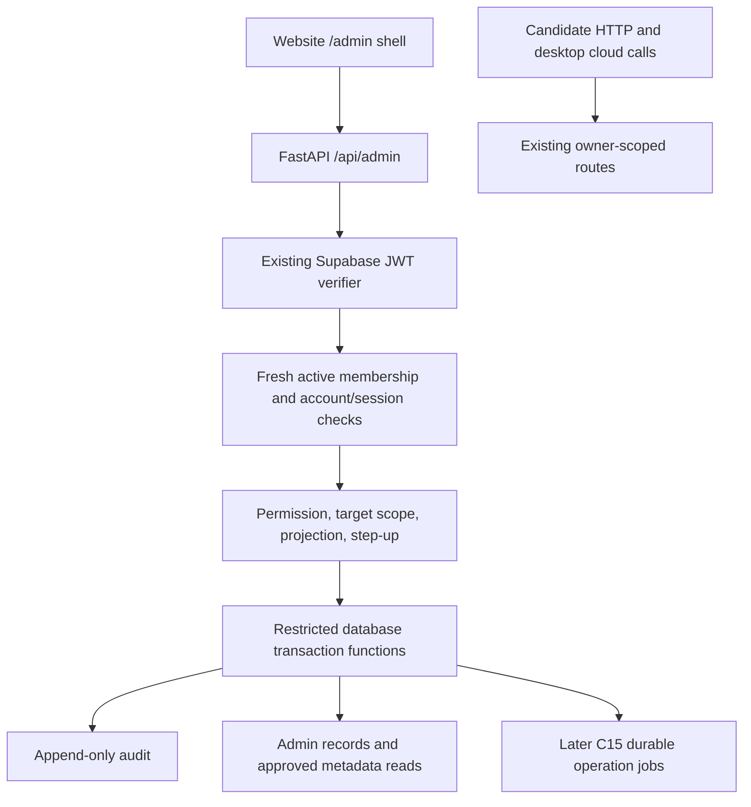

# Intervucopilot internal admin audit and implementation plan

Date: 2026-10-21 (Asia/Calcutta). Repository identifiers remain SAIIA.

Status: **audit and proposal for review; no implementation authorized or performed.** This document does not complete C15, C15.5.1, or any implementation phase.

## 1. Executive findings and readiness verdict

The repository has useful authenticated candidate functionality, but **no internal admin implementation was found** in the inspected frontend routes, FastAPI registrations, cloud clients, migrations, or tests. C15.5 is a detailed requirements baseline, not an existing console. A metadata-first console is feasible without changing frameworks, but it is not ready for production or sensitive operations.

- **Can start now:** threat modeling, resolving the documented permission conflicts, defining C15 data/retention contracts, and specifying database transactions and response projections. These are planning activities.
- **Cannot start under the existing gate:** admin runtime/schema implementation before the C15 prerequisite is satisfied. The requested early audit does not amend that gate. The roadmap explicitly places C15 first and prohibits early admin shortcuts (`SAIIA_CLOUD_PRODUCT_IMPLEMENTATION_ROADMAP.md:2955`, `:2957`, `:3059`).
- **Smallest later implementation:** backend-only membership verification plus append-only audit and `GET /api/admin/me`, disabled by default, with an offline first-owner procedure. No candidate search, raw content, invitations, account mutation, or Electron changes. This is a partial slice of C15.5.2/.3, not completion of those phases or C15.5 overall.
- **First useful support release after that:** bounded user lookup and narrowly projected resume/session status metadata, then a separate website shell. Existing candidate services provide underlying records, but their DTOs and authorization cannot be reused as staff authority.
- **Material blockers:** C15 export/account-deletion/retention contracts and implementation are incomplete; admin membership, durable admin audit, step-up enforcement, first-owner provisioning, and account/session revocation enforcement are absent. Billing and metered usage are not implemented. Transactional invite delivery is not available through the existing email service.

The most important plan defects are conflicting delete-confirm permissions, conflicting owner-invitation/transfer rules, incomplete raw-read permission assignments, overly broad account status transitions, and missing lifecycle treatment for delete-review records. These are requirements gaps, not demonstrated exploits against an existing admin console.

## 2. Scope, method, and evidence boundary

Reproducible source snapshot for this published audit: `7739355a92c977410e44f6be49a8d99d425d5b24` on `review/pr55-commercial-docs`. Read the source files and ordered migration definitions at that revision when assessing the findings below; historical line numbers are navigation hints. The original 21 October audit inspected an uncommitted working tree based on `bff9827ab7ebbcfb560dcac5178a9391f530c5a9`; its exact patch was not preserved as a reproducible audit input. That historical working tree is not the evidence authority for this publication. Untracked files and private operational records are excluded; claims about deployment or their acceptance are not verified. This snapshot predates the separate catalog, subscription and billing feature PRs and must not be read as a current audit of those implementations.

No `AGENTS.md` was found in the workspace inventory or the checked ancestor paths `E:/AGENTS.md`, `E:/saiia_project/AGENTS.md`, and the repository root. The architecture-designer, security-reviewer, and Graphify skill instructions informed the review, within the user's documentation-only scope. The existing graph was queried without rebuilding it; its traversal mostly returned broad roadmap QA nodes, so source files were used to substantiate findings. No dependencies were installed.

Method: read-only Git inspection, filename/text searches, manual tracing of authentication, routes, clients, migration ordering, storage/RLS, and test assertions. Searches covered admin/RBAC, MFA, account status, revocation, audit, privacy, deletion, export, email, billing, and usage. Secret-boundary searches inspected variable references in frontend/Electron source; no credential files were read and no actual credential values are reproduced. This is not a full secret-history or built-artifact scan.

**No live services, remote migrations, deployment state, Supabase settings, SMTP delivery, or production behavior were verified.** Historical docs describing live dev checks are evidence of recorded checks only. Tests were inspected, not executed; no active security testing or destructive database testing occurred. Missing findings mean no implementation was located in the reviewed surfaces, not proof about external systems.

### Requirements and supporting records

| Source | Relevant requirements/evidence |
|---|---|
| `SAIIA_CLOUD_PRODUCT_IMPLEMENTATION_ROADMAP.md:61` | Document precedence; roadmap owns execution order. C15 at `:2801`; entire C15.5 at `:2941` through `:3826`; open decisions at `:4318`. |
| `SAIIA_PRODUCTION_PHASES_TRACKER.md:116` | Current execution alignment; email details at `:271`; production handoff blocker at `:322`; admin explicitly future/not started at `:328`. Historical P-phase checklists are not the C-phase execution authority (`:341`). |
| `SAIIA_PRODUCTION_PRD_CORE.md:56` | Commercial/institution administration deferred; internal admin separately tracked after C15 (`:71`). History deletion/export requirement at `:514`. |
| `SAIIA_PRODUCTION_TECHSTACK.md:77` | Existing React/Vite frontend, no unnecessary Next.js migration; backend at `:156`; historical auth/billing stack at `:477`; secret and privacy rules at `:602`. |
| `docs/C1_SUPABASE_FOUNDATION.md:138` | RLS/storage and explicit service-role bypass warning (`:156`); JWT verification at `:192`. |
| `docs/C2_AUTH_ARCHITECTURE_PLAN.md:99` | Supabase identity, server-derived ownership, backend-only credentials, allowlisted auth redirects. Its early implementation snapshots are historical. |
| `docs/C3_CLOUD_RESUME_PROFILE_PLAN.md:9` | Resume lifecycle implementation record; backend-only writes, CAS/rebuild activation, storage/row partial failure design. |
| `docs/C4_CLOUD_JOB_CONTEXT_PLAN.md:1` | Cloud job context lifecycle, ownership, idempotency, activation, local/cloud separation; implementation checked against routes/migrations. |
| `docs/C5_DESKTOP_AUTH_CLOUD_IDENTITY_PLAN.md:8` | Historical design plus later identity addendum; main-process token storage and narrow IPC. Actual code supersedes its early “no IPC” snapshot. |
| `docs/C6_DESKTOP_STARTUP_UI_SESSION_SETUP_PLAN.md:188` | Token/renderer boundary; later startup and past-session implementation records at `:225` onward. |
| `docs/C7_TRANSCRIPT_STORAGE_VIEW_DOWNLOAD.md:39` | Transcript routes, owner-scoped storage and text export; no admin or transcript summarization. |
| `docs/C8_AI_NOTES_GENERATION.md:1`, `docs/C9_ASK_AI_FOLLOWUP_CONTEXT_MEMORY.md:1` | Session-owned generated notes/chat; derived text remains sensitive, not safe staff metadata. |
| `docs/C10_EMAIL_SYSTEM_PLAN.md:140` | Mutable delivery-event store, projection/retention, consent and unsubscribe; SMTP setup separately in `docs/C10_2A_SUPABASE_AUTH_RESEND_SMTP_RUNBOOK.md:3`. |
| `docs/TRANSCRIPT_DELETION.md:3` | Transcript-only deletion deliberately preserves notes/chat and session metadata; staging verification limitations at `:34`. |
| `SAIIA_SCREEN_INTELLIGENCE_ARCHITECTURE.md:630` | Cloud integration and privacy rules at `:639`; staff tooling must not add screenshot/audio retention. |

### Implementation evidence and classifications

“Implemented” below means present in local source; it does not certify deployment. “Partially implemented” means reusable parts exist but the requested capability is incomplete. “Documented only” means an explicit plan exists without its runtime implementation. “Missing” means no implementation was found. “Not verified” describes remote/operational claims.

| Capability | State | Evidence and practical limit |
|---|---|---|
| Candidate Supabase JWT verification | Implemented | `backend/app/auth/supabase_auth.py:121` requires exp/sub, restricts algorithms per key mode, validates configured issuer/audience; `:152` builds CurrentUser; `:190` returns safe 401/503. Configuration can override issuer/audience (`:85` onward), so production policy must lock expected values. |
| Candidate ownership | Implemented in inspected cloud paths | `backend/app/api/resumes.py:210`, `:266`, `:279`, `:298` derive user ID from CurrentUserDep; `backend/app/api/interview_sessions.py:528`, `:629`, `:653` do likewise. `backend/app/cloud/cloud_resume.py:458` filters record and user ID; `backend/app/cloud/interview_transcripts.py:302`, `:333` filter entry/session/user. No admin bypass branch found. |
| Database/storage isolation | Implemented in migration definitions | `supabase/migrations/20260731123545_enable_rls_and_storage.sql:4` enables RLS on the base tables (it does not FORCE it); own-row update checks include WITH CHECK; `:155` defines private buckets, `:188` owns objects by first path segment. Later `20260803143000_add_resume_lifecycle_and_harden_cloud_writes.sql:76` revokes direct candidate profile/resume/chunk writes and narrows resume storage writes; `20260809120000_add_cloud_job_context_lifecycle.sql` hardens job writes. Read the ordered migrations, not C1 alone. |
| Transcript write boundary | Implemented in migration definitions | `20260829103000_add_interview_session_transcript_storage.sql:37` forces RLS; its original authenticated INSERT is revoked by `20260829170000_lock_down_transcript_entry_inserts.sql:4`. RPC/service-role write path remains. |
| Backend privileged credentials | Implemented boundary, broad trust | `backend/app/cloud/profile_bootstrap.py:39`, `:48`; `backend/app/cloud/cloud_resume.py:298`, `:314`; `backend/app/cloud/interview_transcripts.py:193`, `:207` use backend-only service credentials. They bypass RLS: user-ID predicates and restricted RPC bodies are essential. RLS is not a second ownership check on ordinary service-role REST calls. |
| Browser identity client | Implemented | `frontend/src/auth/supabaseClient.js:8` reads only Vite URL/anon key; `:23` creates persisted, auto-refreshing browser auth. `frontend/src/auth/authApi.js:4` allowlists next routes. A signed-in user is not thereby staff. |
| Desktop identity | Implemented locally; production hardening incomplete | `frontend/electron/desktop_auth_session.cjs:201` validates IPC frame; `:753` adds bearer in main-process HTTP; `:1525` onward uses safeStorage. `frontend/electron/main.cjs:2082` registers narrow auth/cloud IPC. `backend/app/api/auth.py:118`, `:249`, `:275` use hashed, process-memory desktop handoff. Shared atomic TTL store remains a recorded C16.1 production blocker, not solved by admin work. |
| gRPC cloud ownership | Implemented locally | `backend/app/grpc_cloud_context.py:50` verifies identity and `:66` checks owned active session/context. No admin membership or account revocation dependency found there. Account enforcement must cover HTTP and long-lived cloud generation paths. |
| Admin UI/routes/membership/RBAC | Documented only; runtime missing | Roadmap `:2990`, `:3061`, `:3073`, `:3142`, `:3469`. No admin imports/registration in `backend/app/main.py:60`; no `/admin` route in `frontend/src/App.jsx:6989`; no proposed admin tables in migration inventory. |
| MFA/recent step-up, first owner, owner transfer | Documented only; runtime missing | Roadmap `:3538`, `:3631`, `:4373`. CurrentUser safe claims keep only aud/iss/exp/iat (`backend/app/auth/supabase_auth.py:52`); no verified AAL/authentication-method/session assurance available to an admin dependency today. |
| Immediate staff revocation and account-state enforcement | Missing | JWT verifier (`backend/app/auth/supabase_auth.py:152`, `:190`) does signature/expiry verification, not membership/account/session database checks. Proposed statuses exist only in roadmap `:3296`. A client sign-out is not evidence of immediate backend rejection of a still-valid access token. |
| Durable security/admin audit | Documented only; missing | Roadmap `:2903`, `:3183`, `:3333`. Email event records and coding diagnostic “audit” logs are not append-only staff access logs. No general admin audit writer/table found. |
| Resume extraction/rebuild support primitives | Partially implemented | Candidate extraction/rebuild routes at `backend/app/api/resumes.py:298`, `:318`; lifecycle service exists. No staff delegation, reason, audit, cost controls, or admin projection. Reusing candidate request identity as a target override would break ownership. |
| Resume deletion | Partially implements C15 | `backend/app/cloud/cloud_resume.py:930` marks deleted/inactive, removes chunks then object. Metadata and extracted/confirmed fields are not comprehensively purged by that method; failures can leave intermediate state. This is not complete C15 erasure or account deletion. |
| Session/transcript metadata and TXT/MD export | Implemented for owner; admin missing | `backend/app/api/interview_sessions.py:477`, `:528`, `:653`; export checks owner then returns text and triggers dry-run notification. No full-account export archive, retention expiration worker, or staff export job found. |
| Permanent transcript deletion | Implemented locally, limited scope | `20261011120000_add_permanent_transcript_deletion.sql:32` owner check, shared locks, five-minute post-end grace, repeatable deletion; service-role EXECUTE at `:58`. `backend/app/api/interview_sessions.py:614` exposes candidate deletion. Retained notes/chat are explicitly documented; this is not session/account erasure. |
| Privacy center, account erasure/revocation, retention cleanup | Documented only / incomplete overall | Roadmap C15 remains not started (`:2801`); selected delete/export/consent primitives exist, but no complete inventory-driven account cleanup workflow found. |
| Transactional email / admin invitations | Partial foundation; admin invite missing | `backend/app/email/service.py:280` explicitly rejects requested live transactional mode; allowlisted email types at `backend/app/email/provider.py:7` exclude admin invite. Existing body validation also rejects URLs (`:35`), so invitation links cannot simply be passed through this contract. |
| Marketing delivery | Implemented gated provider; live behavior not verified | `backend/app/email/marketing.py:55`, `:78` can POST to Resend when gated settings request live delivery. This differs from broad “no live email implementation” wording. It is not a transactional/security invitation channel. No settings were inspected or changed. |
| Consent / unsubscribe | Implemented locally; rollout not verified | `20260904170000_add_signup_consent_preferences.sql`, `20260905103000_add_marketing_unsubscribe_tokens.sql`; tracker `:309` records remote rollout as pending. Hash-only atomic token consumption is a reusable pattern, not an admin invite implementation. |
| Plans/payments/subscriptions/usage accounting | Documented only | Roadmap C11–C13 requirements (`:2630` requires backend limits/accurate usage); no billing/usage router, ledger, subscription tables, or payment-webhook implementation found in inspected runtime/migrations. Model timing and generation counts do not establish billable usage. |
| Remote schema, staff MFA enrollment, live sends, deployment | Not verified | No remote queries or tests performed. Repository records must not be promoted into fresh verification. |

Inspected tests include `backend/tests/test_supabase_auth.py:94` (missing/invalid/expired token), `:141` (valid identity), `:269` (service key not verifier); `backend/tests/test_auth_routes.py:153` (server-derived bootstrap identity), `:389` (one-time desktop handoff); `backend/tests/test_cloud_resume_routes.py:455` (owner-derived delete/rebuild), `:481` (safe cleanup failure); `backend/tests/test_interview_session_transcript_routes.py:146` (authenticated/repeatable deletion); `backend/tests/test_cloud_interview_transcripts.py:18` (owned deletion RPC); and `backend/tests/transcript_deletion.postgres.mjs`. `backend/tests/test_supabase_migrations.py` contains useful migration-text assertions, but those do not prove actual RLS execution or multi-connection races. No admin security test suite was found.

## 3. Gaps, contradictions, and consequences

Severity is a prioritization of the **proposed capability's risk**. There is no claim that unimplemented routes are remotely exploitable.

| ID / priority | Evidence and issue | Consequence and proposed resolution (requires review where requirements change) |
|---|---|---|
| A01 / High | Roadmap `:3119` says confirm-delete requires `privacy:delete_review`; `:3331` requires `privacy:delete_confirm`; `:3609` repeats review language. | An implementation could allow review-only actors to execute deletion. Canonicalize route contract to delete_confirm plus approved bound request, step-up, explicit confirmation, audit, and policy checks. Keep review and approval separate. |
| A02 / High | Owner can invite owner (`:3515`, `:3666`), while every ownership change must use transfer (`:3555`, `:3703`). | Owner creation could bypass the ownership invariant. Recommended default: first-owner bootstrap is exceptional, later owner promotion/demotion only through transfer; owner invites are disabled until an explicit add-owner policy reconciles the requirement. Do not silently delete the owner-invite requirement. |
| A03 / High | Roles may request/approve break-glass (`:3066`–`:3069`), but raw-read permissions appear only via owner's “all permissions”; routes require raw-read permissions (`:3108`). | Support/privacy requests could never be used by their requesters; granting broad raw-read to “fix” it would expand authority. Explicitly define eligible consumers by data type. Default: raw access disabled for all until approved; later permission plus single-use grant, never grant-as-permission. |
| A04 / High | “any -> billing_restricted/disabled/pending_deletion” (`:3326`–`:3330`); one scalar account_status (`:3296`). | Billing staff could overwrite security/deletion holds and restore active; multiple restrictions cannot be represented. Replace “any” with an explicit transition graph or independent restriction reasons with precedence. Deny changes from terminal/security/deletion states by billing/support; derive effective status. This is a proposed schema/requirements clarification. |
| A05 / High | Current verifier only validates JWT; planned suspension/revocation is database-backed (`:3167`). | A previously issued token remains usable unless admin authorization reloads active membership; candidate account restrictions would be cosmetic if only the admin UI enforces them. Check authoritative state on every admin request, and again under transaction locks for mutations. Define shared account/session enforcement across cloud HTTP, storage/RLS and gRPC before exposing suspend/logout controls. |
| A06 / High | Audit schema/prohibition at `:3183`, `:3333`; no failure semantics or implemented restricted writer. | Writing an audit entry after a committed mutation can lose evidence; read access can escape audit on failures. Mutations and their success audit must commit together; privileged reads require committed access/attempt evidence before returning data. Fail closed on audit-store failure. Denied attempts use a separately bounded safe logging path; unavailability must not open access. |
| A07 / High | Immutable logs (`:3333`) versus eventual pseudonymization (`:3360`); membership references auth.users (`:3149`) but physical-delete restrictions (`:3358`). | Cascades may erase evidence; RESTRICT may deadlock legitimate account deletion; UPDATE-based anonymization may defeat append-only guarantees. Decide C15 retention first, use durable pseudonymous actor references and separately erasable identity mapping, no cascading log delete. Expiry maintenance requires restricted authority and separate audit. |
| A08 / High | Delete-review table at `:3231` omitted from retention matrix/user-linked list at `:3354`–`:3365`; no approve/deny/cancel routes in `:3447` plan. | Requests can neither reach approved state nor follow complete account cleanup rules. Add its retention/export/FK classification and approval lifecycle contracts. Define whether requester may approve (default no), who may consume, expiry, cancellation, and deletion job linkage. |
| A09 / High | Multiple REST/storage operations versus “atomic deletion” (`:3606`); existing resume service `backend/app/cloud/cloud_resume.py:930`. | Cross-service deletion cannot be rolled back as a SQL transaction. Atomically consume approval, block new writes, create durable idempotent job, and record authorization audit; retry external cleanup by step, report partial failure honestly, mark deleted only when policy-defined completion succeeds. Do not claim a consumed approval proves erasure. |
| A10 / Medium | “Metadata and summaries” (`:3560`); transcript-summary permission (`:3040`), but C7 excludes summarization; existing C8 summary contains transcript-derived text. | Reusing AI notes, session titles/JD previews, filenames, or profile summaries may leak content without raw-read authorization. Define summary as counts, lifecycle/timestamps, safe failure codes only for initial support. Content-derived prose requires separate policy and authorization. |
| A11 / Medium | User projections enumerate support/auditor/readonly/owner (`:3126`) but omit billing/privacy; audit/billing/usage summary-only scopes are not fully specified. | Shared DTOs can return fields a role must not see. Require explicit per-resource allowlists for every role; unlisted field/role combination denies by default. Apply projection before serialization and before querying sensitive columns where possible. |
| A12 / Medium | “Every admin action” (`:2974`, `:3798`) versus only “sensitive actions” audit wording (`:3467`), no bounds/redaction contract for free-text reason/metadata. | Reads/searches may be unlogged; reasons/notes can become shadow transcript storage. Audit all staff API actions including searches and own-identity requests with safe IDs/outcomes; never search terms, result bodies, grant/token values, arbitrary JSON or private content. Bound and validate reason codes/text; note content restrictions cannot be guaranteed by regex alone. |
| A13 / Medium | Owner/super_admin invitation authority broad (`:3066`, `:3516`); first owner/recovery deliberately open (`:4373`). | Stale invites or grantor revocation could reactivate a revoked member or grant peer privilege. Define role-grant allowlist, issuer authority recheck at acceptance, existing-membership conflict behavior, verified email matching, and recovery. Default super_admin can invite only approved lower roles, never owner/super_admin; reactivation needs fresh authorized approval. |
| A14 / Medium | Historical PRD/techstack defer auth to PRD B (`SAIIA_PRODUCTION_PRD_CORE.md:5`, techstack `:477`); code already uses Supabase; roadmap current-next-action `:4478` still says sessions/C5 not started. | Following stale text could introduce parallel custom auth, Alembic, or new website framework and misorder work. Preserve historical records; later documentation reconciliation should identify authoritative current source/migration state. Use existing Supabase/FastAPI/React stack; no custom password store. |
| A15 / Medium | Roadmap `:12` and C10 docs broadly describe real sending as not started; gated Resend marketing implementation exists (`backend/app/email/marketing.py:78`). | Incorrectly assuming all email is dry-run can misstate readiness or introduce accidental sends. Record transactional and marketing readiness separately; do not reuse marketing for security invitations. No conclusion about actual live delivery. |
| A16 / Medium | “admin access through normal user endpoints rejected” (`:3733`) alongside “normal user routes unaffected” (`:3731`). | Ambiguous whether staff can use their own candidate account. Recommended interpretation: ordinary endpoints retain own-user behavior and never accept staff-target overrides. Staff cross-user access only under admin routes. If staff accounts must be barred from candidate usage entirely, require an explicit product decision. |

Additional controls needed in detailed design: reject client user_metadata/admin booleans as authority; Supabase JWT role is an identity claim, not C15.5 membership. Ordinary profile/settings updates must never write staff roles. No service credentials, generic privileged fetch, signed raw-data URLs, or target impersonation through candidate endpoints. Admin tables must have no anon/authenticated direct grants or write policies. FORCE RLS does not constrain BYPASSRLS credentials; application RBAC, narrow transaction functions, fixed search_path and reviewed EXECUTE grants remain mandatory.

## 4. Dependency and security assessment

| Gate | Required before | Current verdict |
|---|---|---|
| C15 inventory, export exclusions, deletion/retention and audit identity rules; C15 exit gate | Admin implementation under existing roadmap | Not satisfied. Selected primitives are insufficient. Planning can continue without changing this gate. |
| Resolve A01–A08/A11–A13, role grant policy, owner lifecycle and bootstrap recovery | Foundation schema/authorization design freeze | Decisions outstanding. No implicit exception to phase order. |
| Authoritative membership, durable audit, disabled-by-default backend gate, secure first-owner process | Any usable admin endpoint | Missing; foundation work after prerequisites. |
| Verified assurance/recent step-up and fresh membership checks | Invite/role changes, transfer, high-risk status, raw access, deletion, usage/plan/flag mutations | Missing; MFA enrollment alone is not enforcement. Do not accept an MFA boolean from the client or simply treat token iat as recent authentication. |
| C10 transactional delivery plus security invitation contract | Real email invites, admin password-reset support | Incomplete; invite email category/link/redaction/outbox must be designed. Existing signup/recovery UI is not staff reset tooling. No manual token-copy bypass proposed. |
| C11/C12 plans/subscriptions/payment webhooks | Billing views/actions and plan edits | Missing. Hide/defer modules; do not invent data or override payment success. |
| C13 authoritative usage ledger/metering/idempotency | Usage reports/adjustments | Missing. Existing generation metrics are insufficient. |
| C15 durable export/deletion jobs, storage cleanup, legal exceptions, write fences | Privacy admin support | Missing end-to-end. Transcript download/delete is a reusable candidate primitive only. |
| Approved eligible consumer/approver/data-type matrix, two distinct eligible people, grant transaction and redaction | Break-glass | Not ready. Single-owner installation cannot self-approve; fail closed rather than creating an emergency self-approval exception. |
| C16.1 shared atomic desktop handoff and production deployment/security checks | Public production release | Independently blocked per tracker `:322`; admin work does not clear it. |

Initial metadata support does not need billing/payment integration or raw-content access. It still needs C15 governance, reliable staff authorization, safe projection and durable audit. Later release requirements remain conditional: if internal operations are required, the full agreed C15.5 exit criteria apply; otherwise record explicit release deferral (`roadmap:2949`, `:3783`). Shipping the small slice does not satisfy full C15.5 acceptance.

C15's inventory must also track newer implementation records: `supabase/migrations/20261018150000_add_session_generation_turns.sql:2` stores generation recovery state/payload, while the committed `supabase/migrations/20261021120000_add_answer_sources.sql:2` and `supabase/migrations/20261021130000_add_answer_diagrams.sql:1` add answer provenance and diagram data. Their rollout is not verified. Inspect payload retention, derived-content export, parent deletion behavior and in-flight worker writes before claiming complete deletion; a foreign-key cascade alone does not cover external files, cached responses, or reconstruction from retained recovery payloads. These definitions are included in the pinned source snapshot; their presence is not acceptance of the complete features or their rollout.

## 5. Proposed architecture and decisions

All decisions here are **proposed**, not accepted changes to the roadmap.

**ADR A — Extend existing stack.** Keep React/Vite and FastAPI, using a lazy-loaded website-only `/admin/*` route tree and separate `frontend/src/admin/` client/layout. Do not place it inside DashboardLayout or Electron startup/overlay flows. `App.jsx:6993`/`:6997` currently short-circuit overlay/desktop views; explicit `window.electronAPI` exclusion and deny rendering for admin URLs are still needed. Do not add admin IPC. Add only exact admin return destinations to auth allowlists (`authApi.js:4`), not arbitrary `next` URLs. Existing login redirects authenticated users toward candidate pages, so admin return and invite flows need dedicated tests. A separate admin origin can improve isolation later, but requires explicit redirect/CORS/session-storage/CSP design; it is not a prerequisite for an isolated same-origin route shell. Route separation is organizational, backend RBAC supplies authority.

**ADR B — Dedicated authorization boundary.** Propose `backend/app/auth/admin_auth.py`, `backend/app/admin/permissions.py`, `models.py`, `store.py`, `audit.py`, and `backend/app/api/admin.py`. CurrentUser remains ordinary identity; verified assurance claims are parsed into a separate internal structure and never returned wholesale. Load one active membership each request, deny on lookup/config failure, evaluate resource/visibility/field policies server-side, and recheck authorization at mutation commit. No positive authorization cache in the first slice. Use membership version/expected version to reject stale concurrent edits. Revocation blocks new requests after commit; mutations serialize against revocation. Already delivered data cannot be recalled.

**ADR C — Narrow privileged data access.** Keep service credentials server-only, but avoid a generic admin table proxy. Prefer explicit service-only transaction RPCs for bootstrap, invitation acceptance, transfer, state changes and audit-linked reads. No new database driver needed initially. SQL functions must enforce invariants internally; passing an actor UUID to a service-role RPC does not prove actor identity by itself, so verified backend identity and tightly controlled EXECUTE remain part of the trust boundary. Use explicit select columns/DTOs rather than returning candidate records with fields removed in React. Pagination, input limits, bounded exact-ID/email lookup and rate limits prevent staff enumeration abuse. Proposed metadata fields: opaque user ID, created timestamp if available, resume lifecycle/status and session counts/status/time; email only for explicitly permitted roles. No claimed last_seen until a reliable source exists.

**ADR D — Audit before exposure.** Audit schema needs operation/request ID, action/outcome, actor membership snapshot/version, safe target reference, policy version and timestamps. No payload snapshots, full emails/search strings, JWTs, secrets, grant values, raw content or unrestricted metadata. Use an allowlisted event schema and bounded reason code. Admin credentials get INSERT through restricted writer functions, no ordinary UPDATE/DELETE/TRUNCATE or DDL authority. A DB trigger/privilege boundary should reject mutation even by the normal application service path; test with actual configured role. Database owners remain an operational trust boundary, not cryptographic immutability. Restricted retention maintenance is separate, externally observable/audited; later tamper-evident exports are an option, not a prerequisite invented for this slice. GET /me and searches are audited without recursion in audit-log viewing.

**ADR E — Identity lifecycle.** Bootstrap only through an offline operator procedure, never public signup, email allowlist or “first authenticated user wins.” Verify the exact pre-existing Supabase user ID, verified email, active account and enrolled/verified MFA as policy requires; serialized transaction checks no owner exists, inserts membership and audit together. An explicit maintenance credential/process, distinct from routine runtime paths, performs it; record operator/reason without secrets. Re-running cannot create/promote another owner. Define sealed recovery with independent operator authorization and incident audit; no persistent bootstrap HTTP endpoint. Transfer locks a common owner-invariant record and affected memberships, checks active eligible target and current actor/assurance, preserves at least one active owner, changes roles and audits atomically. Reject generic owner role edits and initially reject all generic owner suspensions pending a precise multi-owner policy. Account deletion must respect the same owner lock.

**ADR F — One-time authorization and external effects.** Invitations use high-entropy opaque tokens stored only as hashes, database-time expiry, verified authenticated email matching and immutable intended role. Atomic acceptance locks invite/membership, rechecks issuer grant authority and revocation, checks expiry/accepted state, commits membership/accepted_at/audit together. Concurrent accept gives one success; subsequent reuse rejects. A revoked existing membership is not automatically reactivated by an old invite. Delivery uses a durable outbox/idempotency key and status reconciliation; retries must not create independent valid invitations or leak tokens to logs. Proposed default expiry is 24 hours, subject to review.

Break-glass remains deferred: later bind grant hash to actor, target user, immutable record ID/version, data type, independent approver, approval policy and short expiry (proposed 10 minutes). Require fresh permission/assurance at request/approval/use, atomically consume and audit before returning raw content. Deletion/revocation invalidates pending grants. Use the required sensitive header, redact it throughout proxies/traces, Cache-Control no-store and no analytics/body logs. On uncertain response delivery, do not replay raw content with a consumed grant; request a new authorization. Storage blobs cannot be made part of the SQL read transaction: consumption records authorized attempt and fails closed on fetch failure; it must not expose a reusable signed URL.

Deletion similarly needs version-bound confirmation, one-time approval, idempotency key scoped to actor/action/target and payload hash, legal-hold checks, a durable job, per-step retries and a write fence. SQL authorization/audit/job enqueue are atomic; external storage, identity revocation, subscription cancellation and email are reconciled steps. Cancellation/partial failure must be visible and cannot silently restore the account to active. No direct “set deleted” status patch bypasses the workflow.

## 6. Phased plan mapped to C15.5.1–C15.5.8

All API/table/file names below are proposals. No migration is created by this document. Each phase has an explicit stop/disable path; rollback must never weaken ordinary ownership or destroy audit evidence.

### C15.5.1 — Architecture and threat model (planning can proceed now)

- Scope: close the findings/decisions, canonical permission/route/projection tables, account restriction model, bootstrap/recovery, threat boundaries, C15 retention identity strategy and release scope. Exclude runtime, migrations, provisioning and UI implementation.
- Dependencies/files: C15 contracts and roadmap/tracker reconciliation; this document, C15 records, and later decision records. Proposed API/schema/UI changes are specifications only, including delete approval lifecycle and corrected confirm permission.
- Security: threat-model malicious candidate metadata, compromised lower-role admin, stale bearer/invite, service-role misuse, concurrent revocation/transfer, and sensitive read/audit failures.
- Acceptance/tests: every planned route maps to a permission, target policy, DTO, audit event, assurance requirement and dependency; all seven roles covered; owner and grant invariants reviewed. No phase marked complete solely from this draft.
- Disable/rollback: retain draft status; reject uncertain features and revise specifications without operational effect.

### C15.5.2 — Admin schema and RBAC

- Scope: first slice creates only membership/audit foundations and static explicit permissions; later add invites and other tables only with their owning workflow. Exclude support bodies, flags, privacy/billing tables and mutation UI initially. Seven planned role values remain explicit; dormant capabilities deny access.
- Dependencies/files: C15 gate and accepted .1; future forward migration, `backend/app/admin/permissions.py`, models/store and migration tests. Unique membership user ID, constrained role/status, revocation/version fields, safe identity references, DB-enforced audit immutability; bootstrap transaction defined here.
- Security: no direct anon/authenticated access; tightly scoped functions/grants and fixed search_path; serialize owner changes, restrict maintenance. Do not copy C1 broad grants onto admin tables.
- Acceptance/tests: real isolated Postgres grants/RLS tests, unique membership and invalid enums; no ordinary audit UPDATE/DELETE/TRUNCATE; first-owner concurrent runs yield one owner; failed bootstrap rolls back audit and membership. Static role matrix denies unknown permissions.
- Disable/rollback: additive unused tables may remain; revoke function EXECUTE/disable admin feature. Preserve audit data; do not drop tables to roll back an incident.

### C15.5.3 — Admin verification and audit logging

- Scope: implement only GET /api/admin/me and dependency/audit, disabled by default; no cross-user reads or mutation endpoints. This completes the minimal backend slice when combined with the small .2 portion.
- Dependencies/files: .2; `backend/app/auth/admin_auth.py`, admin router/DTO/audit modules, `backend/app/main.py`, config and focused tests. Extend internal verified assurance representation without exposing raw claims.
- Security: ordinary JWT role/user_metadata never grants staff access; fresh active membership and fail-closed lookup/audit; server-derived ID. Return only own role/status/permissions and safe capability flags for enabled modules. High-risk modules stay unavailable until verified step-up is implemented.
- Acceptance/tests: missing/invalid/expired token 401; nonmember/invited/suspended/revoked denied; every active planned role can self-read; revocation followed by a new request denies without waiting JWT expiry; forged frontend metadata does nothing; audit failure returns safe unavailable and no identity payload. Snapshot tests exclude credentials/claims/other members.
- Disable/rollback: default-off server flag makes routes unavailable; revoke membership and execution grants if necessary. Candidate auth tests remain unchanged and must pass.

### C15.5.4 — Invite/add-admin and ownership lifecycle

- Scope: hashed invitations, accept/revoke/list, constrained non-owner role/status changes, explicit ownership transfer and recovery runbook. Exclude owner invitations until A02 is resolved; exclude public registration and manual token handoff shortcuts.
- Dependencies/files: .2/.3, verified step-up, accepted grant/ownership policy; C10 transactional invitation delivery before real email flow. Add invite schema/RPCs, lifecycle/audit modules, a security-email contract and outbox integration; website invite acceptance later in .7.
- Security: transaction-safe exactly-once accept, verified email, issuer revalidation, owner invariant locks, recent step-up for high-risk changes, token-safe logs/delivery. No frontend role choice overrides stored role.
- Acceptance/tests: two-connection accept race, expiry/revoke/replay/mismatched email, revoked issuer/membership and stale role/version; parallel transfers/removal cannot leave zero owners; audit failure rolls back; provider timeout does not generate duplicate invitation authority. Manual MFA/recovery rehearsal in isolated environment.
- Disable/rollback: stop invite creation/delivery, revoke outstanding invites, disable mutations, preserve membership/audit history. No blind resend after uncertain provider result.

### C15.5.5 — User/support management APIs

- Scope first: bounded search, safe user summary, resume lifecycle/session metadata only. Later: support-note visibility model and authorized extraction/rebuild. Exclude raw content, generated prose summaries, account suspension/logout/reset initially.
- Dependencies/files: .3, C15 metadata/retention approval; admin support read-model/store/DTO and router; reference `cloud_resume.py`, `interview_sessions.py`, `profile_bootstrap.py` without changing candidate ownership. Notes require their retention/body rules and separate schema. Account mutations require shared account/session enforcement and C10 for resets.
- Security: allowlisted queries/fields for all seven roles; note visibility plus permission; no raw profile/JD/notes/chat/filename leakage. Per-actor lookup/action quotas, reasons/audit, CAS and target-owner validation for later retries; billable provider-side effects bounded.
- Acceptance/tests: exhaustive role-field projections, cross-visibility denial, pagination/search limits, no staff override through candidate routes, metadata canary secrets absent from responses/logs, read-audit failure withholds data. Before status/logout enablement test old bearer rejection, refresh revocation, direct Supabase paths and active gRPC behavior.
- Disable/rollback: disable support endpoints/module, revoke operation grants, cancel queued retries safely. Retain notes/audit per approved C15 policy, never expose raw candidate services as fallback.

### C15.5.6 — Billing/usage/privacy and break-glass

- Scope: only integrate completed authoritative domain workflows. Separate feature gates for billing, usage, privacy and raw access; no speculative placeholder balances or payment overrides. Break-glass can be tracked here as a sensitive privacy subtask rather than silently omitted by the eight-phase headings.
- Dependencies/files: C11–C13 for respective billing/usage operations; full C15 workflow services/jobs for export/deletion; .3/.4 assurance and reviewed approval policy. Later admin integration modules, delete-review/grant tables/RPCs, operation jobs, export-expiry cleanup and worker tests. Actual names selected when underlying domain implementations exist.
- Security: provider/webhook payment truth; append-only adjustment ledger and idempotency; delete_confirm permission, independent approval as decided, scoped one-time grant, raw-header redaction, protected system-flag catalog if enabled. Omit unspecified flags entirely.
- Acceptance/tests: replay/concurrent consumption races, target/actor/version/type mismatch, expired/cancelled approvals, audit failure, legal hold, partial storage/provider failures, failed worker restart/reconciliation, no resurrection by late writes, all derived-data inventory covered. Verify no user deletion mutates global flags and internal notes are excluded/redacted per C15 export policy.
- Disable/rollback: block new jobs/grants/mutations and revoke unused approvals; drain/reconcile already accepted deletion jobs rather than pretending they rolled back. Preserve ledger/audit and truthful partial state. Keep unavailable modules hidden in .7.

### C15.5.7 — Separate admin frontend

- Scope first: website-only /admin identity/permission shell and explicitly enabled metadata views. Add membership/invite/audit tools only when backing APIs pass their gates. Exclude candidate dashboard embeds, Electron UI/IPC and unavailable billing/privacy/raw tools.
- Dependencies/files: .3/.5 (and .4/.6 per module), `frontend/src/admin/`, `App.jsx`, exact auth redirect allowlist changes and frontend tests. Use existing React/CSS patterns and centralized admin API error handling; no new framework.
- Security: permission-based rendering reflects server policy but grants nothing; clear old data on role change/logout/403 and discard stale requests; no tokens in React state/URLs, no persistent support-data cache. Model no-access, revoked/suspended, loading, unavailable, denied, confirmation, expired invite/grant and conflict states. Server gate is independent of UI routes.
- Acceptance/tests: browser deep-link/refresh, admin login return without open redirect, candidate navigation unaffected, Electron admin URL denied, role downgrade hides and clears prior data, no privileged keys in production bundle; keyboard/error-state checks. Capability-off modules offer no pretend live actions.
- Disable/rollback: remove/disable admin route entry and backend capability gates; backend denies remain effective for old cached bundles.

### C15.5.8 — Security closure and manual validation

- Scope: validate the agreed release surface against the complete canonical matrices and roadmap exit criteria; document deferred work without marking full C15.5 done. Exclude live probing/deployment absent separate authorization.
- Dependencies/files: enabled phase implementations and migration rollout record; backend/frontend/isolated Postgres concurrency suites, staging checklist, credential/bundle review and operational runbooks.
- Security: least-privilege grants, audit integrity and retention maintenance, MFA freshness, first-owner/recovery, invitation races, status enforcement, no ordinary-route escalation, no credential/grant leakage. Verify appropriate production CORS/redirect/TLS/CSP/session controls for the chosen origin, not localhost assumptions.
- Acceptance/tests: two distinct staff identities for break-glass, least-role negative tests for all routes/fields, failure injection, remote migration evidence in the intended staging environment, revoke-while-open UI and revoke-during-mutation, backup/recovery and kill-switch drill. Historical pass counts do not satisfy these checks.
- Disable/rollback: documented backend kill switch, pending-grant/invite revocation and audit-preserving rollback drill. Public production remains gated by C16.1 and other release requirements.

## 7. Concrete first implementation task (later, not started)

**Task: implement a disabled-by-default, backend-only own-admin identity boundary.**

Preconditions: complete C15 prerequisite under the current roadmap; accept the foundation threat model, retention/identity strategy and first-owner/recovery contract. If earlier foundation work is desired, the user must explicitly approve a documented phase-order amendment; this audit supplies no such approval.

Deliverables limited to:

1. One forward migration for membership and audit records plus narrowly granted transactional bootstrap/audit functions; no other admin tables.
2. Static explicit seven-role permission map, fresh membership dependency and safe own-identity DTO. No admin trust in JWT role or editable metadata.
3. GET /api/admin/me behind a default-off backend flag; safe 401/403/503 behavior and committed safe audit before response.
4. Offline operator bootstrap/recovery runbook; no provisioning performed by implementation tests against live services. Use isolated fixtures for automated testing.
5. Focused auth/membership/audit and real isolated database privilege/concurrency tests described in .2/.3. Existing candidate ownership regressions must remain green.

Explicit exclusions: search, support notes, candidate data reads, role/invite HTTP mutations, real email, account suspension/logout, billing/usage/privacy tools, raw content, frontend/Electron changes, production deployment. Success means only that an explicitly provisioned active staff identity can see its own safe admin identity and all others are denied; it does not mean an admin console exists.

Rollback: leave flag off, revoke routine function execution if needed, preserve audit and schema. Do not remove account ownership checks to troubleshoot. The next slice is metadata-only APIs after policy approval, then their website UI.

## 8. Decisions requiring user input

These decisions need resolution before their dependent work; no answer is assumed by this audit.

| Decision | Recommended default | Tradeoff / when needed |
|---|---|---|
| Is internal staff tooling required for the target release? | Treat current work as audit only; decide required versus explicitly deferred before C16 acceptance. | Required means full agreed C15.5 exit criteria and dependencies, not just the first slice. |
| May foundations precede full C15 completion? | Preserve existing order; complete C15 first. | An early isolated foundation could reduce later effort but requires an explicit scoped amendment and settled retention/security contracts. No such amendment has been made. |
| Owner invitations versus transfer-only ownership | Bootstrap once; later owner changes only via atomic transfer; disable owner invitations pending resolution. | Changes the current owner-invite test requirement; must reconcile source docs before build. Clarify whether transfer demotes old owner and to which role (recommended super_admin), and whether multiple owners are intended. |
| Who may grant peer roles? | Owner grants super_admin; super_admin invites only an explicit lower-role allowlist. | More owner involvement; avoids accidental peer privilege propagation. |
| Staff accounts also candidates? | Candidate endpoints remain own-user-only for everyone; admin status grants no override. | Dedicated staff identities reduce accidental mixing; choose a full staff/candidate separation policy if required. |
| Raw staff access and two-person approval | Keep raw access disabled initially; later independent approval, actor/record/type-bound single use, 10-minute expiry. | Support may require user-provided sanitized material; enabling access needs explicit consumer permissions and at least two eligible people. Specify permanently forbidden fields. |
| High-risk assurance | Verified MFA plus recent server-validated step-up (proposed 5 minutes); no exception initially. | Requires enrollment/challenge/recovery UX. Session age or a client checkbox cannot substitute. |
| Retention and audit identity | Approve class-specific windows before schema freeze; pseudonymous durable audit references with separately erasable identity mapping. | Operational investigation versus minimization. No arbitrary retention duration is finalized here. C10's documented 90-day delivery-event default does not establish admin/security retention. |
| Admin invite expiry/channel | 24-hour single-use invite through approved transactional security email; no marketing provider reuse. | Requires C10 extension/live-delivery work; expiry value and secure link treatment need approval. |
| Delete approval and restriction semantics | Review/approval/execution are distinct; no self-approval; use effective restrictions that cannot overwrite stronger holds. | Adds explicit approval routes and a durable job instead of simple status PATCH. Resolve canonical delete_confirm permission and retention for delete-review records. |
| Admin hosting | Same React/Vite app with separate website-only route tree initially. | Least operational change; a separate origin offers stronger client isolation with additional deployment/session work. |

## 9. Validation of this audit artifact

The original audit activity added only this Markdown document; it made no runtime code, migration, package, credential, setting or phase-status changes, and performed no deployment, admin provisioning, email or service mutation. This describes that audit activity, not the entire reviewed PR: PR #58 also contains the roadmap, tracker and other commercial planning/checklist documents. Publishing and correcting those documents uses separate documentation commits and pushes; it does not authorize runtime or migration implementation. Runtime/security tests were not run for documentation-only work; cited tests were inspected and future acceptance tests are explicitly proposals. Review this plan and its decisions before authorizing implementation.
